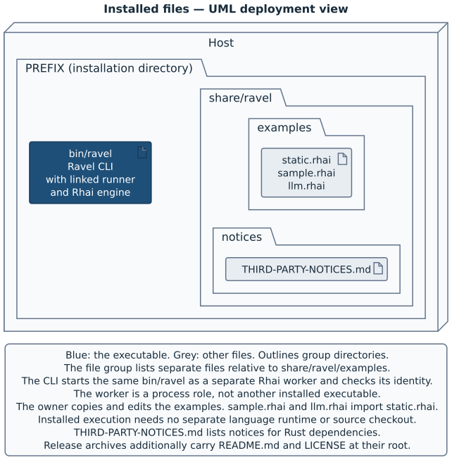

# Reference

Use this chapter to find the command line, exit statuses, streams,
environment rules, configuration and installed paths. A [caller](02-actors-and-words.md#caller-and-owner) starts
a [session](02-actors-and-words.md#caller-and-owner). The
[owner policy](02-actors-and-words.md#caller-and-owner) selects its
[managed process](02-actors-and-words.md#the-managed-process-and-its-result).
Only the caller gives meaning to the
[opaque result](02-actors-and-words.md#the-managed-process-and-its-result).
Each entry links to the chapter that teaches its use.

The entries describe the version that this book names, installed with
[Homebrew](03-a-complete-session.md#install-ravel-and-check-its-version).

This chapter writes INT, TERM, HUP and KILL without the SIG prefix.
Other signal names keep that prefix. Code and diagnostic text keep their literal names.

## Command line

### `ravel`, help and version

`ravel` takes one of two verbs: `start-session` or `end-session`. It has no
`help` subcommand. The table gives the help and version requests.

| Request | Output | Status |
|---|---|---|
| `ravel` without a verb | Help on stderr. | `2` |
| `ravel --help`, `ravel start-session --help`, `ravel end-session --help` | Help on stdout. `-h` is the short option on all three command lines. | `0` |
| `ravel --version`, `ravel -V` | The package version of the [Ravel CLI](02-actors-and-words.md#policy-evaluation-and-supervision) on stdout. The version option belongs only to the top-level command. | `0` |

Help and version text is informational output, never an opaque result.
See [the first complete session](03-a-complete-session.md#run-the-first-session)
for the two verbs in use.

After `--`, Ravel reads no more options. For `end-session`, put `--` before a
result that looks like an option. Inside a live session,
`ravel end-session -- '--help'` sends the literal value `--help`. See
[result arguments](#end-session-result).

### `start-session`

<!-- tc: depart synonym-rotation because launch refers to process creation, while start also denotes the beginning of a deadline -->
`ravel start-session --kind TEXT` also needs exactly one of `--prompt TEXT`
and `--prompt-file PATH`. It reads the owner settings, checks and evaluates
the owner policy, then supervises the selected program. A
[refusal](02-actors-and-words.md#policy-evaluation-and-supervision) starts no final managed process.
Evaluation harness runs can precede it. Ravel tries no alternative route.

<!-- tc: depart synonym-rotation because confirmed absence is a successful cleanup observation, not just an input check -->
A successful invocation writes the sent result unchanged to stdout. This write occurs only after the reap, the confirmed
absence of the process group and the required cleanup. Ravel does not
interpret the result.
See [run a complete session](03-a-complete-session.md#run-the-first-session)
and [interpret the outcome](05-running-sessions.md#interpret-the-exit-status).

All fifteen options below belong after `start-session`. Only `--param`,
`--policy-env` and `--runtime-read` accept more than one occurrence. A
repeated single-value option or switch is a command-line error. `-h` and
`--help` are also available on this verb.

### `--kind TEXT`

`--kind` is required and supplies `request.kind` unchanged. Its value is
nonempty UTF-8. Ravel has no catalogue of
[kinds](02-actors-and-words.md#caller-and-owner) and gets no kind from a task
file. Ravel gives the token no meaning. An absent or empty kind gives
status 2. See
[supply the prompt and caller data](05-running-sessions.md#supply-the-prompt-and-caller-data).

### `--prompt TEXT` and `--prompt-file PATH`

Exactly one of these two prompt inputs is required.

| Option | Source of `request.prompt` |
|---|---|
| `--prompt TEXT` | The argument text, also when it starts with `-`. |
| `--prompt-file PATH` | One read of the file, relative to the caller's working directory. |

The prompt can be empty. It contains no NUL, is valid UTF-8 and has a maximum
of 1,048,576 bytes (1 MiB). Ravel puts its bytes unchanged in
`request.prompt`, with trailing newlines. Ravel adds no instructions to end
the session. The policy decides how to give that text to its selected program.

An unreadable prompt file reports `prompt_unreadable`. Invalid encoding, a
NUL or too many bytes reports `prompt_invalid`. Both give status 2. A command with
no prompt input, or with both prompt inputs, also exits 2. Ravel does not
implicitly read the prompt from stdin, and it refuses a prompt file that is a terminal. See [supply the prompt and caller data](05-running-sessions.md#supply-the-prompt-and-caller-data).

> **Note:** Shell command substitution removes trailing newlines before Ravel
> receives an argument. `--prompt-file` preserves those bytes. An
> operating system can set a smaller argument limit. This limit also applies
> when the policy puts a prompt from a file into the arguments of the selected
> command.

### `--task-file PATH` and `--task-id ID`

These optional fields carry caller data. Invalid input gives status 2.

| Option | Request field | Value and effect |
|---|---|---|
| `--task-file PATH` | `request.taskFile` | Ravel joins the caller's working directory and the given path to make an absolute UTF-8 path. It does not canonicalise or read the path. The file does not have to exist, and the path supplies no kind or task identity. |
| `--task-id ID` | `request.taskId` | Nonempty opaque UTF-8 with a maximum of 1,024 bytes. It can start with `-`. Ravel does not search for a task record. |

See
[caller data](05-running-sessions.md#supply-the-prompt-and-caller-data) for
both fields.

### `--config PATH`

`--config` selects a policy entry, relative to the caller's working directory.
Without it, Ravel uses `$HOME/.config/ravel/policy.rhai`, which needs an
absolute `HOME`. There is no repository search and no environment variable
that selects a different policy. The entry resolves to a readable regular UTF-8
file of at most 1 MiB. Its canonical path is UTF-8. A symlink selects its
real file, and the directory of that file is the base for relative imports.

An empty option value is malformed input, status 2. If Ravel cannot accept
the entry file, the status is 3. A different entry does not move the settings
file from `$HOME/.config/ravel/settings.json`. See
[define a policy](04-writing-an-owner-policy.md#define-a-policy-and-read-the-request)
and [resolve its imports](04-writing-an-owner-policy.md#resolve-policy-imports).

### `--param NAME=VALUE`

`--param` adds a string to `request.params`, and it is repeatable with
different names. The table gives the parts of each argument and their limit.

| Part | Rule |
|---|---|
| Name | Nonempty UTF-8 without `=`. Each name occurs only once. |
| Separator | The first `=` separates the name from the value. |
| Value | UTF-8, possibly empty or with more `=` characters. |
| Whole argument | Can start with `-`. |
| Combined size | All names and values together have a limit of 65,536 bytes. The separators do not count. |

A repeated name, a missing separator, invalid
encoding or a total above the limit gives status 2. Ravel gives names and values no
meaning. See
[caller parameters](05-running-sessions.md#supply-the-prompt-and-caller-data).

### `--context PATH`

<!-- tc: depart synonym-rotation because validation enforces a data shape, while confirmation establishes cleanup -->
`--context` reads a regular file, relative to the caller's working directory,
as version-1 JSON [policy context](02-actors-and-words.md#three-different-kinds-of-information).
Ravel validates it and records its canonical name, byte count and SHA-256.
Without `load_context`, the delivered document is this data with the measured
sources attached. With a loader, the data is input to the loader, and the
loader assembles the document that `select` receives. With no caller document
and no loader, `select` receives `()` as its policy-context argument.

Ravel refuses an unreadable, invalid or oversized document with status 3.
Malformed command-line syntax still gives status 2. This option supplies
policy context, never a
[session-result context](02-actors-and-words.md#three-different-kinds-of-information). See [supply policy context](04-writing-an-owner-policy.md#supply-policy-context).

### `--timeout-ms MS`

`--timeout-ms` replaces the owner's `timeoutMs` setting for this invocation.
The table gives its syntax and values. Invalid syntax or range gives
status 2.

| Property | Value |
|---|---|
| Input syntax | Decimal digits. |
| Inclusive range | 1,000–600,000 milliseconds. |
| Default, with no flag or setting | 30,000 milliseconds. |

Ravel validates the settings before the flag replaces a value. Thus, an
invalid owner setting fails even with a valid flag.

The deadline starts when the Ravel CLI spawns the [policy worker](02-actors-and-words.md#policy-evaluation-and-supervision).
It covers the worker startup, the policy import, the policy-context loader
and the selection, with every host call. At expiry, Ravel stops any evaluation
harness run, then the worker. It reports `selection_timeout`, status 124,
unless cancellation or failed harness cleanup takes precedence. Cleanup time is additional.

The deadline does not limit the time that the managed process
works. See
[set bounds](04-writing-an-owner-policy.md#set-bounds-and-grant-environment-names).

### `--context-bytes BYTES`

`--context-bytes` replaces the owner's `contextBytes` setting. It takes decimal
digits in the inclusive range 1–8,388,608 bytes. With no flag and no setting,
the budget is 262,144 bytes. Invalid syntax or range gives status 2. Ravel validates
the settings first. Thus, an invalid setting fails even with a valid flag.

The budget limits the caller document and the encoded policy context that
selection receives, with the measured source records. It is also the maximum
for a host source read. Ravel refuses data above a bound, and it does not
truncate that data. `context_too_large` uses status 3. See [policy context](04-writing-an-owner-policy.md#supply-policy-context)
and [bounds](04-writing-an-owner-policy.md#set-bounds-and-grant-environment-names).

### `--policy-env NAME`

`--policy-env` lets `ravel::env` read one caller environment variable beyond
its base set. The worker itself has an empty environment. Repeat it to grant more names.

| Grant property | Behaviour |
|---|---|
| Owner settings | The flags add to the owner's `policyEnv` array. |
| Duplicate names | Ravel merges them into one grant, in the order of their first occurrence. |
| Value | A grant carries the caller's current value. An unset variable returns `()` through the helper. |
| Recipient | The policy reads the value through `ravel::env`. This option changes no managed-process or harness-run environment. |

A name is nonempty UTF-8 and contains no `=`. It cannot match a
[reserved grant class](#reserved-worker-grants). A malformed name reports
`malformed_input`, and a reserved name reports `excluded_grant`. Both give
status 2.
Grant diagnostics show each name and whether it is set, never its value.
See [grant environment names](04-writing-an-owner-policy.md#set-bounds-and-grant-environment-names).

### `--confine`

<!-- tc: depart synonym-rotation because launch identifies process creation and start also describes the beginning of evaluation -->

`--confine` restricts the filesystem access and the environment of the
managed process and each evaluation harness run. It uses macOS `sandbox-exec` or Linux bubblewrap.
Confinement is off when the flag is absent. The owner policy and its worker
stay outside [confinement](02-actors-and-words.md#trust-and-confinement).
Ravel tests the backend before policy evaluation. It never uses an
unconfined launch in place of a confined launch.

The table gives the access of the confined managed process.

| Resource | Access |
|---|---|
| Canonical working directory and private run directory | Writable. |
| System runtime paths, selected executable and real executable file of the Ravel CLI | Readable. |
| Network | Permitted. |
| POSIX session and terminal | A new POSIX session, with EOF on stdin. Ravel does not lend the caller's controlling terminal. |
| Environment | Ravel restricts the [managed-process environment](#managed-process-environment) separately from the environment of the policy worker. |

Filesystem grants cannot overlap the policy directory or the owner settings,
and this rule also applies through symlinks. An unusable backend or input
reports `confinement_unusable`, and an overlap reports `confinement_overlap`.
Both give status 2. See [confine the managed process](05-running-sessions.md#confine-the-managed-process)
for the layout and the operational limits.

> **Note:** The project measured inherited signal settings, cancellation,
> cleanup and terminal recovery on aarch64 macOS and aarch64 GNU/Linux. For
> x86_64 GNU/Linux, the project built Ravel and ran it only under emulation. Native x86-64 qualification is still open. The
> [support limits](05-running-sessions.md#understand-the-operational-limits)
> give the scope of these measurements.

### `--runtime-read FILE`

`--runtime-read` adds one read-only runtime file to a confined launch, and it
is repeatable. It needs `--confine`. Without that switch, the command exits 2.
The path resolves from the caller's working directory to a regular file that
exists, and its canonical name is UTF-8. The option grants no directory tree.

Read-only grants stay read-only inside writable directories. If a grant is
unusable or has an overlap, Ravel stops with status 2 before policy
evaluation. See
[confinement grants](05-running-sessions.md#confine-the-managed-process).

### `--exit-dir DIR`

`--exit-dir` gives the parent directory of the private
[result channel](02-actors-and-words.md#the-managed-process-and-its-result).
The parent is a writable directory that exists. Ravel resolves it from the caller's
working directory. The table shows the parent for each form of launch.

| Launch | Without `--exit-dir` | With `--exit-dir DIR` |
|---|---|---|
| Unconfined | The system temporary directory. | `DIR`. |
| Confined | The private run directory. | `DIR`, also as a writable grant. |

The option chooses a parent, not a result filename or a persistent store. An invalid
parent can report `exit_dir_unusable` with status 2. If Ravel later cannot
allocate the result channel, it reports `session_channel_unavailable` with
status 5. See
[choose a channel parent](05-running-sessions.md#confine-the-managed-process).

### `--json`

`--json` replaces Ravel's text routing notice and failure document with
JSON on stderr. The routing notice uses schema 2, and the failure document uses schema 1. It does not change the result on stdout or the
output of the managed process. It is off when it is absent, and it belongs to
`start-session`. See [streams and notices](#streams-and-notices) for the fields and the order of output,
and [read notices](05-running-sessions.md#read-notices-separately-from-results)
for their use.

<!-- tc: depart synonym-rotation because display format names presentation, not an action to show data -->
> **Note:** After a successful parse of the command line, a value such as
> `--prompt '--json'` is caller data, not a switch. If the parse fails, Ravel
> searches the argument words for an exact `--json` to choose the error
> format. Help, version and the help for a missing verb keep their usual
> display format.

### `end-session RESULT`

`ravel end-session RESULT` sends one UTF-8 argument to the live enclosing
session. The inherited `RAVEL_EXIT_FILE` identifies that session. The verb
accepts no session ID, target or settings option, and it reads no policy or
settings. `-h` and `--help` show the help of this verb. `--` permits a result
that looks like an option.

The table gives the inputs of `end-session`. Quote `RESULT` so that it
stays one argument.

| Input | Value or effect |
|---|---|
| `RESULT` | One UTF-8 argument. It can be empty, multiline or Unicode, with a maximum of 1,048,576 bytes (1 MiB). |
| `RAVEL_EXIT_FILE` | The inherited path of the live session's private result channel. |
| `--` | Ends the options, so a value that looks like an option can follow as `RESULT`. |
| `-h`, `--help` | Shows help, without a send. |

Ravel keeps the first complete result that it receives. When that result
arrives, Ravel starts to stop the
[harness](02-actors-and-words.md#the-managed-process-and-its-result). Thus,
a second `end-session` and that shutdown are in a race: either can occur
first. For example, another process in the group can send a result before
Ravel stops that process. Ravel keeps the first result, even if the second
command succeeds. The shutdown can stop the second command, or the removal
of the result channel can make it fail.

A successful `end-session` exits 0 and prints nothing. It means only that the channel accepted
the result, or that a valid first result was already present. It does not
mean that the job ended or that the result reached the caller. A
cancellation or a failure of required cleanup still returns no result to
the caller.

`end-session` exits 1, with a text diagnostic on stderr, if the [session-result context](02-actors-and-words.md#three-different-kinds-of-information)
is missing, empty, stale or invalid. It also exits 1 for an oversized value
or an I/O failure of the send. If the Ravel CLI finds an argument-count or encoding
error, it exits 2. The operating system can set a smaller argument limit
before the executable starts.
See [accept a result only after success](05-running-sessions.md#accept-a-result-only-after-success).

> **Note:** After Ravel detects the sent result, it gives a job that still
> runs 2 seconds. Then it sends TERM, waits up to 5 more seconds and uses KILL
> if necessary. If the direct child exits, Ravel stops the other group members
> before the reap, with no new grace period. Ravel can stop code that
> runs after `end-session`.

## Exit statuses

For `start-session`, accept the result on stdout only when the final status
is 0. Neither the exit status of the managed process nor an earlier
successful `end-session` decides the result of the enclosing session.

Cancellation has precedence over an original failure. Failed harness cleanup
can replace an evaluation deadline with `harness_cleanup_failed`, status 5.
After evaluation, an original failure keeps its status if later cleanup also fails.
Required cleanup failures prevent success. All applicable cleanup
reports stay as diagnostics. See
[outcome precedence](05-running-sessions.md#read-notices-separately-from-results).

| Status | Meaning and next action | Taught in |
|---|---|---|
| `0` | `start-session` wrote the sent result unchanged to stdout and flushed it. This occurs after the reap, the confirmed absence of the group and the required cleanup. An empty result is valid. A later nonzero exit of the managed process does not make the sent result invalid. Ravel does not interpret the result. Interpret it with the caller's convention. For `end-session`, status 0 confirms only that it sent the result, or that a valid first result was already present. An explicit help or version request also gives status 0. | [Accept a result](05-running-sessions.md#accept-a-result-only-after-success) |
| `1` | `start-session` reports `session_result_missing`, even when the managed process exits 0. For `end-session`, status 1 means that it could not send the result. For example, the session-result context was missing, empty or stale, or the value was too large. Check that the call occurs inside a live session. A missing result is not an empty result. | [The sent result and its absence](05-running-sessions.md#accept-a-result-only-after-success) |
| `2` | Malformed command-line input or settings, or confinement inputs that are unusable or overlap. Without a verb, `ravel` prints help with this status. Correct the named input or setting before you try again. | [Caller inputs](05-running-sessions.md#supply-the-prompt-and-caller-data), [confinement](05-running-sessions.md#confine-the-managed-process) |
| `3` | The policy refused, or Ravel could not accept the entry, behaviour, shape, selection result or policy context. Evaluation bounds and policy re-entry also use 3. No fallback route runs. Read the code, the stage and the remedy. For `policy_refused`, also read `policyCode`. | [Select or refuse](04-writing-an-owner-policy.md#select-a-command-or-refuse) |
| `5` | A worker or supervision failed, or the result was invalid. Required cleanup or terminal recovery failed, a group survived, or the result output failed. A failed worker re-execution, identity mismatch or evaluation harness cleanup also gives 5. Retain the diagnostics, repair the installation or the named resource, and discard any partial result bytes. | [Operational diagnostics](05-running-sessions.md#read-notices-separately-from-results) <!-- tc: depart synonym-rotation because repair restores a resource, while correct also describes a valid value --> |
| `124` | Policy evaluation timed out, and no managed process started. Examine the work of the policy before you increase `timeoutMs` or `--timeout-ms`. Failed harness cleanup or cancellation can replace this outcome. The deadline does not limit the managed process. | [Bounds](04-writing-an-owner-policy.md#set-bounds-and-grant-environment-names) |
| `126` | The selected program is not executable, or the launch failed before the runner reported the start, for a reason other than ENOENT. Check the permissions, the format, the interpreter and the execution environment. Retain any recovery reports. | [Program resolution](05-running-sessions.md#supply-the-prompt-and-caller-data) |
| `127` | Ravel did not find the selected program, or the launch failed with ENOENT before the start. A script that exists can have a missing interpreter. Check `PATH`, the selected path and the interpreter. | [Program resolution](05-running-sessions.md#supply-the-prompt-and-caller-data) |
| `129` | Cancellation by HUP (signal 1), during selection or supervision. Ravel returns no result to the caller, even if it already received one. Retain the cleanup reports, and try again only if the caller still wants the work. | [Cancellation](05-running-sessions.md#cancel-during-selection-or-supervision) |
| `130` | Cancellation by INT (signal 2), during selection or supervision. Ravel returns no result to the caller, even if it already received one. A keyboard Ctrl-C that goes only to the group of the managed process is not necessarily a cancellation of Ravel. | [Cancellation and terminal INT](05-running-sessions.md#cancel-during-selection-or-supervision) |
| `143` | Cancellation by TERM (signal 15), during selection or supervision. Ravel returns no result to the caller, even if it already received one. Retain the cleanup reports, and try again only if the caller did not intend the termination. | [Cancellation](05-running-sessions.md#cancel-during-selection-or-supervision) |

The three signal statuses in the table follow the shell convention: 128 plus
the signal number. Ravel attempts the cleanup and then raises the same signal
again. Thus, a process API reports termination by a signal. If the
propagation fails, Ravel reports the failure and uses the numeric status in
its place. A caller that uses a process API handles both cases. If a signal
is ignored or blocked when Ravel starts, that signal does not automatically
cause a cancellation.

> **Note:** KILL or another abrupt death can stop Ravel before it decides
> the final outcome. A signal that arrives after the final decision about
> cancellation can interrupt the result write. Neither case confirms the
> cleanup or that the caller received the complete result. A failed final write can leave a prefix on stdout.
> The [operational limits](05-running-sessions.md#understand-the-operational-limits)
> describe these cases.

## Streams and notices

### Standard streams

> **Table — Streams:** Stdout carries only the result. Stderr combines the
> managed output and the diagnostics. Stdin serves the managed
> process and does not implicitly supply a prompt.

| Stream | Session behaviour | Taught in |
|---|---|---|
| stdout | `start-session` writes only the result of a successful session, unchanged and with no added newline. Ravel does not interpret it. An empty sent result is zero bytes. A failed final write can leave a prefix, so check the status. `end-session` writes nothing to stdout. | [Accept a result](05-running-sessions.md#accept-a-result-only-after-success) |
| stderr | The stdout and stderr of the managed process, Ravel notices and failures, captured policy diagnostics and operational reports. Without `--json`, each runner operation report has the form `ravel: <report>`. `--json` changes only Ravel's routing notice and failure document. | [Read notices](05-running-sessions.md#read-notices-separately-from-results) and [runner operation reports](08-follow-a-session-through-the-code.md#complete-cleanup-and-write-the-result) |
| Evaluation harness output | Captured stdout, stderr and optional result return to the policy as data. They reach a caller stream only if policy code copies them into visible output. | [Harness runs](04-writing-an-owner-policy.md#run-a-harness-during-evaluation) |
| stdin | Ravel does not implicitly read a prompt from stdin. The worker receives null stdin. A harness run receives its requested text or EOF. An unconfined managed process can use the caller's stdin, and a confined one receives EOF. | [Caller inputs](05-running-sessions.md#supply-the-prompt-and-caller-data), [confinement](05-running-sessions.md#confine-the-managed-process) |

A text routing notice starts with `ravel: starting provider` and names the
provider, model, effort and kind before the launch. Captured policy lines
have the prefix `policy stdout:` or `policy stderr:`. A failure starts with
`ravel: refused (CODE, stage STAGE):`. The word “refused” in this text also
covers operational failures, and the code and the status show which failure
it is. A failure of `end-session` to send the result starts with
`ravel: end-session:` instead. See [read notices](05-running-sessions.md#read-notices-separately-from-results).

### JSON routing notice

Ravel prepares the `--json` routing notice after three steps succeed: the
selection, the reservation of the result output and the allocation of the
result channel. It prints the notice after the supervision attempt, before it
decides the final outcome. The notice does not prove the launch, the cleanup
or success. Stderr stays a mixed stream, and the managed process can print
text that looks like a Ravel document. See
[read notices](05-running-sessions.md#read-notices-separately-from-results).

| Field | Value and meaning |
|---|---|
| `schemaVersion` | `2`, the version of the routing notice. Failure documents separately use schema 1. |
| `selection` | An object with `provider`, `model`, `effort` and `reason`. The owner supplies these strings. The labels do not connect Ravel to a model provider. |
| `policy` | `path`, the canonical entry path, `version`, the owner-maintained version, and `modules`, the file measurements described below. |
| `worker` | `path`, the re-executed binary, `version`, its package version, `buildId`, its build identity, and `rhaiVersion`, its Rhai version. Ravel checks the worker identity before evaluation. This is not code signing. |
| `selectionMs` | The elapsed time of policy evaluation, in milliseconds. |
| `context` | `null` when there is no delivered policy context. Otherwise, the report in the next table. It is never the session-result context. |
| `bounds` | Objects named `selection`, `context`, `source`, `sources`, `message`, `diagnostics` and `harnessRuns`. Each has its field for the value with a unit (`ms`, `bytes`, `sources` or `runs`) and `from`. `from` gives `default`, `fixed`, `settings.json` or the flag that set the value. |
| `policyEnvironment` | An array of `{name, set}` grants. `set` is a boolean that shows whether the caller has the variable, never its value. Ravel does not add the [base variables](#caller-inputs-and-worker-environment) of the worker to this list. |
| `resolution` | A string that gives the resolved executable path and the base of the resolution: an absolute path, the caller's working directory or a `PATH` entry. |
| `promptSource` | `argument` for `--prompt`. For `--prompt-file`, the file path joined to the caller's working directory. |
| `diagnostics` | An object with `stdout` and `stderr`, the captured policy streams as strings. Invalid UTF-8 bytes show as replacement characters. |
| `operationReports` | An array of the report strings that the [runner](02-actors-and-words.md#policy-evaluation-and-supervision) retained. It is present only when the runner returned its account of how the job ended. It is empty when there are no reports. A failed stop attempt in this list does not alone decide the final status. |

The following arrays describe evaluation activity. They can be empty.
Each record has all the fields in its row.

| Array | Record fields and order |
|---|---|
| `policy.modules` | `name`: canonical file path. `bytes`: source byte count. `sha256`: lowercase SHA-256 of those bytes. The entry comes first, then modules in first-import order. |
| `reads` | `via`: `read_text` or `read_json`. `phase`: `load`, `context` or `selection`. `name`: canonical path. `bytes`: count before the JSON parse. `sha256`: lowercase digest. Successful host reads appear in call order, also for repeated reads. |
| `harnessRuns` | `harness`: settings entry name. `status`: the run status. `exitCode`: integer or `null`. `signal`: signal name or `null`. `elapsedMs`: integer duration. `sentResult`: whether the run sent a result. Calls appear in order, also for `unavailable` calls. |

`load` means module top-level execution, `context` means `load_context`, and
`selection` means `select`. The caller's context file appears in `context.sources`,
not in `reads`. Failed reads do not appear in `reads`, even when their bytes
consumed a source from the budget.

A harness-run record contains no prompt, output, result text or token usage.
Its `status` is `exited`, `signalled`, `timed_out`, `output_limit` or `unavailable`.
An unavailable call has null exit code and signal, zero elapsed time and `sentResult: false`.
See [harness-run outcomes](#harness-run-result) for the meaning of each status.

The non-null `context` report has six fields. They describe the data that
selection receives. [Chapter 4's policy-context section](04-writing-an-owner-policy.md#supply-policy-context)
teaches where they come from.

| Policy-context report field | Meaning |
|---|---|
| `loader` | Whether the `load_context` of the policy made the delivered document. |
| `sources` | Measured source records. Each has the canonical `name`, `via` (`--context`, `read_text` or `read_json`), `bytes` and `sha256`. |
| `sourceBytes` | The sum of the measured source byte counts. |
| `encodedBytes` | The byte length of the compact JSON encoding of the delivered document, with the measured records. |
| `sha256` | The SHA-256 of that encoding. |
| `value` | The delivered policy-context document. |

> **Note:** The notice can contain policy-context data and captured policy
> output. Grant diagnostics do not show environment values, but trusted
> policy code can still print a value itself.

### JSON failure document

A JSON failure document has `schemaVersion: 1`, an `error` object and an
optional top-level `diagnostics`. That object contains the policy `stdout` and
`stderr` strings. Read `code` and `stage` together, and retain the complete
stderr stream. Secondary operational reports can occur outside this document.
See [read failure notices](05-running-sessions.md#read-notices-separately-from-results).

| `error` field | Presence and meaning |
|---|---|
| `code` | Required. A stable Ravel diagnostic code, such as `malformed_input` or `session_result_missing`. |
| `stage` | Required. A stage string from the table below. |
| `message` | Required. An explanation. It can contain original and secondary operational details. |
| `remedy` | Required. A suggested correction or recovery action. |
| `exit` | Required. The numeric status. A cancellation also has its numeric status here. |
| `input` | Optional. The caller input involved, such as a flag. |
| `source` | Optional. The file that relates to the failure, such as the policy entry. |
| `location` | Optional. The location inside the source or data, such as `result.args[2]` or a script position `LINE:COLUMN`. A host-request failure also names the function and field. |
| `policyCode` | Optional. The refusal code that the owner supplied, beside Ravel's `policy_refused`. |
| `bound` | Optional. The exhausted bound: `name`, the field for the value with its unit, and `from`. |
| `signal` | Optional. `SIGINT`, `SIGTERM` or `SIGHUP`, the signal of the cancellation. |

The stage tells where Ravel found a problem, not which process ultimately caused it. For
example, Ravel uses `evaluation` for the whole deadline, because the Ravel
CLI cannot see which policy operation ran at expiry.

| Stage | Scope | Taught in |
|---|---|---|
| `cli` | The command line and the owner settings. | [Caller inputs](05-running-sessions.md#supply-the-prompt-and-caller-data), [settings](04-writing-an-owner-policy.md#set-bounds-and-grant-environment-names) |
| `authority` | The choice of the policy entry and the attempt to open it, or the query for the caller's working directory. | [Define a policy](04-writing-an-owner-policy.md#define-a-policy-and-read-the-request) |
| `worker` | The re-execution of Ravel as its worker, or the check of the worker and its protocol. | [Check and evaluate](03-a-complete-session.md#check-the-request-and-evaluate-the-policy) |
| `evaluation` | The evaluation by the worker as a whole, with the deadline and the cancellation of selection. | [Bounds](04-writing-an-owner-policy.md#set-bounds-and-grant-environment-names), [cancellation](05-running-sessions.md#cancel-during-selection-or-supervision) |
| `load` | The import of the policy entry. | [Resolve imports](04-writing-an-owner-policy.md#resolve-policy-imports) |
| `context` | The read, assembly, validation and measurement of policy context. | [Supply policy context](04-writing-an-owner-policy.md#supply-policy-context) |
| `validation` | The check of the policy exports and function parameter counts. | [Define a policy](04-writing-an-owner-policy.md#define-a-policy-and-read-the-request) |
| `selection` | The call to `select` and the check of the data that it returns. | [Select or refuse](04-writing-an-owner-policy.md#select-a-command-or-refuse) |
| `resolution` | The search for the selected program. | [Program resolution](05-running-sessions.md#supply-the-prompt-and-caller-data) |
| `exec` | The preparation and supervision of the managed launch, and the decision about its outcome. This stage also covers failures of the result output or the result channel before the spawn. | [Results](05-running-sessions.md#accept-a-result-only-after-success), [notices](05-running-sessions.md#read-notices-separately-from-results) |

## Environment variables

### Caller inputs and worker environment

The Rhai worker receives an empty environment. The policy uses `ravel::env(name)`
to request a caller value from the Ravel CLI.
The helper permits the base names below and explicit grants.
A permitted but unset name returns `()`.

An ungranted name throws `env_not_granted`, even when unset.
A value outside UTF-8 throws `env_not_utf8`.
See [environment grants](04-writing-an-owner-policy.md#set-bounds-and-grant-environment-names).

| Variable or class | Meaning and effect |
|---|---|
| `HOME` | Locates the default policy and settings. The default entry needs an absolute value. With `--config`, an absent or relative value supplies no settings. The helper permits it. |
| `PATH` | Resolves a bare program for a final selection or harness run. If unset, Ravel cannot search. An empty or relative entry resolves from the caller's working directory. The helper permits it. |
| `TMPDIR` | Chooses the system temporary directory for private worker and run directories, and unconfined result channels without `--exit-dir`. The helper permits it. |
| `LANG`, `LC_*` | Caller locale values that the helper permits. `LC_*` means every name with that case-sensitive prefix. |
| Explicit grants | `policyEnv` and `--policy-env` add names that the helper permits. Duplicates count once. The caller supplies each value. |
| `XDG_CONFIG_HOME` | Does not move the policy or settings from `$HOME/.config/ravel`. It needs an explicit grant for `ravel::env`. |
| `RAVEL_POLICY_RUN` | Marks an evaluation harness run. Its presence, even with an empty value, makes `start-session` refuse before settings or policy evaluation. |

A grant controls the helper, not file access or the environment of an unconfined
harness run. Trusted policy can read a credential file through a measured read,
or receive credentials that a harness prints. Ravel does not redact that data.

### Reserved worker grants

`policyEnv` and `--policy-env` do not accept these nine exact names or prefix
classes. The match is case-sensitive. `*` means any suffix, also the empty
suffix. It is not shell expansion. A grant that names one of them reports
`excluded_grant` with status 2.

The reserved classes are rules for `ravel::env` grants. They do not tell which
names Ravel removes from the environment of an unconfined managed process.
The next section gives that shorter list. See
[grant environment names](04-writing-an-owner-policy.md#set-bounds-and-grant-environment-names).

| Name or class | Reserved purpose |
|---|---|
| `BUN_*` | Runtime startup controls. They remain excluded from policy grants. |
| `NODE_OPTIONS` | Options for the runtime and for the load of code. |
| `NODE_PATH` | Module search path. |
| `NODE_PRESERVE_SYMLINKS` | Resolver behaviour. |
| `NODE_CHANNEL_*` | Runtime controls for IPC descriptors. |
| `LD_*` | Dynamic-loader controls. |
| `DYLD_*` | macOS dynamic-loader controls. |
| `RAVEL_*` | Ravel's reserved controls. They include `RAVEL_EXIT_FILE`, the session-result context that the worker never receives. |
| `HARNESS_DISPATCH_*` | Names of the earlier `harness-dispatch` command. Ravel reserves them with its own names. |

### Managed-process environment

An unconfined managed process inherits the caller's environment, except for
six exact names that Ravel removes. The list of these names is below. Ravel
then supplies its new `RAVEL_EXIT_FILE`. Other names stay inherited, for
example any application credentials and the names in the classes that the
worker does not accept. A policy environment grant has no effect on that inheritance. See
[caller environment](05-running-sessions.md#supply-the-prompt-and-caller-data).

| Name or class | Confined managed process | Taught in |
|---|---|---|
| `HOME`, `USER`, `LOGNAME`, `PATH`, `LANG`, `LC_*` | Ravel retains the caller values when they are present. A retained `HOME` gives no filesystem access to that directory. | [Confined environment](05-running-sessions.md#confine-the-managed-process) |
| `TMPDIR`, `TMP`, `TEMP` | Ravel sets all three to the temporary directory of the private run. They replace the caller values. | [Confined environment](05-running-sessions.md#confine-the-managed-process) |
| `RAVEL_EXIT_FILE` | A new path for this session. Ravel supplies it after the environment grants. | [Nested sessions](05-running-sessions.md#keep-nested-sessions-separate) |
| Every other caller variable | Absent. `--policy-env` grants only `ravel::env` access and adds no variable here. | [Confined environment](05-running-sessions.md#confine-the-managed-process) |

The removed names are exactly `RAVEL_EXIT_FILE`, `RAVEL_RUN_ID`, `RAVEL_STATE_DIR`,
`HARNESS_DISPATCH_EXIT_FILE`, `HARNESS_DISPATCH_RUN_ID` and
`HARNESS_DISPATCH_STATE_DIR`. Ravel replaces the first with the new
result-channel path. The other five stay absent. Each evaluation harness run uses the same rules,
with its own result path and the additional `RAVEL_POLICY_RUN` marker.

A final managed process receives no marker, because an invocation that inherits
it refuses before selection. These obsolete identity and
storage names create no store and select no session. See
[caller environment](05-running-sessions.md#supply-the-prompt-and-caller-data).

### `RAVEL_EXIT_FILE`

`RAVEL_EXIT_FILE` is the inherited
[session-result context](02-actors-and-words.md#three-different-kinds-of-information):
the path that `end-session` uses to send the result to its enclosing session.
The Ravel CLI sets it separately for each managed launch and evaluation harness run. The policy worker never
receives it. A nested launch replaces it only for its own managed process.
The value of the outer caller does not change.

If the path is unset, empty or stale, `end-session` fails with status 1. Do
not use it as a persistent result location or as an address across sessions.
The result channel separates ordinary sessions. It is not a defence against
hostile code that runs as the same user. See
[nested sessions](05-running-sessions.md#keep-nested-sessions-separate) and
[operational limits](05-running-sessions.md#understand-the-operational-limits).

## Policy entry and settings

### `policy.rhai`

`$HOME/.config/ravel/policy.rhai` is the default owner entry.
This default needs an absolute `HOME`.
`--config PATH` chooses a different entry, relative to the caller's working directory.
There is no repository search, environment override or fallback policy.

The entry must canonicalise to a readable regular UTF-8 file of at most 1 MiB.
Its canonical path must also be UTF-8. A symlink selects its real file.
Imports resolve from the directory of that real file.
An unacceptable entry gives status 3 before owner code runs.
See [define a policy](04-writing-an-owner-policy.md#define-a-policy-and-read-the-request).

| Entry choice | Ravel 2.0.0 behaviour |
|---|---|
| Default Rhai entry exists | Evaluate it. Other policy formats do not participate. |
| Default Rhai entry absent, but `policy.ts` exists | Refuse with `policy_format_retired`, status 3. The remedy points to the Rhai policy chapter. |
| Neither default file exists | Refuse with `policy_missing`, status 3. |
| Explicit `.rhai` entry | Evaluate it after file checks. |
| Explicit `.ts`, `.mts`, `.cts`, `.js`, `.mjs` or `.cjs` entry | Refuse with `policy_format_retired`, status 3. |
| Other explicit extension | Refuse with `policy_unreadable`, status 3. Supply a `.rhai` file. |

Ravel runs the module in a separate worker, which is its own binary in an internal role.
The script has no direct filesystem, network, process or environment access.
It uses the [host operations](#host-operations) for permitted effects.
The worker receives no session-result context.
Before the final managed launch, every host call ends and Ravel reaps the worker.
Ravel also removes the worker's private directory.

### `settings.json`

`$HOME/.config/ravel/settings.json` supplies owner defaults for `start-session`.
`--config` does not move it, and `XDG_CONFIG_HOME` does not select it. A
missing file, an absent or relative `HOME` or an empty JSON object supplies
no settings. A file that exists must be a readable regular file that contains
a JSON object. `end-session` reads neither settings nor policy. See
[set bounds and grants](04-writing-an-owner-policy.md#set-bounds-and-grant-environment-names).

| Key | Accepted value, default and consequence | Taught in |
|---|---|---|
| `timeoutMs` | Optional whole number of milliseconds, 1,000–600,000 inclusive. The default is 30,000. `--timeout-ms` replaces the value after settings validation. It limits worker startup, module loads, the loader, selection and every host call. It does not limit the final managed process. | [Set bounds](04-writing-an-owner-policy.md#set-bounds-and-grant-environment-names) |
| `contextBytes` | Optional whole number of bytes, 1–8,388,608 inclusive. The default is 262,144. `--context-bytes` replaces it after validation. It limits the caller document and the delivered policy context. It is also the ceiling for a host read. | [Set bounds](04-writing-an-owner-policy.md#set-bounds-and-grant-environment-names) |
| `policyEnv` | Optional array of environment-variable names. The default is no extra grants. Each name is nonempty UTF-8 without `=` and cannot match a reserved grant class. Flags add names. Ravel merges duplicates, and unset values stay absent. Grants permit `ravel::env` reads. They change no managed-process or harness-run environment. | [Grant environment names](04-writing-an-owner-policy.md#set-bounds-and-grant-environment-names) |
| `harnesses` | Optional object of named programs for evaluation runs. Default: no entries. Each entry has the fields below. Final selections need no entry. | [Harness entries](04-writing-an-owner-policy.md#run-a-harness-during-evaluation) |
| `budgets` | Optional object with only `harnessRuns`. An empty object uses the default budget. | [Evaluation budgets](04-writing-an-owner-policy.md#set-bounds-and-grant-environment-names) |

A harness name contains 1–64 lowercase ASCII letters, digits or dashes.
The first character is a letter or digit. Unknown nested fields refuse.

| Nested setting | Accepted value and default |
|---|---|
| `harnesses.NAME.program` | Required nonempty string without NUL. An absolute path, a relative path with `/`, or a bare `PATH` name. Resolution uses the caller's directory and environment. |
| `harnesses.NAME.capabilities` | Optional array of nonempty strings. Default: empty. Discovery repeats these owner labels without interpretation. |
| `budgets.harnessRuns` | Optional integer from 0 to 16 inclusive. Default: 0. Only settings can raise it. Each launched evaluation run consumes one. |

These problems report `settings_invalid`, status 2:

- an unknown key, also the obsolete `stateDir` and a `config` key
- an unreadable or non-regular file
- invalid JSON, or a document that is not an object
- a `policyEnv` that is not an array of strings
- a malformed `harnesses` entry or `budgets` object, also an invalid `harnessRuns` value

Invalid `timeoutMs` or `contextBytes` values and malformed grant names use `malformed_input`, and
excluded grants use `excluded_grant`. Both have status 2. Ravel validates the
whole file before flags replace values. Thus, an invalid setting fails even
with a valid flag. No setting opens persistent storage. See
[settings validation](04-writing-an-owner-policy.md#set-bounds-and-grant-environment-names).

## Bounds

`request.limits` gives seven effective bounds. The Ravel CLI and worker enforce
their own copies. A change to the request map cannot raise a bound.
Evaluation bounds end selection, even inside `try`. A harness run
can instead return its own timeout or output-limit status as data. The JSON notice names each bound separately and
records its origin.

See [set bounds](04-writing-an-owner-policy.md#set-bounds-and-grant-environment-names).

| Request field / notice name | Default or fixed value | Adjustment and consequence | Taught in <!-- tc: depart synonym-rotation because fixed describes an immutable bound, not an action to correct an error --> |
|---|---:|---|---|
| `selectionMs` / `selection` | 30,000 ms | `timeoutMs`, then `--timeout-ms`, within 1,000–600,000. Ravel measures it from the worker spawn through the startup, the import, the loader and the selection. Expiry is `selection_timeout`, status 124. The teardown time is additional. | [Selection deadline](04-writing-an-owner-policy.md#set-bounds-and-grant-environment-names) |
| `contextBytes` / `context` | 262,144 bytes | `contextBytes`, then `--context-bytes`, within 1–8,388,608. The caller file and the compact delivered JSON with `measured` must both fit. If one does not fit, the code is `context_too_large`, status 3. | [Policy-context budget](04-writing-an-owner-policy.md#supply-policy-context) |
| `sourceBytes` / `source` | The smaller of 65,536 bytes and `contextBytes` | A positive whole-number `max_bytes` of a host read can replace the default, up to `contextBytes`. Too many bytes, or a requested limit that is too large, cause `source_too_large`, status 3. No script `try` can prevent this refusal. | [Host reads](04-writing-an-owner-policy.md#supply-policy-context) |
| `sources` / `sources` | Fixed 256 | It applies separately to the measured reads, with the caller document and reads in every phase, and to the attributed `sources` array of the document. If either has more, the code is `too_many_sources`, status 3. A caught exception for a read bound still causes the refusal. | [Measured and attributed sources](04-writing-an-owner-policy.md#supply-policy-context) |
| `messageBytes` / `message` | Fixed 1,048,576 bytes | It limits a host request, selection result or failure report from the worker. A message that is too large gives `message_too_large`, status 3. A delivered document has the policy-context budget instead. | [Protocol bounds](04-writing-an-owner-policy.md#set-bounds-and-grant-environment-names) |
| `diagnosticsBytes` / `diagnostics` | Fixed 262,144 bytes | The combined worker stdout and stderr, with `print` and `debug` output. Output above the limit gives `output_limit`, status 3. Ravel retains the first 262,144 bytes and discards the rest while it stops the worker. | [Output bounds](04-writing-an-owner-policy.md#set-bounds-and-grant-environment-names) |
| `harnessRuns` / `harnessRuns` | 0 runs | Only `budgets.harnessRuns` changes it, within 0–16. A launched run consumes one. Exhaustion gives `harness_budget_exhausted`, status 3. | [Harness runs](04-writing-an-owner-policy.md#run-a-harness-during-evaluation) |

`from` in a reported bound is `default`, `fixed`, `settings.json` or the flag
that set the bound. If the policy-context budget makes a source limit lower,
that limit gets the origin of the budget. If a read gave its own limit, a
source-bound refusal reports `max_bytes` as its `from`. The report uses `ms`,
`bytes`, `sources` or `runs` for its numeric field. See [bounds and their inputs](04-writing-an-owner-policy.md#set-bounds-and-grant-environment-names).

## Policy and request

### Policy module

The entry exports constants and defines public functions with the parameter counts below.
Other constants and functions can serve as helpers.
Top-level statements run once before the loader and selection.
See [define a policy](04-writing-an-owner-policy.md#define-a-policy-and-read-the-request).

| Declaration | Contract |
|---|---|
| `export const SCHEMA_VERSION = 3;` | Required integer 3. Another integer gives `unsupported_version`. A missing or mistyped export gives `policy_invalid`, status 3. |
| `export const VERSION = "...";` | Required nonblank owner-maintained string. The notice reports it independently of Ravel's package version. |
| `fn select(request, context)` | Required public function with two parameters. Returns a selected or refused map. The second argument is delivered policy context or `()`. |
| `fn load_context(request)` | Optional public function with one parameter. Returns version-1 policy context or a refusal before `select`. A return of `()` gives `context_invalid`. |

Functions read top-level constants through `global::NAME`.
They do not capture variables around them.
Ravel checks undefined variables at compilation and refuses absent map properties at execution.
Ravel disables `eval`.
`print` writes captured policy stdout, and `debug` writes captured policy stderr with source information.
Both streams count towards the diagnostics bound and reach caller stderr.

### `SelectionRequest`

The selection request is a Rhai map. Every documented field is present.
An absent optional input has the value `()`, not an empty string. The request carries data and limits, never
the session-result context. See [read the request](04-writing-an-owner-policy.md#define-a-policy-and-read-the-request).

| Field | Value and limits | Taught in |
|---|---|---|
| `schemaVersion` | Always the integer `3`, independent of policy-context schema 1. | [Read the request](04-writing-an-owner-policy.md#define-a-policy-and-read-the-request) |
| `kind` | Required nonempty caller token, unchanged from `--kind`. Ravel defines no catalogue. | [Caller inputs](05-running-sessions.md#supply-the-prompt-and-caller-data) |
| `prompt` | Required UTF-8 string, possibly empty, with a maximum of 1,048,576 bytes and no NUL. The caller bytes and newlines stay unchanged. The policy chooses how to give them to its program. | [Prompt delivery](05-running-sessions.md#supply-the-prompt-and-caller-data) |
| `cwd` | The caller's working directory as data. Relative input paths and selected program paths resolve from it. The worker starts in a private directory. The script cannot change that directory or read files directly. | [Caller directory](05-running-sessions.md#supply-the-prompt-and-caller-data) |
| `params` | String values by caller-supplied name, or `#{}` if there are none. Names are nonempty without `=`. Ravel refuses a duplicate name. All names and values together have a maximum of 65,536 bytes. | [Caller parameters](05-running-sessions.md#supply-the-prompt-and-caller-data) |
| `taskFile` | Absolute UTF-8 path from `--task-file`, or `()`. Ravel does not canonicalise or read it, and the file does not have to exist. | [Caller data](05-running-sessions.md#supply-the-prompt-and-caller-data) |
| `taskId` | Nonempty opaque UTF-8 string of at most 1,024 bytes, or `()`. It names no Ravel record. | [Caller data](05-running-sessions.md#supply-the-prompt-and-caller-data) |
| `context` | Checked version-1 caller policy context, or `()`, before Ravel attaches `measured`. A loader sees this input, also when it returns different data for `select`. | [Caller and delivered documents](04-writing-an-owner-policy.md#supply-policy-context) |
| `limits` | Required map with the seven effective fields in [Bounds](#bounds). A change to this map cannot change enforcement. | [Effective bounds](04-writing-an-owner-policy.md#set-bounds-and-grant-environment-names) |

## Selection and refusal

### `Selected`

The selected map is the command that `select` returns. All seven fields are
required, and Ravel refuses unknown fields. Ravel validates the shape, then
resolves the program. It does not check that the prompt is in the arguments
or that the labels describe the actual program. See [select a command](04-writing-an-owner-policy.md#select-a-command-or-refuse).

| Field | Accepted value and effect | Taught in |
|---|---|---|
| `status` | Literal `"selected"`. | [Select or refuse](04-writing-an-owner-policy.md#select-a-command-or-refuse) |
| `program` | Nonblank string without NUL. It is an absolute path, a path relative to the caller that contains `/`, or a bare name that Ravel finds through the caller's `PATH`. It also supplies `argv[0]`. | [Program resolution](05-running-sessions.md#supply-the-prompt-and-caller-data) |
| `args` | Array of strings after `program`. Ravel accepts an empty array and empty strings, but not NUL. Each string is one argument. Ravel does no word splitting, shell expansion or template interpretation. | [Construct arguments](04-writing-an-owner-policy.md#select-a-command-or-refuse) |
| `provider` | Nonblank owner label for the model origin. Ravel reports it as given. Ravel does not infer it or use it to contact a provider. | [Selection labels](04-writing-an-owner-policy.md#select-a-command-or-refuse) |
| `model` | Nonblank owner label. It does not have to occur in `args`, and it does not configure the selected program by itself. | [Selection labels](04-writing-an-owner-policy.md#select-a-command-or-refuse) |
| `effort` | Nonblank owner label. Ravel defines no effort levels and does not change this label into a flag. | [Selection labels](04-writing-an-owner-policy.md#select-a-command-or-refuse) |
| `reason` | Nonblank explanation by the owner. Ravel reports it verbatim in routing diagnostics. | [Selection labels](04-writing-an-owner-policy.md#select-a-command-or-refuse) |

### `Refused`

The refused map declines the request from `select` or `load_context`. All four
fields are required, and Ravel refuses unknown fields. Ravel starts no final managed process
and tries no other route. A valid refusal reports Ravel's `policy_refused`,
status 3, with the owner's code beside it as `policyCode`. The stage is
`selection` for `select` and `context` for `load_context`. See [return a refusal](04-writing-an-owner-policy.md#select-a-command-or-refuse)
and [refuse from a loader](04-writing-an-owner-policy.md#supply-policy-context).

| Field | Accepted value and effect | Taught in |
|---|---|---|
| `status` | Literal `"refused"`. | [Return a refusal](04-writing-an-owner-policy.md#select-a-command-or-refuse) |
| `code` | Nonblank owner-defined string. It is separate from the namespace of Ravel's diagnostic codes. | [Return a refusal](04-writing-an-owner-policy.md#select-a-command-or-refuse) |
| `message` | Nonblank explanation of what prevents selection. | [Return a refusal](04-writing-an-owner-policy.md#select-a-command-or-refuse) |
| `remedy` | Nonblank action that the caller or owner can take. | [Return a refusal](04-writing-an-owner-policy.md#select-a-command-or-refuse) |

### Diagnostic codes

In a JSON failure document, `error.code`, `error.stage` and `error.exit`
identify a Ravel failure. These tables give the usual classification of each
code.

Cancellation has precedence over a failure that already occurred.
Failed evaluation harness cleanup can replace a deadline with status 5.
After evaluation, the original error decides the code and status.
Ravel reports later cleanup errors beside it. Thus, a code in these tables can also occur
as retained detail beside a different outcome.

Read the complete stderr
stream. See [interpret notices](05-running-sessions.md#read-notices-separately-from-results).

| Code | Stage | Status | Meaning and remedy | Taught in |
|---|---|---|---|---|
| `malformed_input` | `cli` | 2 | Invalid CLI input, numeric setting or grant name. Correct the named input and range. An invalid setting fails even with a valid flag. | [Inputs](05-running-sessions.md#supply-the-prompt-and-caller-data), [settings](04-writing-an-owner-policy.md#set-bounds-and-grant-environment-names) |
| `prompt_unreadable` | `cli` | 2 | Ravel cannot open or read the prompt file, or the file is a terminal. Supply a readable file that is not a terminal, or use `--prompt`. | [Prompt inputs](05-running-sessions.md#supply-the-prompt-and-caller-data) |
| `prompt_invalid` | `cli` | 2 | The prompt is invalid UTF-8, contains NUL or is larger than 1 MiB. Correct the encoding or the content, or make the prompt shorter. | [Prompt inputs](05-running-sessions.md#supply-the-prompt-and-caller-data) |
| `settings_invalid` | `cli` | 2 | The settings file, a key or a nested entry is invalid. Correct the named location to the five optional settings and their documented shapes. | [Policy behaviour](04-writing-an-owner-policy.md#set-bounds-and-grant-environment-names) |
| `excluded_grant` | `cli` | 2 | A grant in the settings or in a flag names a reserved variable or prefix. Remove the grant. A grant cannot replace the startup controls of the worker. | [Grants](04-writing-an-owner-policy.md#set-bounds-and-grant-environment-names) |
| `confinement_unusable` | `cli` | 2 | Ravel cannot use the backend or the confinement inputs. Correct the named backend or path. No unconfined launch runs in its place. | [Confinement](05-running-sessions.md#confine-the-managed-process) |
| `confinement_overlap` | `cli` | 2 | A grant overlaps the policy directory or the settings. Separate the paths, also their canonical symlink targets. | [Confinement](05-running-sessions.md#confine-the-managed-process) |
| `exit_dir_unusable` | `cli` | 2 | The parent of the result channel is unusable. Name a writable directory that exists, or omit `--exit-dir`. | [Channel placement](05-running-sessions.md#confine-the-managed-process) |
| `cwd_unavailable` | `authority` | 3 | Ravel cannot get the caller's directory. Run from a readable directory that exists. | [Caller directory](05-running-sessions.md#supply-the-prompt-and-caller-data) |
| `home_unset` | `authority` | 3 | The default entry has no absolute `HOME`. Set an absolute `HOME` or use `--config`. | [Policy entry](04-writing-an-owner-policy.md#define-a-policy-and-read-the-request) |
| `policy_missing` | `authority` | 3 | The chosen entry does not exist. Create it or correct `--config`. Ravel does no search. | [Policy entry](04-writing-an-owner-policy.md#define-a-policy-and-read-the-request) |
| `policy_unreadable` | `authority` | 3 | The entry is not a readable regular UTF-8 file within 1 MiB, or its path or extension is unusable. Supply a valid `.rhai` entry. | [Policy behaviour](04-writing-an-owner-policy.md#define-a-policy-and-read-the-request) |
| `worker_missing` | `worker` | 5 | Ravel cannot locate or re-execute its own binary as the worker. Repair the installation or execute permissions. | [Policy behaviour](04-writing-an-owner-policy.md#validate-a-policy-with-fake-agents) |
| `worker_identity_mismatch` | `worker` | 5 | The re-executed worker reports a different protocol, package, build or Rhai identity. Reinstall Ravel and start a new invocation. | [Policy behaviour](04-writing-an-owner-policy.md#validate-a-policy-with-fake-agents) |
| `worker_failed` | `worker` | 5 | The preparation, execution or required teardown of the worker failed. Examine the retained operation details, and repair the installation or the named resource. | [Operational failures](05-running-sessions.md#read-notices-separately-from-results) |
| `protocol_error` | `worker` | 5 | The private worker conversation is malformed or closed unexpectedly. Retain the diagnostics and reinstall or rebuild Ravel. | [Policy behaviour](04-writing-an-owner-policy.md#validate-a-policy-with-fake-agents) |
| `selection_timeout` | `evaluation` | 124 | The whole deadline expired during worker startup, imports, loader, selection or host calls. Reduce the work or increase the permitted deadline. Failed harness cleanup can replace this outcome. | [Policy behaviour](04-writing-an-owner-policy.md#set-bounds-and-grant-environment-names) |
| `selection_cancelled` | `evaluation` | 129/130/143 | HUP, INT or TERM ended the selection. Retain the teardown reports, and try again only if the caller still wants the work. Termination by the signal is the usual outcome at the process level. | [Selection cancellation](05-running-sessions.md#cancel-during-selection-or-supervision) |
| `output_limit` | `evaluation` | 3 | The stdout and stderr of the worker together are larger than 262,144 bytes (256 KiB). Print less. The retained prefix is diagnostic evidence, not an accepted selection. | [Output bound](04-writing-an-owner-policy.md#set-bounds-and-grant-environment-names) |
| `policy_import_failed` | `load` | 3 | A module read, import cycle, module-count breach or top-level execution failed. Correct the file, import chain or top-level code. | [Policy behaviour](04-writing-an-owner-policy.md#resolve-policy-imports) |
| `policy_invalid` | `validation` | 3 | A required export is absent or mistyped, or a function is private or has the wrong parameter count. Supply the documented schema-3 module. | [Policy behaviour](04-writing-an-owner-policy.md#define-a-policy-and-read-the-request) |
| `unsupported_version` | `validation or context` | 3 | The policy schema is not 3, or the policy-context schema is not 1. Supply the supported shape, not only its version number. | [Policy behaviour](04-writing-an-owner-policy.md#define-a-policy-and-read-the-request) |
| `message_too_large` | `selection` | 3 | A host request, selection result or failure frame exceeds the 1 MiB worker-message bound. Reduce the data. Delivered context has its separate budget. | [Policy behaviour](04-writing-an-owner-policy.md#set-bounds-and-grant-environment-names) |
| `context_unreadable` | `context` | 3 | Ravel cannot read the caller document as a regular file with a canonical UTF-8 path. Correct `--context` or omit it. | [Caller policy context](04-writing-an-owner-policy.md#supply-policy-context) |
| `context_invalid` | `context` | 3 | The caller or loader document is invalid JSON, or it has invalid fields or data. Or the loader returned nothing, unserialisable data or a malformed refusal. Correct the named location to version-1 data or a valid refusal. | [Policy-context shape](04-writing-an-owner-policy.md#supply-policy-context) |
| `context_too_large` | `context` | 3 | The caller bytes, or the delivered JSON with the measurements, are larger than the budget. Deliver less, or increase `contextBytes` or `--context-bytes` within its range. | [Policy-context budget](04-writing-an-owner-policy.md#supply-policy-context) |
| `context_loader_failed` | `context` | 3 | An ordinary error escaped `load_context`. Correct the source or handle the data error. No selection follows without the required policy context. | [Policy behaviour](04-writing-an-owner-policy.md#supply-policy-context) |
| `source_too_large` | `context` | 3 | A source exceeds its read limit, or `max_bytes` exceeds the context budget. Read less or use an allowed limit. No `try` can prevent refusal. | [Policy behaviour](04-writing-an-owner-policy.md#supply-policy-context) |
| `too_many_sources` | `context` | 3 | Measured reads, with the caller document and failed UTF-8 or JSON conversion, exhausted 256 sources. Or attributed sources exceed 256. Read or attribute fewer sources. | [Policy behaviour](04-writing-an-owner-policy.md#supply-policy-context) |
| `policy_refused` | `selection` or `context` | 3 | `select` or the loader returned a valid refusal. Follow its `policyCode`, message and remedy, which the owner supplied. No alternative route runs. | [Refusals](04-writing-an-owner-policy.md#select-a-command-or-refuse), [loader refusals](04-writing-an-owner-policy.md#supply-policy-context) |
| `selection_abstained` | `selection` | 3 | `select` returned `()`. Return a selected or refused map on every path. | [Policy behaviour](04-writing-an-owner-policy.md#select-a-command-or-refuse) |
| `selection_malformed` | `selection` | 3 | The result has the wrong shape, fields or types, or contains NUL, or Ravel cannot serialise it. Correct the named location to `Selected` or `Refused`. | [Selection shape](04-writing-an-owner-policy.md#select-a-command-or-refuse) |
| `selection_threw` | `selection` | 3 | An ordinary error escaped `select`. Correct the reported source location or handle the data error. To decline intentionally, return a refusal map. | [Policy behaviour](04-writing-an-owner-policy.md#select-a-command-or-refuse) |
| `policy_parse_failed` | `load` | 3 | The entry or an imported module does not compile. Correct the syntax or undefined variable at the source location. | [Policy behaviour](04-writing-an-owner-policy.md#validate-a-policy-with-fake-agents) |
| `policy_format_retired` | `authority` | 3 | The selected entry uses a retired format. Supply a Rhai policy, as chapter 4 teaches. No compatibility path runs. | [Policy behaviour](04-writing-an-owner-policy.md#define-a-policy-and-read-the-request) |
| `policy_reentry_refused` | `authority` | 3 | `start-session` inherited `RAVEL_POLICY_RUN` from an evaluation harness run. Call the policy route helper directly instead of another session. | [Policy behaviour](04-writing-an-owner-policy.md#run-a-harness-during-evaluation) |
| `host_request_invalid` | `load, context or selection` | 3 | A host call has an invalid argument type, field or value. Correct the function and field at the reported location. This failure is not catchable. | [Policy behaviour](04-writing-an-owner-policy.md#use-the-data-helpers) |
| `script_limit` | `evaluation` | 3 | The script exceeded an engine bound. Reduce its operations, recursion or data size. A `try` block cannot suppress this failure. | [Policy behaviour](04-writing-an-owner-policy.md#set-bounds-and-grant-environment-names) |
| `memory_limit` | `evaluation` | 3 | The worker exceeded its 1 GiB heap bound. Reduce retained data. The worker exits, and no managed launch follows. | [Policy behaviour](04-writing-an-owner-policy.md#set-bounds-and-grant-environment-names) |
| `harness_budget_exhausted` | `evaluation` | 3 | The policy requested a harness run with no runs left. Reduce calls or raise the owner setting, at most to 16. No caller flag raises it. | [Policy behaviour](04-writing-an-owner-policy.md#run-a-harness-during-evaluation) |
| `harness_cleanup_failed` | `evaluation` | 5 | A harness run left a group, failed reap or failed required cleanup. Retain the reports and inspect the named resources. This failure replaces an evaluation deadline. | [Policy behaviour](04-writing-an-owner-policy.md#run-a-harness-during-evaluation) |
| `program_not_found` | `resolution` | 127 | The selected path does not exist, or no entry of the caller's `PATH` has the bare name. Correct the path or `PATH`. | [Program resolution](05-running-sessions.md#supply-the-prompt-and-caller-data) |
| `program_unexecutable` | `resolution` | 126 | The selected file is not an executable regular file, or Ravel cannot search the caller's `PATH` for a bare name. Correct the permissions, the file or `PATH`. | [Program resolution](05-running-sessions.md#supply-the-prompt-and-caller-data) |

| Code | Stage | Status | Meaning and remedy | Taught in |
|---|---|---|---|---|
| `cancellation_unavailable` | `exec` | 5 | The Ravel CLI cannot prepare for cancellation. Examine the reported OS error and the execution environment. | [Operational failures](05-running-sessions.md#read-notices-separately-from-results) |
| `signal_state_unavailable` | `exec` | 5 | The capture of the signal state at entry, or a required transition of the signal state, failed. Retain all reports, and correct the execution environment. Do not treat any result as success. | [Signal and recovery limits](05-running-sessions.md#understand-the-operational-limits) |
| `output_unavailable` | `exec` | 5 | Ravel cannot reserve or restore the result stdout. Supply a writable output stream, and examine any error of the restoration. | [Result output](05-running-sessions.md#accept-a-result-only-after-success) |
| `session_channel_unavailable` | `exec` | 5 | Ravel cannot allocate or prepare the private result channel. Correct the temporary storage or `--exit-dir`, and examine the reports of a partial cleanup. | [Channel placement](05-running-sessions.md#confine-the-managed-process) |
| `supervision_failed` | `exec` | 127, 126 or 5 | Before the runner reports the start, ENOENT gives 127, and other failures give 126. After the start, the status is 5. Check the executable and the interpreter, the execution environment and the retained reports of the runner and the terminal. | [Launch and supervision](05-running-sessions.md#interpret-the-exit-status) |
| `session_result_missing` | `exec` | 1 | The managed process ended and sent no result, even if its own status was 0. Make the managed process call `end-session` when its work succeeds. | [The sent result and its absence](05-running-sessions.md#accept-a-result-only-after-success) |
| `session_result_invalid` | `exec` | 5 | Ravel cannot accept the sent entry in the result channel or the result bytes, for example because of an invalid encoding, type or size. Use `end-session` inside the live session, and send a result of 1 MiB or less. | [Result validity](05-running-sessions.md#accept-a-result-only-after-success) |
| `session_cleanup_failed` | `exec` | 5 | The required cleanup of the result channel or of a private directory failed. Examine the named path and the ownership report before you remove any residue. Ravel returns no result to the caller. | [Cleanup limits](05-running-sessions.md#understand-the-operational-limits) |
| `process_group_survived` | `exec` | 5 | Ravel did not confirm the absence of the group when it decided the final outcome. Examine the reported group and the cleanup failures before you try again. The sent result alone is not sufficient. | [Cleanup and success](05-running-sessions.md#accept-a-result-only-after-success) |
| `session_cancelled` | `exec` | 129/130/143 | HUP, INT or TERM wins when Ravel decides the final outcome, even after Ravel received the result. Ravel returns no result to the caller. Retain the original and cleanup errors. Try again only if the caller still wants the work. | [Cancellation](05-running-sessions.md#cancel-during-selection-or-supervision) |
| `result_write_failed` | `exec` | 5 | The final write or flush of the result failed after Ravel decided the outcome. Correct the output destination, and discard any prefix that Ravel already wrote. | [Result output](05-running-sessions.md#accept-a-result-only-after-success) |

An `end-session` failure is a plain `ravel: end-session:` message with
status 1. It is not an entry in the JSON code table. A missing, empty or stale
`RAVEL_EXIT_FILE`, an oversized argument or a failed send does not mean an
empty result. See [send and accept results](05-running-sessions.md#accept-a-result-only-after-success).

## Policy context and host operations

### `Context` and `DeliveredContext`

Policy context is version-1 JSON data. `--context` supplies it, or `load_context`
returns it. An absent optional field means unknown, which is different from a
known empty object, array or string. Ravel refuses unknown top-level fields,
for example `program`, `args`, `argv`, `command`, `select`, `load_context`, `env`,
`environment`, `exec`, `shell` and `script`. These names inside free-form JSON
facts stay data. See [supply policy context](04-writing-an-owner-policy.md#supply-policy-context).

| Field | Accepted value | Taught in |
|---|---|---|
| `schemaVersion` | Required number `1`. It is independent of the version-3 request and policy contract. | [Policy-context shape](04-writing-an-owner-policy.md#supply-policy-context) |
| `summary` | Optional string, which can be empty. | [Policy-context shape](04-writing-an-owner-policy.md#supply-policy-context) |
| `acceptanceCriteria` | Optional array of strings. The array and the strings can be empty. | [Policy-context shape](04-writing-an-owner-policy.md#supply-policy-context) |
| `facts` | Optional object that maps names to JSON values. A fact is data. Ravel never runs it as a command. | [Policy-context shape](04-writing-an-owner-policy.md#supply-policy-context) |
| `assessments` | Optional object that maps names to attributed `{ by, value }` objects. | [Attributed judgements](04-writing-an-owner-policy.md#supply-policy-context) |
| `sources` | Optional array of 256 or fewer attributed source records. These records are separate from measured reads. A record does not cause the read of a file. | [Source attribution](04-writing-an-owner-policy.md#supply-policy-context) |

The delivered policy-context map adds `measured` to the accepted document. Neither the caller nor the loader supplies that field.
Without a loader, selection receives the caller document with the
measurements, or `()` if there is no document.

A loader replaces the document that `select` receives, but `request.context`
still gives the caller's original input. Ravel does not merge the two
automatically. Ravel refuses a loader that returns nothing. See
[caller and delivered documents](04-writing-an-owner-policy.md#supply-policy-context).

`measured` holds the successful reads in order. The caller's `--context`
document comes first when present, then successful `load_context` reads,
also repeated reads of one file. Top-level and selection reads appear
only in the notice's `reads` list.

The separate limit of this list is 256 records. The
compact encoding of the whole delivered document, with this list, must fit
`contextBytes`. Source attribution and measurement do not prove who the
author was or that a claim is true. See
[measurement and its limits](04-writing-an-owner-policy.md#supply-policy-context).

### Nested data and measured records

JSON data allows null, booleans, finite numbers, strings, arrays and objects of
JSON values. Ravel cannot deliver cycles, executable values or other values
that are not JSON. Ravel reserves an object whose only key is `$ravel`, also
inside facts or assessment values, and refuses it as `context_invalid`. See
[JSON policy data](04-writing-an-owner-policy.md#supply-policy-context).

| Type and field | Accepted value or meaning | Taught in |
|---|---|---|
| `Assessment.by` | Required nonblank string that names who made the judgement. | [Assessments](04-writing-an-owner-policy.md#supply-policy-context) |
| `Assessment.value` | Required JSON value. Null is valid. Ravel refuses unknown assessment fields. | [Assessments](04-writing-an-owner-policy.md#supply-policy-context) |
| `SourceRecord.name` | Required nonblank name, such as a path, URL or evidence label. It does not cause a read. | [Attributed sources](04-writing-an-owner-policy.md#supply-policy-context) |
| `SourceRecord.sha256` | Optional digest of exactly 64 lowercase hexadecimal digits. At least this field or `version` is required. | [Attributed sources](04-writing-an-owner-policy.md#supply-policy-context) |
| `SourceRecord.version` | Optional nonblank version string. At least this field or `sha256` is required. Ravel accepts both. | [Attributed sources](04-writing-an-owner-policy.md#supply-policy-context) |
| `SourceRecord.bytes` | Optional nonnegative whole-number byte count. Ravel refuses unknown source-record fields. | [Attributed sources](04-writing-an-owner-policy.md#supply-policy-context) |
| `MeasuredSource.name` | Required canonical file path of the source that Ravel measured. | [Measured sources](04-writing-an-owner-policy.md#supply-policy-context) |
| `MeasuredSource.via` | Required `"--context"`, `"read_text"` or `"read_json"`. It identifies the read. | [Measured sources](04-writing-an-owner-policy.md#supply-policy-context) |
| `MeasuredSource.bytes` | Required count of the bytes that Ravel actually read, before it parses any JSON. | [Measured sources](04-writing-an-owner-policy.md#supply-policy-context) |
| `MeasuredSource.sha256` | Required lowercase SHA-256 digest of those bytes. | [Measured sources](04-writing-an-owner-policy.md#supply-policy-context) |
| `ReadSource.name` | Required canonical file path that the host returns beside the content of a read. | [Host reads](04-writing-an-owner-policy.md#supply-policy-context) |
| `ReadSource.bytes` | Required actual byte count that the host returns. | [Host reads](04-writing-an-owner-policy.md#supply-policy-context) |
| `ReadSource.sha256` | Required lowercase SHA-256 of the bytes that the host read. The policy can put the three-field object in the attributed `sources`. | [Host reads](04-writing-an-owner-policy.md#supply-policy-context) |

### Host operations

The `ravel` namespace supplies the functions below at the module's top level,
in `load_context` and in `select`.
Calls are synchronous, so only one host call runs at a time.
Ravel performs file reads, environment lookup, discovery and harness runs for the worker.
The data helpers compute inside the worker.
See [host capabilities](04-writing-an-owner-policy.md#use-the-data-helpers).

| Function | Arguments, return value and failure |
|---|---|
| `ravel::read_text(path)` | Read a nonempty string path to a regular UTF-8 file. A relative path uses `request.cwd`. Return `#{ text, source }`, with the source record described above. |
| `ravel::read_text(path, max_bytes)` | The same read with an explicit positive integer byte limit, at most `contextBytes`. The default is the smaller of 65,536 and `contextBytes`. |
| `ravel::read_json(path)` | The same read and measurement, then a strict JSON parse. Return `#{ value, source }`. JSON depth is at most 100 levels. |
| `ravel::read_json(path, max_bytes)` | The same JSON read with the explicit limit described for `read_text`. |
| `ravel::json_parse(text)` | Parse a string as strict JSON. Return its Rhai value. Invalid JSON or depth beyond 100 levels throws `json_invalid`. |
| `ravel::json_encode(value)` | Return canonical JSON text, with sorted object keys and no whitespace. A value without a JSON form throws `json_unencodable`. |
| `ravel::json_check(value, schema)` | Check the JSON Schema subset below and return the value unchanged. Throw `schema_invalid`, `json_unencodable` or `json_mismatch` on failure. |
| `ravel::uuid_v4()` | Return a random version-4 UUID string in lowercase hexadecimal. If the operating system supplies no random bytes, throw `random_unavailable`. |
| `ravel::path_resolve(base, path)` | Both arguments are strings. Join a relative path to an absolute base, then normalise it. An absolute path replaces the base. A relative base throws `path_not_absolute`. |
| `ravel::path_parent(path)` | Return the parent of an absolute string path. Remove final slashes and the last segment. The parent of `/` is `/`. A relative path throws `path_not_absolute`. |
| `ravel::env(name)` | Read a string name from the caller's permitted environment. Return its string value or `()` when unset. Throw `env_not_granted` or `env_not_utf8` on failure. |
| `ravel::harnesses()` | Return the settings entries in name order, with the discovery fields below. Resolve programs without execution or network access. |
| `ravel::remaining()` | Return the milliseconds left, run budget and source count in the fields below. |
| `ravel::run_harness(request)` | Run the named settings entry with the request below. Return the run result after cleanup. A budget breach or cleanup failure ends evaluation. |

The read functions throw catchable maps for absent, non-regular, unreadable,
non-UTF-8 or invalid-JSON sources. The [data-error table](#host-data-errors)
gives each code. A map has `code`, `message` and a `name` when applicable.
A wrong argument type or malformed host request ends evaluation as `host_request_invalid`.
Rhai resolves function arity before the host function runs. A wrong argument count
therefore raises an ordinary function-call error instead.

A source consumes one count once its bytes arrive, even if UTF-8 or JSON conversion fails.
A read with no file consumes none. Repeated reads each consume one.
Only successful reads enter the measurement records.
Entry and module loads have their own module bound and do not consume this source count.

A read above its byte bound gives `source_too_large`.
A read after the source count reaches 256 gives `too_many_sources`.
Neither failure is catchable. A requested `max_bytes` above `contextBytes` also ends evaluation.
The source-count check occurs before the read, also a request for an absent file.

The path helpers read no file and resolve no symlink.
`path_resolve` removes empty and `.` segments and applies `..` without a step above `/`.
`path_parent` keeps the spelling that remains: `/a//b` gives `/a/`, and `/a/./b` gives `/a/.`.
See [data helpers](04-writing-an-owner-policy.md#use-the-data-helpers) for their use.

### JSON values and schema checks

Values that cross between the policy and Ravel use this conversion.
Arrays and maps nest at most 100 levels.
A conversion failure identifies the value's location, such as `result.args[2]`.
See [data conversion](04-writing-an-owner-policy.md#use-the-data-helpers).

| Rhai value | JSON value or outcome |
|---|---|
| `()` | `null`. |
| Boolean | Boolean. |
| Signed 64-bit integer | Integer. A JSON integer outside this range becomes a float on input. |
| Finite float | Number. NaN and infinities refuse. |
| String | String. |
| Array | Array of converted values. |
| Map | Object of converted values. |
| Character, BLOB, function pointer, timestamp, range or custom type | Refused. These values have no JSON form at this boundary. |

`json_parse` rejects comments, final commas, single-quoted strings, NaN and text after the value.
`json_encode` sorts object keys by code point and writes no whitespace.
It escapes quotes, backslashes and control characters with JSON escapes.
Other characters remain UTF-8.
Finite floats use the shortest form that reads back exactly and retains their float type.
These helpers have different rules from Rhai's built-in `parse_json` and `to_json`.

`json_check` accepts only the keywords below. The root schema has level 1.
Each nested property schema or `items` schema adds one level, up to 32.
An unknown keyword or unsupported schema shape throws `schema_invalid`.
A mismatch throws `json_mismatch`. Its location can contain property names,
but its message omits property values.

| Keyword | Accepted value and effect |
|---|---|
| `type` | One of `object`, `array`, `string`, `number`, `integer`, `boolean`, `null`, or an array of those names. An integral float such as `3.0` matches `integer`. |
| `properties` | Object from property names to schemas. Applies to objects. |
| `required` | Array of property names that an object must contain. |
| `additionalProperties` | Boolean that permits or refuses object properties outside `properties`. |
| `items` | Schema for each array item. |
| `enum` | Array of scalar JSON values: strings, numbers, booleans or nulls. |
| `title`, `description` | Strings that the check ignores. |

Object keywords impose no requirement on an array, and `items` imposes none on an object.
Use `type` when the value must have a particular kind.
A schema checks data shape and permitted values. Policy code still decides their meaning.

### Discovery and available budgets

`ravel::harnesses()` reports settings entries without execution.
It reports availability, not a recommendation or live model list.
Each map contains these fields.
See [discover harnesses](04-writing-an-owner-policy.md#run-a-harness-during-evaluation).

| Field | Value |
|---|---|
| `name` | Settings entry name. Entries appear in name order. |
| `program` | The owner's program string. |
| `available` | Boolean: whether program resolution found an executable regular file. |
| `resolved` | Resolved path when available, otherwise `()`. |
| `reason` | `()` when available. Otherwise `not_found` or `not_executable`. |
| `capabilities` | The owner's string labels, unchanged. An omitted setting gives an empty array. |

`ravel::remaining()` returns the following map for this evaluation.
It changes no budget. Each nested session in the final managed process has its own budgets.
See [evaluation bounds](04-writing-an-owner-policy.md#set-bounds-and-grant-environment-names).

| Field | Value |
|---|---|
| `ms` | Milliseconds before the whole evaluation deadline. |
| `harnessRuns` | Owner's run budget minus the runs that started. |
| `sources` | 256 minus the caller's context document and host reads whose bytes arrived. Failed UTF-8 or JSON conversion still consumes a source. |

### Harness-run request

`ravel::run_harness(request)` executes a program that the owner's `harnesses` settings name.
It evaluates no policy and selects no final command.
The request is a map with these fields and no others.
See [run a harness](04-writing-an-owner-policy.md#run-a-harness-during-evaluation).

| Field | Contract |
|---|---|
| `harness` | Required string name of a settings entry. An unknown name returns `unavailable`. |
| `args` | Required array of strings after the entry's program. Empty arrays and strings are valid. NUL is not. Each string is one argument. |
| `stdin` | Optional string for standard input. Without it, input is at end of file. |
| `timeoutMs` | Optional positive integer in milliseconds. Ravel lowers it to the time left for evaluation. Without it, all the time left applies. |

The script supplies every argument and decides whether the prompt belongs in an argument or stdin.
Ravel builds no harness-specific argument and parses no harness output.
An [LLM call](02-actors-and-words.md#policy-evaluation-and-supervision) uses this same operation.
The harness uses its own sign-in. Ravel holds no model credential or token budget.

Each run uses the caller's working directory, with a new POSIX session and no terminal.
It uses the managed-process environment rules and the caller's confinement options.
It receives `RAVEL_POLICY_RUN` and a fresh `RAVEL_EXIT_FILE` for its own result channel.
A result sent there reaches only the policy, not the outer session's caller.

Each launched run consumes one from `budgets.harnessRuns`.
An unavailable call consumes none, even with no budget left.
After successful program resolution, a call with no budget left ends evaluation before launch.
A malformed request also ends evaluation, as `host_request_invalid`.
The script cannot catch these evaluation failures.

### Harness-run result

The call returns after the run's required cleanup.
A natural exit does not need an `end-session` value.
The policy interprets the status, output and optional result.
Every returned map has the following fields.
See [interpret harness results](04-writing-an-owner-policy.md#run-a-harness-during-evaluation).

| Field | Value and meaning |
|---|---|
| `status` | One of the five statuses in the next table. |
| `exitCode` | Integer process exit code when available, otherwise `()`. A nonzero code is data for the policy. |
| `signal` | Signal name such as `SIGTERM`, or `()`. |
| `stdout` | Captured text, at most 1 MiB of source bytes. Invalid UTF-8 becomes U+FFFD. |
| `stderr` | Captured text, with the same independent 1 MiB bound and UTF-8 replacement rule. |
| `result` | Text sent with `end-session`, or `()` when no result exists. An empty string is a sent result. |
| `elapsedMs` | Integer elapsed milliseconds. An unavailable call reports zero. |
| `error` | `()` except for `unavailable`, which supplies `#{ code, message }`. The codes appear below. |

| Status | Meaning |
|---|---|
| `exited` | The program exited. Inspect `exitCode`, output and any result. |
| `signalled` | A signal ended the program. Inspect `signal`. |
| `timed_out` | This run's deadline expired. Ravel stopped the run and completed cleanup. Evaluation can continue if its whole deadline remains. |
| `output_limit` | One output stream exceeded 1 MiB. Ravel stopped the run and kept the bounded output. Evaluation can continue. |
| `unavailable` | No program started. Output strings are empty, result and termination fields are `()`, and `error` explains why. |

A result sent with `end-session` starts the same 2-second grace and 5-second TERM grace as a final managed process.
A per-run timeout requests TERM immediately, with KILL after the kill grace if necessary.
Cleanup covers descendants that stay in the run's process group.
A group that survives, a failed reap or failed required temporary-directory cleanup ends evaluation as `harness_cleanup_failed`, status 5.
The policy cannot catch that failure.

### Host data errors

These codes reach the script as data. They have no independent CLI exit status.
A thrown helper error can reach `catch`.
If it escapes, Ravel reports `policy_import_failed`, `context_loader_failed` or `selection_threw`, as the evaluation phase requires.
Unavailable-run errors instead appear in `run.error`.
See [catchable errors](04-writing-an-owner-policy.md#offer-a-checkout-choice) and [harness outcomes](04-writing-an-owner-policy.md#run-a-harness-during-evaluation).

| Code | Origin and remedy |
|---|---|
| `source_missing` | A measured read found no file. Supply the file or handle its absence. |
| `source_not_regular` | The source is not a regular file. Supply a regular file, not a directory or FIFO. |
| `source_unreadable` | The read, canonical path or encoded reply is unusable. Check permissions, path encoding and source content. |
| `source_not_utf8` | Source bytes do not decode as UTF-8. Correct the file encoding. The read still consumes one source. |
| `source_invalid_json` | `read_json` found invalid JSON or depth beyond 100 levels. Correct the data. The read still consumes one source. |
| `json_invalid` | `json_parse` found invalid strict JSON or excessive depth. Correct the text. |
| `json_unencodable` | A value given to `json_encode` or `json_check` cannot cross the JSON boundary. Correct the named value or its depth. |
| `schema_invalid` | `json_check` received an unsupported schema. Use the listed keywords and depth bound. |
| `json_mismatch` | A value fails `json_check`. Inspect its named location and handle the unusable value. |
| `path_not_absolute` | A path helper needs an absolute base or argument. Supply the caller's absolute directory or another absolute path. |
| `env_not_granted` | `ravel::env` cannot read that name. Grant it explicitly if permitted, or remove the read. |
| `env_not_utf8` | The permitted caller variable contains non-UTF-8 bytes. Correct the caller value. |
| `random_unavailable` | `uuid_v4` received no random bytes from the operating system. Handle the failure or correct the OS resource problem. |
| `unknown_harness` | `run_harness` names no settings entry. Correct the entry name or add the intended entry. |
| `harness_not_found` | The configured program does not resolve. Correct its path or the caller's `PATH`. |
| `harness_not_executable` | The configured program is not executable. Correct its file type or execute permissions. |
| `harness_launch_failed` | The runner could not start the configured program. Inspect the message, interpreter and execution environment. |

## Module resolution

### Import resolution

`import "PATH" as NAME;` loads a file module.
A relative import resolves from the directory of the file that imports it.
An absolute import uses its own path.
A policy symlink uses the real file's directory.
See [resolve imports](04-writing-an-owner-policy.md#resolve-policy-imports).

| Import property | Rule |
|---|---|
| Extension | Ravel appends `.rhai` when the path has no extension. |
| File | Readable regular UTF-8 file, at most 1 MiB, with a canonical UTF-8 name. |
| Repeated import | Each distinct canonical file loads once per evaluation. Repetition does not consume another module. |
| Count | At most 64 distinct imported modules, besides the entry. |
| Cycle | An import cycle refuses as `policy_import_failed`. |
| Measurement | The notice lists the entry first, then modules in first-import order, with canonical name, bytes and SHA-256. |
| Embedded modules | None. Every import names a file. The `ravel` host namespace needs no import. |

A missing, unreadable, oversized or cyclic module gives `policy_import_failed`.
A syntax error gives `policy_parse_failed` with its source location.
The importer cannot catch a failed host import and continue selection.

### Engine and conversion bounds

Ravel fixes these bounds in both development and release builds.
An engine limit ends evaluation as `script_limit`, status 3.
The worker heap bound gives `memory_limit`, status 3.
A `try` block cannot catch either, also inside an array or map callback.
See [evaluation bounds](04-writing-an-owner-policy.md#set-bounds-and-grant-environment-names).

| Bound | Fixed value and consequence |
|---|---|
| Operations | 100,000,000 across evaluation. |
| Function call depth | 64 levels. |
| Expression depth | 64 at top level, 32 inside a function. |
| String size | 16,777,216 bytes (16 MiB). |
| Array size | 1,048,576 elements, with nested elements. |
| Map size | 1,048,576 properties, with nested properties. |
| Variables | 16,384 at one time. |
| Script functions | 4,096. |
| Worker heap | 1,073,741,824 live allocated bytes (1 GiB). |
| Worker evaluation stack | 64 MiB. A worker abort is an operational failure, not a successful selection. |
| Imported modules | 64 files besides the entry. A 65th distinct module gives `policy_import_failed`. |
| Entry or module source | 1,048,576 bytes per file. Entry failure gives `policy_unreadable`, and module failure gives `policy_import_failed`. |
| Encoded host-read reply | 19,922,944 bytes (19 MiB), with JSON escapes and record fields. Excess throws catchable `source_unreadable` and consumes one source. |
| JSON conversion depth | 100 levels of arrays and maps. The boundary reports a data-conversion error at the value's location. |
| JSON Schema depth | 32 levels, with the root at level 1. Excess gives catchable `schema_invalid`. |
| Host calls at one time | One, because the script is synchronous. |
| Harness output | 1,048,576 bytes per stream. Excess returns run status `output_limit` after cleanup. |
| One harness deadline | The smaller of its positive `timeoutMs` and the whole time left. Expiry can return `timed_out`. |

Rhai checks container size when a call returns a value.
An in-place change can exceed that container limit before such a check.
The worker heap bound still applies.
The whole evaluation deadline also stops a native call that does not yield, by termination of the worker.

At cancellation or the whole deadline, Ravel abandons a read and does not wait for its reply.
It stops an active harness run before it stops and reaps the worker.
Ravel waits at most 8 seconds for harness cleanup: the 5-second kill grace, 2 seconds for a failed reap and 1 second for group confirmation.
If the runner has not completed cleanup by that limit, Ravel reports `harness_cleanup_failed`.
Worker teardown follows and has its own 1-second grace before KILL.

Kernel stalls can still delay process exit. These bounds are not a real-time guarantee.

## Shipped sample

The examples are editable Rhai files under `share/ravel/examples/`.
Their checkout source is `crates/ravel/examples/`.
Copy the files that your chosen example imports, then replace the placeholder commands and labels.
Ravel installs no personal policy and has no `init` command.
See [copy a policy](04-writing-an-owner-policy.md#copy-a-policy-from-another-configuration).

| File | Behaviour and dependencies |
|---|---|
| `static.rhai` | Exports schema 3, version `ravel/examples/static 3` and `ROUTES`. `agent(effort)` constructs a route, and `select_route(routes, request)` applies it. `select` uses the exported table. |
| `sample.rhai` | Imports adjacent `static.rhai`. Version `owner-choice-1`. Reads `.ravel-choice` in `request.cwd` and applies the choices below. |
| `llm.rhai` | Imports adjacent `static.rhai`. Version `llm-triage-1`. Calls the `claude` harness entry with a 20,000 ms timeout and a schema restricted to table keys. |

`static.rhai` selects `my-agent-wrapper`, provider `your-provider` and model `your-model`.
Its arguments are `--model`, the model, `--effort`, the effort, and the unchanged prompt.
The table maps `question` to `low`, `bugfix` to `medium`, and `feature` to `high`.
It maps `migration` and `architecture` to `xhigh`.
A missing kind returns the owner refusal `incomplete_mapping`.
These names belong to the sample, not Ravel's vocabulary.

The choice sample reads at most 4,096 bytes and splits names at whitespace.
It preserves their order and duplicates, and searches no parent directory.
Successful reads appear in the notice.
See [checkout choices](04-writing-an-owner-policy.md#offer-a-checkout-choice).

| Choice input | Outcome |
|---|---|
| Missing file, also a dangling symlink | Use `default`. |
| Exactly `default` | Return the starter selection unchanged. |
| Exactly `careful` | Preserve program, model and provider. Set effort to `high`, rebuild the arguments, and use reason `careful choice`. A starter refusal stays a refusal. |
| Empty file or multiple offered names | Return owner code `one_choice`. |
| An unoffered name | Return owner code `choice_unoffered`. |
| Unreadable, non-regular or invalid-UTF-8 file | Return owner code `choice_unreadable`. |
| More than 4,096 bytes, or a read limit above `contextBytes` | End evaluation as `source_too_large`. The sample cannot catch a bound breach. |

`llm.rhai` needs a `claude` settings entry and at least one harness run in the budget.
It accepts only an allowed table key from a successful structured answer.
An unavailable, unsuccessful or invalid answer falls back to the caller's kind.
An exhausted budget or whole deadline still ends evaluation.
The [Claude Code recipe](04-writing-an-owner-policy.md#ask-a-model-through-claude-code)
teaches that call, and the [Codex recipe](04-writing-an-owner-policy.md#ask-a-model-through-codex)
teaches its file-based schema alternative.

## Installed layout

`PREFIX` is the installation root, independent of the owner's `HOME`.
For Homebrew, `brew --prefix ravel` gives this path.
Ravel 2.0.0 installs one executable with the Rhai engine inside it.
It needs no separate language runtime or source checkout.
See [install Ravel](03-a-complete-session.md#install-ravel-and-check-its-version).

| Path below `PREFIX` | Purpose |
|---|---|
| `bin/ravel` | The Rust CLI, linked runner and embedded Rhai engine. Ravel re-executes this binary for its separate policy worker. |
| `share/ravel/examples/static.rhai` | Editable starter table. |
| `share/ravel/examples/sample.rhai` | Editable choice policy, with an import of `static.rhai`. |
| `share/ravel/examples/llm.rhai` | Editable model-assisted policy, with an import of `static.rhai`. |

The distribution also carries third-party notices for its Rust dependencies.
The archive carries the project `README.md` and `LICENSE` at its root.
The [delivery chapter](11-deliver-ravel.md) gives release archive details.

The following figures show source responsibilities and installed files.
Ravel's runner is library code in the CLI, not a service or another executable.
The policy worker is a separate process of the same binary.
Ravel completes host calls, reaps the worker and removes its directory before the final managed launch.

> **Figure — Source responsibilities:** This C4 view groups internal code by process responsibility.
> It does not define a sandbox or a supported library interface.

> **Figure link:** [Open the source-responsibility view at full size](figures/source-components.svg).

> **Figure — Installed files:** This deployment view groups installed files by directory.
> Directory outlines do not show concurrent process lifetimes.

> **Figure link:** [Open the installed-file view at full size](figures/installed-files.svg).

> **Note:** Ravel supports no separate component. Another program invokes the CLI as a child process.
> The private runner can change process-wide signal state and does not restore that state on return.
> [Chapter 1](01-what-ravel-is-for.md#choose-a-route-through-the-book) explains the supported integration route.

> **Note:** Native x86-64 Linux qualification remains open.
> The [platform limits](05-running-sessions.md#understand-the-operational-limits)
> distinguish native measurements from emulation.
