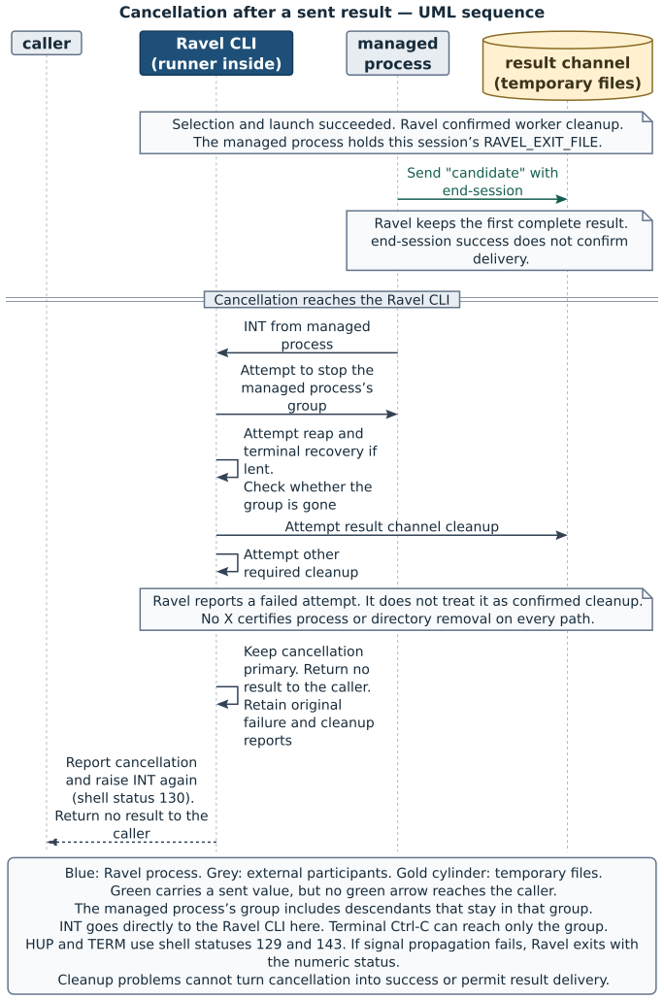
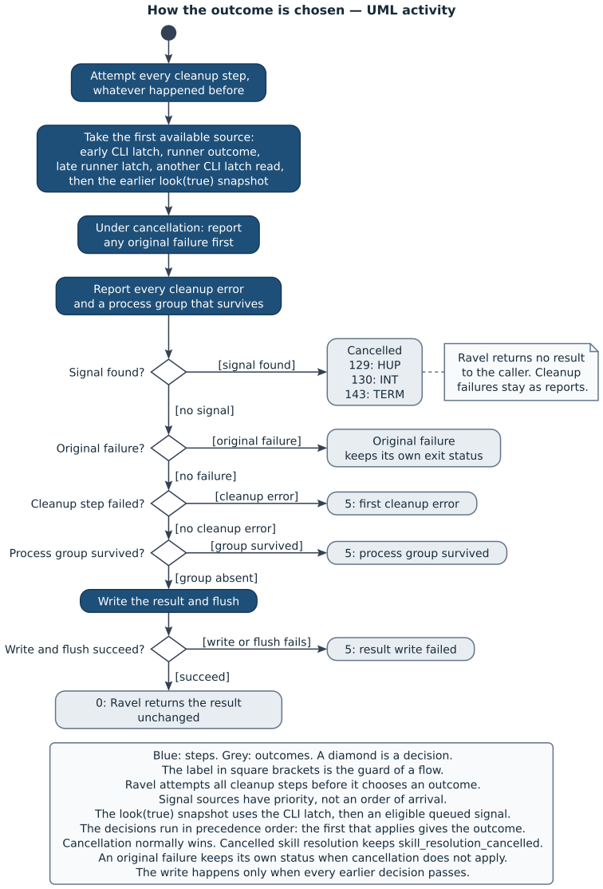

# Follow a session through the code

Do you want to change what Ravel does, or find the code that made a session
fail? Then you need to know which function does each step of a session, and
in which order. This chapter follows one session through the code, from
`main` to the last byte on standard output. Then it follows the same session
when the configuration script refuses and when a signal cancels it. At the
end, you can find where a change belongs.

The session is the `ravel-parts` example from
[chapter 7](07-the-parts-of-ravel.md#watch-the-parts-in-one-session). Its
configuration script asks a fake harness, `fake-advisor`, for advice. The
advisor prints `short` and sends the result `advice`. Then the script selects
the fake agent `fake-agent` with the argument `short`. The agent sends
`finished`, and the caller receives `finished` with status 0.

These are the words of chapter 7, with the value that each word has in this
chapter's example:

<!-- tc: depart synonym-rotation because launch names the runner's launch of a job, while start names other process creation -->

| Word | What it names | In the example |
|---|---|---|
| [Ravel CLI](02-actors-and-words.md#evaluation-and-supervision) | The `ravel` command-line program. It checks the request, runs the programs and decides the outcome. | The process `ravel start-session --kind demo …` |
| [Configuration script](02-actors-and-words.md#caller-and-owner) | The owner's Rhai file that selects a program or refuses | `config.rhai` |
| [Rhai worker](02-actors-and-words.md#evaluation-and-supervision) | A second copy of the `ravel` executable that evaluates the configuration script | It runs `select` in `config.rhai` |
| Host bridge | The code on both sides of the worker's private socket. It carries each request of the script to the Ravel CLI and returns the answer. | It carries the call `ravel::run_harness` |
| Reader thread | The thread of the Ravel CLI that does every file read and every harness run during evaluation | It reads `config.rhai` and runs `fake-advisor` |
| [Harness run](02-actors-and-words.md#evaluation-and-supervision) | One run of a program from the `harnesses` settings, during evaluation. Its output returns to the script. | `fake-advisor` |
| [Managed process](02-actors-and-words.md#the-managed-process-and-its-result) | The program that the script selects. It does the caller's work. | `fake-agent` |
| [Result channel](02-actors-and-words.md#the-managed-process-and-its-result) | A private temporary directory with one path for a result file. The path goes to a program in `RAVEL_EXIT_FILE`. | One for `fake-advisor`, one for `fake-agent` |
| [Runner](02-actors-and-words.md#evaluation-and-supervision) | The Rust library code in the Ravel CLI that launches and supervises a job | It runs both fakes |

This chapter is an orientation to one path. It does not cover the complete
source. It omits the `load_context` exchange of the
[selection context](02-actors-and-words.md#three-different-kinds-of-information),
the other host calls, platform system calls, test instruments and delivery
code. [Chapter 7](07-the-parts-of-ravel.md) explains the parts and why each
one is separate. [Chapter 9](09-jobs-signals-and-the-terminal.md) explains
the job-control details.

This chapter writes INT, TERM, HUP and KILL without the SIG prefix. Other
signal names keep that prefix. Code and diagnostic text keep their literal
names. Paths are relative to the root of a checkout.

## Trace the example

You saved four files in `~/ravel-parts` in chapter 7. The configuration script
is the file that decides the path. It is the same file as in chapter 7.

Fragment: `config.rhai` of the `ravel-parts` example. This block omits
`settings.json`, the two fakes and the command. Chapter 7 gives them.

```rhai
export const SCHEMA_VERSION = 4;
export const VERSION = "parts";

fn select(request, context) {
    let run = ravel::run_harness(#{ harness: "advisor", args: [] });
    print(`The advisor run ended: ${run.status}, result ${run.result}.`);
    #{
        status: "selected",
        program: "fake-agent",
        args: [run.stdout],
        provider: "local",
        model: "fake",
        effort: "none",
        reason: "Show each part of Ravel.",
    }
}
```

The command of chapter 7 gave the kind `demo`, the script `config.rhai` and
the prompt `Show the parts of Ravel.`. It ran with a cleared environment and a
private home. Standard error showed two lines in this order. The check of
chapter 7 claims them as one block, so it also checks their order.

```text
config stdout: The advisor run ended: exited, result advice.
ravel: starting provider local, model fake, effort none for kind "demo"
```

The first line is the script's `print` output. The Ravel CLI wrote it after
the worker ended. The second line is the routing notice. The Ravel CLI wrote
it just before it launched `fake-agent`. The file `result` then held
`finished`, without a newline.

The table gives the whole path before the sections explain each step. Each
step needs the step before it. The last column says what the next step
receives.

<!-- tc: depart synonym-rotation because launch names the runner's launch of a job, while start names other process creation -->

| Step | What happens | Code location | What the next step receives |
|---|---|---|---|
| 1 | Parse the command | `crates/ravel/src/main.rs`, `main` | `RunArgs` for `run::run` |
| 2 | Refuse inside a harness run, check the entry signal state, install the cancellation handlers | `crates/ravel/src/run.rs`, `run` | Handlers that keep a signal for later |
| 3 | Read the settings and inputs, find the script, prepare the skills | `crates/ravel/src/choice.rs`, `prepare` | `Prepared` |
| 4 | Spawn the Rhai worker and check its identity | `choice::choose_prepared`, `rhai_worker::front::evaluate`, `worker::supervise` | A worker that is the same build |
| 5 | Send the script to the worker and answer its host calls | `crates/ravel/src/rhai_worker/serve.rs`, `serve`, with `host.rs` and `harness.rs` | The run of `fake-advisor`, as a map for the script |
| 6 | Check the reply, reap the worker, find the program | `worker::supervise`, `config::judge_result`, `program::resolve` | A `Choice` with the checked command and the executable path |
| 7 | Reserve standard output, make the result channel, write the routing notice | `run` | A `Launch` |
| 8 | Launch and supervise the managed process | `crates/keyed-launch/src/run.rs` | `Ended`, after reap and terminal recovery |
| 9 | Read the result | `crates/ravel/src/completion.rs`, `result_after` | `Some("finished")` |
| 10 | Complete cleanup and decide the outcome | `run`, `Handlers::finalise`, `settle` | `finished`, or a failure |
| 11 | Write the result | `run`, then `main` | Unchanged output, then status 0 |

The sequence shows the same order. It shows why the sent result reaches the
caller only after worker cleanup, managed-job cleanup and the final outcome
decision.


[Open the full session sequence at full size](figures/session-code-path.svg).
The optional region applies when `watch` sees the result before the child
exits. The later appearance check also finds the result when the child exits
first. Terminal actions are conditional. The checked example has no terminal.

<!-- tc: depart synonym-rotation because launch names the runner's managed launch, while start names other process creation -->
The session starts other short `ravel` processes. One is the Rhai worker.
Each fake also starts `ravel end-session` to send its result. None of these
processes returns a result to the caller. Only the original Ravel CLI does that.

## Prepare the request

`main` in `crates/ravel/src/main.rs` first decides which role this process
has. The Ravel CLI starts the worker with `argv[0]` set to
`ravel-rhai-config-worker`. Thus, `main` compares `argv[0]` with that name
before it reads any argument.

Excerpt from `crates/ravel/src/main.rs`: the role check comes first in `main`,
after a test-only branch.

```rust
    if std::env::args_os()
        .next()
        .is_some_and(|arg0| arg0 == rhai_worker::ARG0)
    {
        return rhai_worker::role::run();
```

In the example, the name is `ravel`, so `main` reads the command line. It
uses the clap definitions in `crates/ravel/src/cli.rs`. For `end-session`,
`main` calls `end_session` directly, without a configuration script. For
`start-session`, it first refuses the withdrawn confinement flags with
`cli::withdrawn`. Then it calls `run::run`.

`run` in `crates/ravel/src/run.rs` refuses first when `RAVEL_CONFIG_RUN` is in
its environment. A harness run has that variable, and a `start-session` inside
it cannot select. The example's caller has no such variable.

Next, `signal_state::recorded` checks that Ravel saved its entry signal state.
An initialiser function saves that state before `main` runs. Then
`handlers.begin()` installs the cancellation handlers. From here, a signal
does not stop the process at once. A handler keeps it, and the code checks it
at fixed points.

`choice::prepare` then reads the settings, reads the inputs and resolves the
configuration script path. The order matters: the settings supply defaults
that the input checks need, and both come before the worker exists.

Excerpt from `crates/ravel/src/choice.rs`: these first statements of
`prepare` establish the inputs and the configuration script entry.

```rust
    let home = std::env::var_os("HOME");
    let settings = Settings::read(home.as_deref())?;
    let inputs = Inputs::read(args, &settings)?;
    let entry = authority::resolve(args.config.as_deref(), &inputs.cwd, home.as_deref())?;
```

In the example, `Settings::read` reads `home/.config/ravel/settings.json`. It
finds the harness entry `advisor` and the budget of one harness run.

`authority::resolve` resolves `config.rhai` relative to the caller's working
directory. It requires a regular file and gives the canonical path. It does
not open the file. The reader thread reads it later, inside the selection
deadline. `authority::resolve` does not search for another configuration
script when this path fails.

Then `prepare` resolves the skill sources and prepares the prompt. This step
comes before the worker. Thus, a skill refusal starts no worker and makes no
result channel.

Excerpt from `crates/ravel/src/choice.rs`: the call that follows the entry in
`prepare`. `config_dir` is the directory of the canonical entry.

```rust
    let skills = crate::skills::launch::prepare(
        home.as_deref().map(Path::new),
        &settings,
        config_dir,
        &inputs.prompt.text,
    )?;
```

The example has no `skills` settings. This trace uses the checkout build
of the book checker, which has no installation record. Thus, this call returns `None`. `Prepared` holds the
checked inputs, the entry and that `None`. It holds no decision of the
configuration script yet.

Back in `run`, a `RunSetup` collects three values for each program that Ravel
runs later. They are the entry signal state, the `--exit-dir` directory and
the skill descriptor path. A harness run and the managed process both use
them. In this trace, the descriptor path is absent.

## Start the Rhai worker

`choice::choose_prepared` calls `evaluate_and_resolve_rhai`. That function
builds the request for the script. In this checkout-build trace, the request holds these
fields:

- `kind` is `demo`.
- `originalPrompt` and `prompt` both hold `Show the parts of Ravel.`.
- `cwd` is the caller's working directory.
- `params` is empty, and `skills` is null.

It also makes two checks for later, as closures. The `judge` closure checks a
context that `load_context` returns. The example has no `load_context`, so
`judge` never runs. The `reply_judge` closure calls `config::judge_result` on
the final reply of the worker. Then `evaluate_and_resolve_rhai` calls
`rhai_worker::front::evaluate`.

`evaluate` gives the worker to `worker::supervise` in `crates/ravel/src/worker.rs`.
That function owns the worker process from its start to its reap. It
prepares the worker in this way:

- It makes a private empty directory with mode 0700. The worker starts there.
- It makes a socket pair. In the child, between fork and exec, the worker's
  end moves to file descriptor 3.
- It clears the environment, so the worker inherits no variable.
- It sets standard input to `/dev/null` and pipes standard output and standard
  error back to the Ravel CLI.
- In the child, between fork and exec, it marks every descriptor above 3
  close-on-exec. Thus, the worker holds only descriptors 0 to 3.

A failure of any of these steps, or of the spawn, refuses as `worker_missing`
or `worker_failed`, status 5.

The worker therefore has no `RAVEL_EXIT_FILE`. It cannot send a result for
any session. The selection deadline starts at the spawn, so a slow start uses
the same time as a slow script. Two threads then read the worker's standard
output and standard error within one size limit.

The worker side is `rhai_worker::role::run` in
`crates/ravel/src/rhai_worker/role.rs`. It sets its heap limit of 1 GiB before
the first byte of script arrives. Then it sends `hello` with its protocol,
package version, build identity and Rhai version.

On the CLI side, `converse` in `rhai_worker/front.rs` receives that frame.
`verify_hello` compares each value with the values of the Ravel CLI itself.

Excerpt from `crates/ravel/src/rhai_worker/front.rs`: `verify_hello` refuses a
worker when one of these four values differs.

```rust
    if protocol != Some(PROTOCOL)
        || text("packageVersion") != PACKAGE_VERSION
        || text("buildId") != BUILD_ID
        || text("rhaiVersion") != RHAI_VERSION
```

A difference gives `worker_identity_mismatch`, status 5. In the example, the
worker is the same file as the Ravel CLI, so each value is equal.

Next, `converse` starts the reader thread with `Reader::start`. The thread
blocks INT, TERM and HUP for its whole life, so a signal never runs a handler
on it. Then `converse` builds a Tokio runtime on the current thread and runs
`serve` on it. Tokio is the Rust library for asynchronous input and output.
The runtime thread itself makes no file call.

## Answer the script's requests

`serve` in `crates/ravel/src/rhai_worker/serve.rs` first gives the entry to
the reader thread. The worker reads no file, also for its own script. The
reader thread reads `config.rhai`, measures it and returns its source.

Excerpt from `crates/ravel/src/rhai_worker/serve.rs`: the deadline covers
the read of the entry, because the read waits inside `watch.until`.

```rust
    // The deadline began when the worker started, so it covers this read.
    let source = match watch.until(host.read_entry(entry)).await? {
        Ok(source) => source,
        Err(what) => return Err(Conversation::Refused(unreadable(&what))),
```

`watch.until` is the pattern of the conversation after the handshake. It
waits for one piece of work, and it also watches three conditions: the
deadline, the cancellation latch and the output limit. A **latch** is the
saved signal number that a handler stores. The first condition that occurs
stops the wait. While a host call is in progress, `during_call` also watches
the socket. A worker that sends a frame or closes its end then breaks the
protocol.

Then `serve` sends the `evaluate` frame. It holds the entry path, the source
exactly as the reader thread read it, the request and the limits.

Excerpt from `crates/ravel/src/rhai_worker/serve.rs`: the `evaluate` frame.
A `selectContext` member follows only when the caller supplied a context.

```rust
    let mut evaluate = json!({
        "type": "evaluate",
        "protocol": super::PROTOCOL,
        // Exactly the admitted file.
        "entry": entry,
        "source": source,
        "request": request,
        "bounds": bounds.to_json(),
    });
```

The worker evaluates the source on its own thread with `engine::evaluate_with`
in `rhai_worker/engine.rs`. It compiles the script and runs its top level.
Then it checks the exports `SCHEMA_VERSION`, `VERSION` and `select`. Last, it
calls `select(request, context)`.

What does `select` receive as `context` in the example? The caller gave no
context document, and the script has no `load_context`. Then `select`
receives `request.context`, which is null in the request. Rhai shows null as
the unit value `()`.

Excerpt from `crates/ravel/src/rhai_worker/engine.rs`: the second argument of
`select`, in `evaluate_with`.

```rust
    let context = match select_context {
        Some(context) if context.is_object() => from_json(context),
        Some(_) => return Err("the selectContext is not an object".to_owned()),
        None => request.get("context").cloned().unwrap_or(Dynamic::UNIT),
    };
```

The refusal example below prints `type_of(context)`, and the output is `()`.

## Follow the harness run through the host bridge

The first statement of `select` calls `ravel::run_harness`. The table follows
that call. Each row names the thread or process that acts.

| Order | Who acts | Code location | What happens in the example |
|---|---|---|---|
| 1 | The worker | `rhai_worker/bridge.rs` | Sends a `host` frame with the call `run_harness` and the harness `advisor`, then waits for the answer |
| 2 | The runtime thread | `serve` | Receives the frame and passes it to `Host::call` in `rhai_worker/host.rs` |
| 3 | The runtime thread | `Host::run_harness` | Finds the entry `advisor` in the settings. The reader thread finds `fake-advisor` on the caller's `PATH`. It checks that the budget allows one more run. |
| 4 | The reader thread | `harness::execute` in `rhai_worker/harness.rs` | Makes a result channel for the run. Adds `RAVEL_CONFIG_RUN=1` to the run's environment. Calls the runner. |
| 5 | The reader thread, in the runner | `keyed_launch::run_captured` | Runs `fake-advisor` in a new POSIX session. Captures `short` from its standard output. Stops its process group after it exits. |
| 6 | The reader thread | `harness::execute` | Reads `advice` from the run's channel, then removes the channel |
| 7 | The runtime thread | `Host::run_harness`, then `serve` | Sends a `reply` frame with the run's map |
| 8 | The worker | `rhai_worker/bridge.rs` | Gives the map to the script. `run.stdout` is `short`, and `run.result` is `advice`. |

Excerpt from `crates/ravel/src/rhai_worker/harness.rs`: the marker that each
harness run receives. The skill descriptor path joins it when delivery is on.

```rust
    let mut granted: Vec<(OsString, OsString)> =
        vec![(OsString::from(CONFIG_RUN), OsString::from("1"))];
```

That marker is why chapter 7's advisor printed `RAVEL_CONFIG_RUN is 1`. The
managed process does not receive it, so it can start a nested session.

While the reader thread runs the harness, the runtime thread still watches
the deadline and the cancellation latch. `Host::run_harness` also limits the
run to the time that remains, or to the script's `timeoutMs` when that is
shorter. At that limit, it sets a `StopRequest`, and the runner stops the run.

After the reply, `select` returns its map, and the worker sends a `selection`
frame with `VERSION` and that map. `serve` returns. `converse` then shuts down
the runtime with `retire` and calls `reply_judge`.

Excerpt from `crates/ravel/src/rhai_worker/front.rs`: the end of `converse`.
No runtime task remains when `reply_judge` checks the reply.

```rust
    // Every task is finished here, and the copy of the channel is closed.
    retire(runtime);
    let served = served?;
    reply_judge(&served.reply).map_err(Conversation::Refused)?;
    Ok((identity, served, started.elapsed()))
```

Why does `reply_judge` check the reply here, before the worker ends? A
refusal is part of the conversation. If the later worker teardown fails, the
script's refusal stays the primary failure, and the teardown reports join it.

## Check the selection and find the program

`converse` returns to `worker::supervise`. The worker sent its last frame, so
it exits by itself. `supervise` waits up to 1 second for the exit, then kills
the worker if it still runs. It collects the script's output and removes the
private directory.

Excerpt from `crates/ravel/src/worker.rs`: `supervise` accepts a teardown only
when the reap, the removal and the stop each succeeded.

```rust
    let admitted = teardown.status.is_ok() && teardown.removed.is_ok() && !teardown.stop_failed;
```

<!-- tc: depart synonym-rotation because confirmation establishes a completed reap, while checks also cover input validation -->
`supervise` returns success only after confirmed worker reap and successful
removal of the directory. A valid command alone does not permit a launch. The
runner cannot enforce this order, because it has no worker to inspect. The
Ravel CLI enforces it before the runner call.

Back in `evaluate_and_resolve_rhai`, the reply is a `Selection`. The function
checks the result again with `config::judge_result`. This check gives the
`Command` with the program, the arguments and the three labels.

Excerpt from `crates/ravel/src/choice.rs`: the selected command, then a
cancellation check before the program lookup.

```rust
    let command = config::judge_result(result, &inputs.kind, &source).map_err(refuse)?;
    cancellation::check(&source).map_err(refuse)?;
```

Then `program::resolve` searches the caller's `PATH` for `fake-agent`. The
example's `bin` directory supplies that executable. The `Choice` keeps both
the selected command and the executable path. The labels `local`, `fake` and
`none` supply text for the routing notice. Ravel does not use them to talk to
a model.

`choose_prepared` checks the latch one more time. Then it returns the
`Choice` to `run`, and `run` writes the worker's operation reports, if any,
on standard error.

## Prepare the managed launch

`run` first calls `ResultOutput::reserve`. This function checks that standard
output is writable, saves its descriptor, then points standard output at
standard error. The saved descriptor does not pass through exec to the managed
process. Thus, a program that prints cannot write the result of the session.

Next, `SessionChannel::allocate` makes a fresh temporary directory and channel
path under `TMPDIR`. It keeps an open directory descriptor for the later read.
Allocation makes no result file. The channel belongs to this launch alone.

Only now does `run` write the script's output and the routing notice.

Excerpt from `crates/ravel/src/run.rs`: the routing notice. A `--json`
session keeps a notice document instead and writes it after supervision.

```rust
            eprintln!(
                "ravel: starting provider {}, model {}, effort {} for kind {:?}",
                choice.command.provider,
                choice.command.model,
                choice.command.effort,
                choice.inputs.kind
            );
```

Then `handlers.try_block_and_check()` looks for a signal one last time before
the launch. A signal here prevents the runner call.

`run` builds the argument vector from the checked command. The excerpt shows
the difference between the executable path and the original program name,
which becomes argument zero.

Excerpt from `crates/ravel/src/run.rs`: the argument vector uses the
resolved path and each argument that the configuration script supplied.

```rust
        let argv = Argv::new(
            OsString::from(&choice.executable.path),
            choice.command.args.iter().map(OsString::from).collect(),
        )
        .with_arg0(OsString::from(&choice.executable.program));
```

In the example, the vector is `fake-agent` and `short`. Ravel does no shell
expansion or word splitting. The fake's shebang selects its shell interpreter,
as chapter 3 explains.

Excerpt from `crates/ravel/src/run.rs`: the environment of the managed
process. The descriptor path replaces an inherited `RAVEL_SKILL_DIRECTORIES`,
and `scrubbed` removes that name when delivery is off.

```rust
        let directories = setup.skill_directories.as_ref();
        let environment = skill_environment(directories);
```

The `Launch` holds the argument vector, the channel, these environment
changes, the entry signal state and the escalation times. `run` calls
`keyed_launch::run_observed_with_start_check`. The runner removes the
inherited variables that name a result destination. It applies the
environment grants, then sets the new `RAVEL_EXIT_FILE` last. Thus, a nested
session gives its own child a fresh destination. The child otherwise inherits
the caller's environment and working directory.

In `crates/keyed-launch/src/run.rs`, `run_with_output` makes the process
group and spawns the command. If Ravel owns the foreground of a terminal, the
child takes the terminal during spawn, before exec. After spawn,
`run_with_output` calls `supervise_started`. The `Started` event records that
the spawn succeeded. It does not prove that exec succeeded. The start check of
the Ravel CLI restores its entry signal mask before supervision continues.

## Send the result

`fake-agent` calls `ravel end-session -- "finished"`. In this second Ravel
process, `main` calls `end_session` in `crates/ravel/src/completion.rs`. That
function reads `RAVEL_EXIT_FILE` and passes the path and the result to
`publish_result`. The function name keeps the source's own word. Its action
is to send one value to the enclosing session.

`publish_result` checks the byte limit and the parent directory. Then it
writes the value into a temporary file in that directory. It adds the
completion name only after the write and flush succeed.

Excerpt from `crates/ravel/src/completion.rs`: the temporary file receives
the complete value before the completion name exists.

```rust
    let mut temporary = NamedTempFile::new_in(parent)?;
    temporary.write_all(result.as_bytes())?;
    temporary.flush()?;
```

The next operation, `fs::hard_link`, adds a name for that file. It does not
replace a name that already exists. This behaviour is the first-result rule.
Thus, the runner can observe only a complete file, never a partly written
value.

| Channel state | Effect of `end-session` |
|---|---|
| No completion name | Adds the name for the complete temporary file |
| A valid result already exists | Checks the earlier result and leaves it unchanged |
| Missing or empty inherited path, stale directory, or invalid earlier result | Reports failure |

The same code ran earlier in the session, when `fake-advisor` sent `advice`
to its own channel. Only the destination differed.

An empty string is still a sent result. Newlines and Unicode stay in the
value. A second call cannot replace the first value, but it races with the
shutdown and removal of the channel. It can therefore fail or never run.

The file operation asks for completion. It does not signal the managed group
or do the cleanup of the enclosing session. The original Ravel CLI owns those
actions.

## Finish the managed job

`supervise_started` calls `supervise_reported`, which calls `watch`. These
functions are in `crates/keyed-launch/src/run.rs`.

The runner calls its observer synchronously at successful spawn and at
confirmed reap. The observer must return promptly and without a panic. The
start-check callback has the same requirement, but it can return an error.

`watch` checks cancellation, the child's state and channel appearance. If the
child continues after the result appears, `watch` applies the grace, TERM and
KILL stages from [chapter 3](03-a-complete-session.md#send-the-result-and-finish-the-job).

`fake-agent` can exit before `watch` observes the file. That path needs no
escalation. `supervise_reported` checks channel appearance again when it
makes `Ended`, after the job cleanup steps. Thus, Ravel does not lose the
result when the child exits quickly.

The final group stop comes before the reap on the normal path through `watch`.

Excerpt from `crates/keyed-launch/src/run.rs`: after it observes the child's
exit, `watch` stops the group before it collects the child's exit status.

```rust
    child.bound(Instant::now() + ERROR_SETTLEMENT);
    child.kill_group();
    let reaped = child.reap();
```

The direct child's PID keeps the group's identity until the reap. The runner
uses that interval to stop descendants that stay in the group. After `watch`
returns, `supervise_reported` recovers a lent terminal and confirms whether
the group is gone. It returns an `Ended` with separate fields for the child
status, cancellation, channel appearance and group state.

The Ravel CLI needs those separate facts. A later nonzero child status does
not invalidate a sent result. A group that stays, or a failed terminal
recovery, prevents success. Descendants that leave the group stay outside
this cleanup guarantee.

On macOS, standard error can show `ravel: stop attempt` lines here. The group
stop can find only zombie members, and the system then refuses the signal.
[Chapter 3](03-a-complete-session.md#run-the-first-session) explains why these
operation reports alone do not decide success.

## Read the result

Back in `run`, `allocated.result_after(ending)` receives the `Ended` from
this channel's runner call. The association belongs to `run`: the Rust type
alone does not prove that an arbitrary `Ended` belongs to this channel.

`result_after` first checks the group and cancellation, then channel
appearance. It reads the contents only after those checks.

| Observation | Result of `result_after` |
|---|---|
| The group is still present | Error |
| The runner reports cancellation | Error |
| The runner observed no completion file | `None` |
| A valid empty completion file | `Some(String::new())` |
| A valid completion file that is not empty | `Some(result)` |

`read_result` opens the file relative to the held directory descriptor with
`openat`. A replacement of the directory pathname cannot redirect this read.
The open refuses a final symlink and cannot block on a FIFO. `read_regular`
requires a regular file, enforces the byte limit and checks UTF-8. These checks
matter because the managed process can change files.

In the example, the value is `Some("finished")`. `run` changes `None` to
`session_result_missing`, even if the child's exit status is zero.
`result_after` returns candidate text to `run`, not to the caller. Resource
cleanup and the final cancellation decision still follow.

## Complete cleanup and write the result

After the runner returns, `run` writes the runner's operation reports.
Without `--json`, each report has the form `ravel: <report>` on standard
error. With `--json`, `operationReports` belongs to the selection notice,
which `run` writes now.

`run` then attempts these operations in order:

| Order | Operation | Purpose |
|---|---|---|
| 1 | `handlers.restore_entry_mask()` | Restores the entry mask while the handlers still protect the transition |
| 2 | `channel.close()` | Removes the result channel's temporary files |
| 3 | `output.restore()` | Restores the caller's standard output |
| 4 | `handlers.finalise(runner_signal)` | Joins the cancellation observations and completes the signal transitions |
| 5 | `settle(...)` | Reports failures and decides whether the result can go to the caller |

Channel cleanup checks the directory's recorded identity before removal. It
does not remove a replacement directory. This pathname check is not an atomic
defence against concurrent changes by code of the same user. An unknown
directory identity also prevents removal. An explicit cleanup attempt disables
the destructor's later retry, even on failure. A moved directory can need
manual cleanup.

`settle` decides the end of supervision from the collected result, the
cleanup outcomes, the group state and cancellation. It reports failures,
gives cancellation priority and rejects unsuccessful cleanup. It does not do
those cleanup operations itself. On this successful path it returns
`finished` to `run`.

Excerpt from `crates/ravel/src/run.rs`: only a successful `settle` reaches
this final write and flush.

```rust
    io::stdout()
        .write_all(result.as_bytes())
        .and_then(|()| io::stdout().flush())
        .map_err(|error| failed("result_write_failed", error))?;
    Ok(())
```

`main` changes this success to status 0. Ravel writes the result unchanged
and adds no newline. A failed final write can leave only the start of the
value on standard output. The invocation then fails, so output bytes alone do
not prove success. A signal that arrives after the final cancellation decision
can still stop the Ravel CLI during output. The write is not atomic with that
decision.

To summarise the successful path: the Ravel CLI starts the worker, answers
its one harness call, checks its reply and reaps it. Only then does it make
the result channel, write the routing notice and launch `fake-agent`. After
the reap of `fake-agent` and the cleanup, `settle` permits the write of
`finished`.

## Follow a refusal or launch failure

What changes when the configuration script refuses? Run the same example
with one changed file, and see where the path stops. The example directory
is `~/ravel-parts-refusal`. Make it and copy the three files that stay the
same:

Fragment: make the example directory and copy three files of chapter 7. This
block omits the new `config.rhai`. The book checker makes its own directory
and does not run this block.

```sh
mkdir -p ~/ravel-parts-refusal/bin
cd ~/ravel-parts-refusal
cp ~/ravel-parts/settings.json .
cp ~/ravel-parts/bin/fake-advisor ~/ravel-parts/bin/fake-agent bin/
```

Then save the new `config.rhai`. It prints what `select` received as its
context. It runs the advisor as before. Then it refuses with the advisor's
answer in its message. Type the commands of the complete example without
their first `$ `.

Complete example: the configuration script asks the fake harness for advice,
then refuses. The managed process does not start.

**`settings.json`**

```json
{"harnesses":{"advisor":{"program":"fake-advisor"}},"budgets":{"harnessRuns":1}}
```

**`config.rhai`**

```rhai
export const SCHEMA_VERSION = 4;
export const VERSION = "parts-refusal";

fn select(request, context) {
    print(`The context is ${type_of(context)}.`);
    let run = ravel::run_harness(#{ harness: "advisor", args: [] });
    print(`The advisor run ended: ${run.status}, result ${run.result}.`);
    #{
        status: "refused",
        code: "advice_too_short",
        message: `The advisor said only "${run.stdout}".`,
        remedy: "Ask the advisor for a longer answer.",
    }
}
```

**`bin/fake-advisor`**

```sh
#!/bin/sh
{
  echo "advisor: parent is $(ps -o args= -p "$PPID" | cut -d ' ' -f 1-2)"
  echo "advisor: RAVEL_CONFIG_RUN is ${RAVEL_CONFIG_RUN-absent}"
} > advisor.txt
printf '%s\n' "$RAVEL_EXIT_FILE" > advisor.path
printf 'short'
ravel end-session -- "advice"
```

**`bin/fake-agent`**

```sh
#!/bin/sh
{
  echo "agent: parent is $(ps -o args= -p "$PPID" | cut -d ' ' -f 1-2)"
  echo "agent: RAVEL_CONFIG_RUN is ${RAVEL_CONFIG_RUN-absent}"
  echo "agent: argument is $1"
} > agent.txt
printf '%s\n' "$RAVEL_EXIT_FILE" > agent.path
ravel end-session -- "finished"
```

**Command**

```console
$ mkdir -p home/.config/ravel tmp && chmod +x bin/* && cp settings.json home/.config/ravel/settings.json
$ env -i HOME="$PWD/home" TMPDIR="$PWD/tmp" PATH="$PWD/bin:$PATH" ravel start-session --kind demo --config config.rhai --prompt 'Show the parts of Ravel.' > result
```

**Standard output**

```text
```

**Standard error includes**

```text
config stdout: The context is ().
config stdout: The advisor run ended: exited, result advice.
ravel: refused (config_refused, stage selection): the configuration script <scratch>/work/config.rhai refused the selection: The advisor said only "short".
  input: --kind demo
  source: <scratch>/work/config.rhai
  config code: advice_too_short
  remedy: Ask the advisor for a longer answer.
```

**Exit status**

```text
3
```

**Command**

```console
$ cat advisor.txt && test ! -e agent.txt && echo "fake-agent did not run."
$ test ! -s result && echo "The file result is empty."
$ rmdir tmp && echo "The directory tmp is empty again."
```

**Standard output**

```text
advisor: parent is ravel start-session
advisor: RAVEL_CONFIG_RUN is 1
fake-agent did not run.
The file result is empty.
The directory tmp is empty again.
```

**Exit status**

```text
0
```

Here `<scratch>/work` stands for the example's directory. In your shell, the
line shows the absolute path of your `ravel-parts-refusal` directory. The
first line answers the question of the last section: without a context,
`select` received `()`.

Follow the refusal through the code. The steps up to the reply are the steps
of the successful path. The harness run happened, and its channel was
removed. Then the path changes:

1. The worker sends the refusal map in its `selection` frame.
2. `reply_judge` calls `config::judge_result`. That function finds
   `status: "refused"`, checks the three fields and returns `config_refused`
   with the script's own code `advice_too_short`.
3. `converse` returns that refusal as `Conversation::Refused`.
   `worker::supervise` still waits for the worker, reaps it and removes its
   directory. It returns the refusal together with the script's output.
4. `choose_prepared` returns the failure to `run`. `run` never reserves
   standard output, makes no result channel and writes no routing notice.
5. The common cleanup and `settle` run as before. With no cancellation and no
   cleanup failure, `settle` keeps the refusal, and `main` exits with status 3.

Ravel does not try another configuration script or command when selection
fails. The Rust type `Refusal` also carries worker failures and timeouts. Its
name alone does not tell you that the script
[refused](02-actors-and-words.md#evaluation-and-supervision). The `code` does.

The table locates the other forks. Its statuses describe each failure alone,
without cancellation. The [exit-status table](06-reference.md#exit-statuses)
gives their meaning to the caller.

| Problem | Code that decides | Status and point of failure |
|---|---|---|
| The configuration script file is missing, is not a regular file, or is the retired `policy.ts` | `authority::resolve` | 3, before the worker starts |
| The entry cannot be read, is not UTF-8 or passes the entry limit | `Host::read_entry` on the reader thread, then `serve` | 3, after the worker starts |
| A skill source, the skill cache or a skill limit refuses | `skills::launch::prepare` | 3, or 124 at the skill deadline, or 5 when the random source or a cache cleanup fails. All before the worker starts. |
| The script does not parse, an import fails, or an export is wrong | The worker's engine reports it. `choice::script_refusal` gives the code. | 3, before the program lookup |
| `load_context` refuses, throws, or returns an invalid or oversized context | The `judge` closure, with `config::loader_refused` and `context::deliver`. Or the worker and `serve` report it, and `choice::script_refusal` gives the code. | 3, before the program lookup |
| `select` refuses, abstains or returns a malformed result | `config::judge_result` | 3, before the program lookup |
| `select` throws, or the script passes an engine limit, the heap limit or the harness budget | The worker reports it. `choice::script_refusal` gives the code. | 3, before the program lookup |
| The script's output passes its limit | `worker::supervise`, with `output_limit` | 3, before the program lookup |
| The selection deadline passes | Before the `hello`, `receive_for` in `converse` times out. After it, `watch.until` in `serve` stops the wait. `worker::supervise` then uses `expired` in `worker.rs`. | 124, before the program lookup |
| The worker cannot start, has another identity or breaks the protocol | `worker::supervise`, as `worker_missing` or `worker_failed`, then `verify_hello` and `worker::broken_for` | 5, before the managed launch |
| A harness run cannot be cleaned up | `harness::execute` reports the problem. `Host::run_harness` or `Host::settle` makes `harness_cleanup_failed`. | 5, before the managed launch |
| The conversation succeeds, but worker teardown fails | `worker::supervise` | 5, before the managed launch |
| The selected program is absent | `program::resolve` | 127, before the runner call |
| The selected file cannot execute, and no other `PATH` entry can | `program::resolve` | 126, before the runner call |

The deadline covers the worker start, the read of the entry and the whole
conversation, harness runs included. A timeout can therefore occur before the
worker receives the script. It is not a decision of the script. A valid answer
of the script also cannot override an unconfirmed worker reap or a failed
directory removal.

When failures combine without cancellation, `worker::supervise` uses this
priority. The table separates the primary failure from the reports that stay
in the diagnostic.

| First condition that applies | Primary failure | Other reports |
|---|---|---|
| The script's output passes its limit | `output_limit`, status 3 | The conversation failure and the teardown problems stay |
| The conversation fails | That failure keeps its code, such as 3 for `config_refused` or 124 for `selection_timeout` | The teardown problems stay |
| The conversation succeeds, but teardown fails | `worker_failed`, status 5 | The teardown problems stay |

The program check does not guarantee that a later spawn succeeds. For
example, a script can pass the file checks but name a missing interpreter.
`run::supervision_failure` classifies such a runner error from `started` and
the OS error number. The `Started` event sets `started`.

Excerpt from `crates/ravel/src/run.rs`: `supervision_failure` chooses a
status before it makes the diagnostic.

```rust
    let exit = if started {
        EXIT_WORKER
    } else if errno == Some(libc::ENOENT) {
        127
    } else {
        126
    };
```

`EXIT_WORKER` is 5. After `Started`, a supervision error keeps that status.
Before `Started`, `ENOENT` gives 127 and another launch error gives 126. The
conversion also keeps a signal that the runner consumed, for the final
cancellation decision.

Each of these failures leaves the main closure in `run`, then reaches its
common cleanup and final decision. An allocator that fails partway through
its directory setup attempts its own cleanup before it returns the error.
`run` handles the resources that the allocator returned. Thus, even a failure
without an `Ended` value has cleanup work to complete.

## Follow cancellation

A cancellation is an INT, TERM or HUP signal that reaches the Ravel CLI. It
can arrive during selection, during supervision or during the final cleanup.
The handlers that `handlers.begin()` installed keep the signal in the latch.
Ordinary code then attempts cleanup before the Ravel CLI propagates the
signal.

### Cancel during selection

During selection, nothing waits on a signal directly. `Watch::stopped` in
`serve` looks at the latch every 50 milliseconds. When it finds a signal, it
stops the current wait with `Stop::Signal`.

If a harness run is in progress, `Host::settle` stops it first. It sets the
run's `StopRequest` and waits up to 8 seconds for the runner to stop the
run's group and reap it. Then `serve` returns, and `converse` retires the
runtime. `worker::supervise` sends TERM to the worker, reaps it, collects its
output and removes its directory.

The conversation ended without a reply, so `supervise` first makes a
`worker_failed` refusal. Then it sees the latch, and `cancelled_by` replaces
the primary failure with `selection_cancelled`. The `worker_failed` text stays
under “original failure:”. `run` launches nothing. In its final decision,
`settle` writes that report, then returns `session_cancelled`.


[Open the selection cancellation sequence at full size](figures/selection-cancellation.svg).
The figure is the direct-signal example of
[chapter 5](05-running-sessions.md#cancel-during-selection-or-supervision),
`cancel-selection`. In that example, a fake harness sends INT to its parent,
the Ravel CLI. The configuration script itself cannot send a signal. The
figure does not show keyboard delivery from a terminal.

The next check sits just before the managed launch. `run` calls
`handlers.try_block_and_check()` after it reserves output and makes the
channel. A signal found here prevents the runner call. The common cleanup
still closes the channel and restores output.

### Cancel during supervision

During supervision, the runner's own handlers catch INT, TERM and HUP. They
write the runner's latch. `watch` checks that latch before it accepts even a child
that has already exited. It forwards the signal to the managed group, then
escalates if needed. It keeps the first signal that it consumes through the
wait, the reap and the recovery that follow.

What happens to a result that the program already sent? Run the
`ravel-parts` example with a changed `fake-agent` to see. The example
directory is `~/ravel-parts-cancel`. Make it and copy the three files that
stay the same:

Fragment: make the example directory and copy three files of chapter 7. This
block omits the new `bin/fake-agent`. The book checker makes its own
directory and does not run this block.

```sh
mkdir -p ~/ravel-parts-cancel/bin
cd ~/ravel-parts-cancel
cp ~/ravel-parts/settings.json ~/ravel-parts/config.rhai .
cp ~/ravel-parts/bin/fake-advisor bin/
```

The new `fake-agent` sends `finished`, writes a note and sends INT to its
parent, the Ravel CLI. Then it waits until Ravel stops it.

Complete example: the managed process sends `finished`, then sends INT to the
Ravel CLI. The caller receives no result.

**`settings.json`**

```json
{"harnesses":{"advisor":{"program":"fake-advisor"}},"budgets":{"harnessRuns":1}}
```

**`config.rhai`**

```rhai
export const SCHEMA_VERSION = 4;
export const VERSION = "parts";

fn select(request, context) {
    let run = ravel::run_harness(#{ harness: "advisor", args: [] });
    print(`The advisor run ended: ${run.status}, result ${run.result}.`);
    #{
        status: "selected",
        program: "fake-agent",
        args: [run.stdout],
        provider: "local",
        model: "fake",
        effort: "none",
        reason: "Show each part of Ravel.",
    }
}
```

**`bin/fake-advisor`**

```sh
#!/bin/sh
{
  echo "advisor: parent is $(ps -o args= -p "$PPID" | cut -d ' ' -f 1-2)"
  echo "advisor: RAVEL_CONFIG_RUN is ${RAVEL_CONFIG_RUN-absent}"
} > advisor.txt
printf '%s\n' "$RAVEL_EXIT_FILE" > advisor.path
printf 'short'
ravel end-session -- "advice"
```

**`bin/fake-agent`**

```sh
#!/bin/sh
ravel end-session -- "finished"
echo "agent: sent finished, then INT to $(ps -o args= -p "$PPID" | cut -d ' ' -f 1-2)" > agent.txt
kill -INT "$PPID"
while :; do sleep 1; done
```

**Command**

```console
$ mkdir -p home/.config/ravel tmp && chmod +x bin/* && cp settings.json home/.config/ravel/settings.json
$ env -i HOME="$PWD/home" TMPDIR="$PWD/tmp" PATH="$PWD/bin:$PATH" ravel start-session --kind demo --config config.rhai --prompt 'Show the parts of Ravel.' > result
```

**Standard output**

```text
```

**Standard error includes**

```text
ravel: refused (session_result_invalid, stage exec): session was cancelled; no result is returned
  remedy: correct the named process or temporary-directory error and retry start-session
ravel: refused (session_cancelled, stage exec): session selected by <scratch>/work/config.rhai was cancelled by SIGINT
  signal: SIGINT, re-raised once this is reported
  remedy: retry the same command if cancellation was unintended
```

**Exit status**

```text
130
```

**Command**

```console
$ cat agent.txt && test ! -s result && echo "The file result is empty."
$ rmdir tmp && echo "The directory tmp is empty again."
```

**Standard output**

```text
agent: sent finished, then INT to ravel start-session
The file result is empty.
The directory tmp is empty again.
```

**Exit status**

```text
0
```

The note shows that `fake-agent` sent `finished` before the signal. Earlier
lines of standard error show the routing notice and, on macOS, can show
`ravel: stop attempt` lines. Their process-group IDs change from run to run,
so the example does not claim them.

The status is 130, the shell status of INT. Ravel raised INT again, so the
shell reports 128 plus the signal number 2.

Follow the two refusals through the code:

1. `watch` consumed INT from the runner's latch, sent INT to the group and
   stopped the group. `Ended` carries `End::Interrupted`, and `run` keeps the
   signal as `runner_signal`.
2. `result_after` found the cancellation in `Ended` and returned an error
   before it read the file. `run` made that error `session_result_invalid`.
   That is the first refusal.
3. `Handlers::finalise` chose INT as the cancellation observation.
4. `settle` saw a signal and an original failure. It wrote the original
   failure, then returned `session_cancelled`. That is the second refusal.
5. `main` wrote the second refusal and called `cancellation::reraise`.

Two runner outcomes carry cancellation to `run`:

| Runner returns | Where `run` gets the signal | What the value does not establish |
|---|---|---|
| `Ended` with `End::Interrupted` | The `signal` field of that end | Permission to return a result |
| `LaunchError` | `consumed_signal()`, through `supervision_failure` | Confirmed reap, group absence or an `Ended` value |

A result sent before cancellation stays only a candidate.
`SessionChannel::result_after` rejects an interrupted end, even when the file
exists. A later signal can also reach the Ravel CLI after that check.
`Handlers::finalise` collects that observation before `settle` decides the
outcome.



[Open the supervision cancellation sequence at full size](figures/supervision-cancellation.svg).
The figure shows chapter 5's `cancel-session` example, whose program sends
`candidate`. The path is the same as for `finished` in this chapter. Its
cleanup arrows are attempts, not confirmation that every operation succeeds.

After the final decision, `report_failure` in `main.rs` writes the refusal and
calls `cancellation::reraise`. That function restores the default action of
the selected signal, unblocks it and raises it. If propagation fails, it
reports the problem and exits with the numeric signal status. The shell
statuses are 130 for INT, 143 for TERM and 129 for HUP. Chapter 9 explains
entry masks, terminal delivery and the limits of cleanup.

## Choose the final outcome

`Handlers::finalise` and `run::settle` make different decisions. The first
selects the cancellation observation and completes the signal transitions.
The second chooses whether cancellation, a failure or a result reaches the
caller.

`finalise` restores the entry mask while the handlers still protect the
transition. It then attempts to block the handled signals and to inspect the
signals that wait in the queue. Only after that block attempt does it consume
the late runner latch. Otherwise a signal could reach that latch between a
read and the block, and neither read would find it.

Excerpt from `crates/ravel/src/cancellation.rs`: `Handlers::finalise`
chooses the first available observation in this expression.

```rust
        let signal = front.or(outcome).or(late).or(received()).or(pending);
```

This expression gives an order of sources. It does not compare the times
when the signals arrived. The variables have these meanings:

| Expression | Observation |
|---|---|
| `front` | The latch of the Ravel CLI, before and just after the entry mask returns |
| `outcome` | The signal that the runner's end or error kept |
| `late` | The runner's latch, consumed after the final block attempt |
| `received()` | Another read of the latch of the Ravel CLI |
| `pending` | The result of `look(true)`: the latch of the Ravel CLI first, then an eligible signal in the queue |

For signals in the queue, `look` excludes the signals that the process
blocked or ignored at entry. It checks INT, TERM, then HUP. Failures of signal
operations become reports. They are not an invented cancellation, and they
do not prove that no signal exists. `finalise` returns the selected signal
and those reports to `run`.

The helper named `join_cancellation` in `run.rs` is test-only. It is not the
production decision shown above.

In the cancellation example, `outcome` held INT from `End::Interrupted`.
That observation alone is enough to select INT.

`run` gives `settle` the candidate result or the original failure, the
optional `Ended`, all cleanup outcomes and the selected signal. It orders the
cleanup outcomes as mask restoration, channel removal, output restoration,
then the final signal-operation reports. `settle` reports every cleanup error
and any group that stays. When cancellation overrides an original failure,
it reports that failure too.



[Open the outcome-precedence activity at full size](figures/outcome-precedence.svg).
The figure separates report order from outcome priority after the required
cleanup attempts. Under cancellation, `settle` reports an original failure
first, then cleanup errors, then a group that stays. Its signal step gives the
priority of sources, not the order of arrival.

The primary outcome follows this order:

| First condition that applies | Decision |
|---|---|
| A cancellation observation exists | `session_cancelled`, no result, the selected signal. A cancelled skill resolution keeps its own refusal, `skill_resolution_cancelled`. |
| The original operation failed | Keep that failure and its status |
| Otherwise, a cleanup failed | The first cleanup error, status 5 |
| Otherwise, an `Ended` reports a group that stays | `process_group_survived`, status 5 |
| None of these conditions applies | Return the candidate result to `run` for output |

Excerpt from `crates/ravel/src/run.rs`: after its cancellation branch,
`settle` keeps an original error before it selects a cleanup error.

```rust
    let result = result?;
    if let Some(error) = cleanups.into_iter().find_map(Result::err) {
        return Err(error.into());
    }
```

For example, `session_result_missing` plus a channel cleanup error keeps
status 1 and reports the cleanup problem. If INT also reaches the final
decision, cancellation wins and both failures stay as diagnostics. When an
`Ended` reports a group that stays, `result_after` fails first. Thus, the
original failure is already `session_result_invalid`. The final group branch
in `settle` still prevents success independently.

Only a successful `settle` reaches the result write. A write or flush failure
then gives `result_write_failed`, status 5. A later signal can still stop the
Ravel CLI during output, and a failed write can leave a partial value. The
[caller accepts a result only after success](05-running-sessions.md#accept-a-result-only-after-success).
The final decision and the output write are not one atomic operation.

## Find where a change belongs

You now know the order of the path. Which file do you open for a change? The
table names the first file for frequent changes. Each row also names the
neighbour that the change can affect.

| Change | Start in | Check also |
|---|---|---|
| A new route or a new refusal of the owner | The configuration script | Nothing in Ravel |
| A new host capability | `rhai_worker/bridge.rs` and `rhai_worker/host.rs` | `rhai_worker/convert.rs`, the limits and the specification `configuration-evaluation.md` |
| The shape that `select` can return | `config::judge_result` in `config.rs` | `choice::script_refusal` and the reference in chapter 6 |
| The code or status of a failure of the script | `choice::script_refusal` in `choice.rs` | The exit-status table in chapter 6 |
| The deadline, the output limit or worker teardown | `worker::supervise` in `worker.rs` | `Watch` in `rhai_worker/serve.rs` |
| A harness run | `harness::execute` in `rhai_worker/harness.rs` | `Host::run_harness` and `Host::settle` in `rhai_worker/host.rs` |
| The order of failures and cancellation | `settle` in `run.rs` | `Handlers::finalise` in `cancellation.rs` |
| Process groups, escalation or the terminal | `crates/keyed-launch/src/run.rs` | Chapter 9 |

Suppose that you change how Ravel stores a sent result, and the behaviour of
the CLI stays the same. Start with `crates/ravel/src/completion.rs`. It owns
allocation, the first complete value, checked reads and explicit channel
removal. A change there also needs checks at its three consumers: the runner,
`run` and `harness::execute`.

| Code to inspect | Property that the change keeps |
|---|---|
| `publish_result` and `SessionChannel` in `completion.rs` | Ravel keeps the first complete value, empty differs from absent, and UTF-8 text stays unchanged |
| `Channel::appeared` in `crates/keyed-launch/src/channel.rs` | Appearance alone tells the runner when to start completion, without a read of the contents |
| `Launch.channel`, `CapturedLaunch.channel` and `Ended` in the runner | Each launch uses its own channel and reports job state separately from appearance |
| `run` in `crates/ravel/src/run.rs` | A fresh session-result context for each launch, a channel and an `Ended` from the same launch, explicit cleanup and the final priority |
| `harness::execute` in `crates/ravel/src/rhai_worker/harness.rs` | A harness run's result goes to the script as `run.result`, and a group that stays gives no result |

The completion name now appears only after the complete write. A new
mechanism that shows a partly written value would break that agreement with
the runner. Empty results also need a positive completion event, because zero
bytes do not mean that no result exists.

`SessionChannel::result_after` accepts an `Ended` reference. Its type cannot
establish that this end belongs to this channel. `run` and `harness::execute`
each establish the association. Each passes its own channel to the runner,
then passes that runner's end to `result_after`. A storage change keeps this
association as well as the file contents.

For this change, exercise the result channel with empty, multiline and
Unicode values, repeated sends, invalid files and nested sessions. Then
exercise cancellation after a sent result, as in `ravel-parts-cancel`. Also
exercise a result failure plus a cleanup failure, and cancellation plus a
cleanup failure. A status check alone cannot show that the original failure
and every cleanup report stayed.

The configuration script's choice of program does not depend on how Ravel
stores a result. Its behaviour can stay unchanged for this change. The code
boundaries above tell you where to inspect and test a change. They do not
give a supported public component interface.
