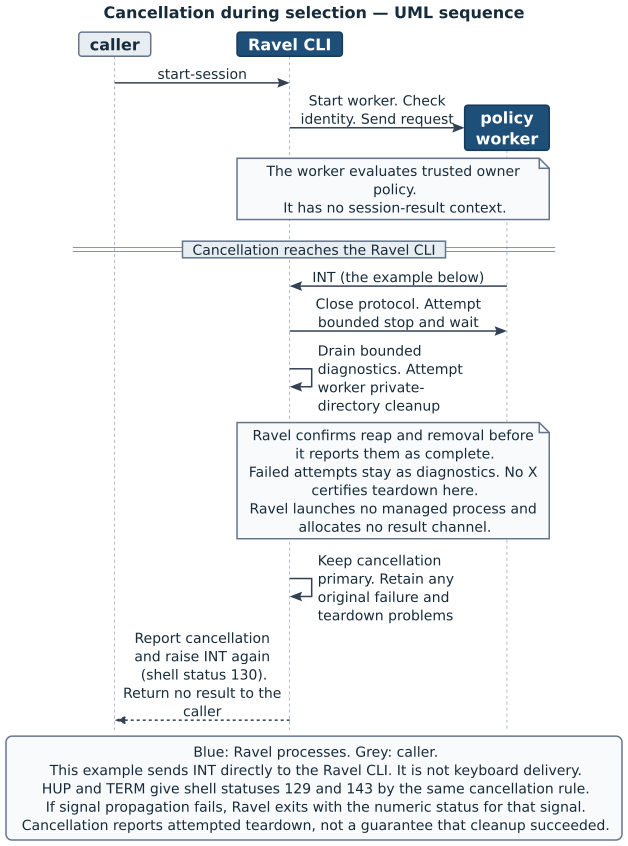
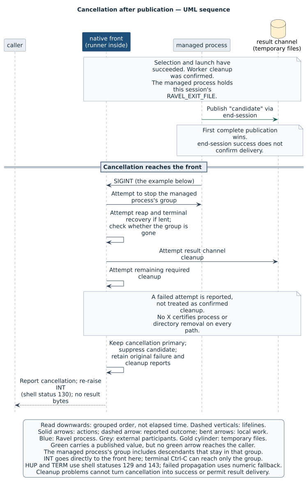
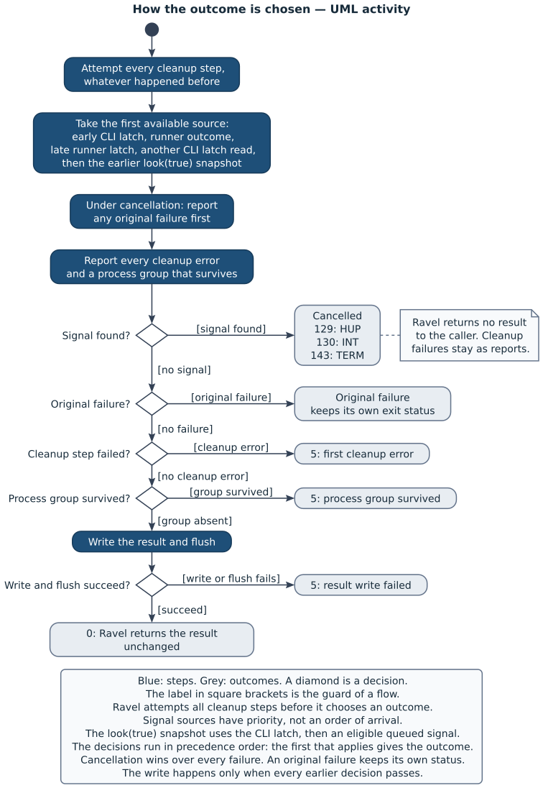

# Follow a session through the code

This chapter follows the [session](02-actors-and-words.md#caller-and-owner)
from chapter 3 through the code that returns `finished`.
The [Ravel CLI](02-actors-and-words.md#policy-evaluation-and-supervision)
coordinates the path. The [policy worker](02-actors-and-words.md#policy-evaluation-and-supervision)
evaluates the [owner policy](02-actors-and-words.md#caller-and-owner).
The [runner](02-actors-and-words.md#policy-evaluation-and-supervision)
controls the managed job inside the Ravel CLI process.

This chapter is an orientation to one path. It does not cover the complete
source. It omits the full
[policy-context](02-actors-and-words.md#three-different-kinds-of-information)
protocol, [confinement](02-actors-and-words.md#trust-and-confinement)
backends, platform system calls, test instruments and delivery code.
[Chapter 7](07-the-parts-of-ravel.md) explains the component boundaries.
Chapter 9, “Jobs, signals and the terminal”, explains the job-control details.

## Trace the example

The [first session in chapter 3](03-a-complete-session.md#run-the-first-session)
supplies `--kind demo`, `--config policy.ts` and a prompt argument.
The policy chooses `fake-agent` and passes the prompt as one argument.
The fake agent prints the prompt, calls `ravel end-session -- "finished"`, then exits.
No policy-context loader or confinement participates in this path.

The [caller](02-actors-and-words.md#caller-and-owner) receives `finished`
without a newline on standard output and status 0.
The fake's printed line and Ravel's diagnostics appear on standard error.
The example check runs the checkout build in a scratch directory, with private
directories and a cleared environment. It has no terminal, so it does not demonstrate
terminal handover or recovery.

The table gives the whole path before the individual decisions.
Paths below are relative to the checkout root.

| Step | Code location | What passes to the next step |
|---|---|---|
| Parse the command | `crates/ravel/src/main.rs`, `main` | `RunArgs` for `run::run` |
| Check inputs and policy path | `crates/ravel/src/choice.rs`, `prepare` | `Prepared`, with inputs and the policy entry |
| Evaluate and check the policy | `choice::choose_prepared`, `worker::evaluate` | A checked command after worker cleanup |
| Find the program | `crates/ravel/src/program.rs`, `resolve` | The executable path and original program name |
| Prepare output and channel | `crates/ravel/src/run.rs`, `run` | A `Launch` with arguments and its own result channel |
| Launch and supervise | `crates/keyed-launch/src/run.rs` | `Ended`, after reap and terminal recovery, with group state |
| Check the result | `crates/ravel/src/completion.rs`, `result_after` | The result from that launch |
| Complete cleanup and decide | `run`, `Handlers::finalise`, `settle` | A result that can reach the final write |
| Return the result | `run`, then `main` | Unchanged output, then status 0 if the write and flush succeed |

During supervision, the
[managed process](02-actors-and-words.md#the-managed-process-and-its-result)
starts a second `ravel` process for `end-session`. That process sends the
[opaque result](02-actors-and-words.md#the-managed-process-and-its-result)
through the [result channel](02-actors-and-words.md#the-managed-process-and-its-result).
It does not return the result to the original caller or wait for job cleanup.

## Prepare the request

`main` in `crates/ravel/src/main.rs` parses the arguments with
`Cli::try_parse_from`. The definitions in `crates/ravel/src/cli.rs` distinguish
`StartSession` from `EndSession`.
For `start-session`, `main` calls `run::run`. For `end-session`, it calls
`completion::end_session` directly, without policy evaluation.

`run` checks the saved entry signal state and installs the cancellation
handlers with `handlers.begin()`.
These handlers retain a signal that arrives during selection.
Next, `choice::prepare` reads the settings, prepares the inputs and resolves
the policy path. The order matters: settings supply defaults that input
validation needs before the worker exists.

Excerpt from `crates/ravel/src/choice.rs`: these first statements of
`prepare` establish the inputs and the policy entry.

```rust
    let home = std::env::var_os("HOME");
    let settings = Settings::read(home.as_deref())?;
    let inputs = Inputs::read(args, &settings)?;
    let entry = authority::resolve(args.config.as_deref(), &inputs.cwd, home.as_deref())?;
```

`Prepared` holds these checked inputs and the entry. It contains no policy
decision. In the example, `authority::resolve` resolves `policy.ts` relative
to the caller's working directory. It requires a readable regular file and
a real path that the worker can import exactly.
It does not search for another policy when this path fails.

The prompt remains caller data. The request that `choice::request` constructs
contains the unchanged prompt, the
[kind](02-actors-and-words.md#caller-and-owner), the working directory, parameters
and effective limits. Ravel does not append instructions to end the session.
The example's policy chooses to pass the prompt to the fake.

## Evaluate and check the policy

`choice::choose_prepared` locates the worker that matches the CLI, then calls
`evaluate_and_resolve`. That function calls `worker::evaluate` with the
request and a callback, `choice::judge`, that checks the worker's responses.
The Rust code of the Ravel CLI owns the checks. The TypeScript worker executes
the policy.

The code in `crates/ravel/src/worker.rs` is the worker coordinator.
Its function `worker::evaluate` creates the worker's
private directory and socket. It starts the worker with a restricted
environment, null standard input and separate pipes for diagnostics.
The worker receives no
[session-result context](02-actors-and-words.md#three-different-kinds-of-information).
The selection protocol does not use its standard output.

The exchange has these steps in the example:

| Order | Actor and function | Action |
|---|---|---|
| 1 | Worker, `crates/ravel/worker/src/main.ts` | Changes its working directory to `/`, registers embedded modules and sends `hello` |
| 2 | Rust, `worker::converse` | Checks the worker identity, then sends the policy path and request |
| 3 | Worker, `converse` via `load` | Imports the policy and sends its description |
| 4 | Rust, `choice::judge` | Checks that description, then requests selection |
| 5 | Worker, `converse` via `select` | Calls the policy's `select` and sends its returned value |
| 6 | Rust, `choice::judge` | Checks the selected command with `policy::selected` |
| 7 | Rust, `worker::evaluate` | Closes the socket, ends and reaps the worker, collects diagnostics and removes its private directory |

The example has no [policy context](02-actors-and-words.md#three-different-kinds-of-information).
Thus, `judge` skips the optional policy-context exchange.
The worker supplies `undefined` as the policy's context argument.
The policy returns `fake-agent` with the prompt in its argument array.

`worker::evaluate` returns success only after confirmed worker reap and
successful required cleanup. A valid command alone does not permit launch.
The runner cannot enforce this order because it has no worker to inspect.
The Ravel CLI enforces it before the runner call.

After that return, `evaluate_and_resolve` checks cancellation and calls
`program::resolve`. In the example, it searches the caller's `PATH` for `fake-agent`.
The example's `bin` directory supplies that executable.
The `Choice` retains both the selected command and the executable
path. The command's labels supply text for the routing notice. Ravel does not
use them to integrate with a model.

## Prepare the managed launch

`run` first calls `ResultOutput::reserve`. This function checks that standard
output is writable, saves its descriptor, then redirects standard output to
standard error. The saved descriptor does not pass through exec to the managed process.
This arrangement keeps the fake's diagnostics separate from the result.

Next, `SessionChannel::allocate` creates a fresh temporary directory and
channel path. It retains an open directory descriptor for the later read.
Allocation creates no result file. The channel belongs to this launch alone.

`run` builds the argument vector from the checked command.
The excerpt shows the difference between the executable path and the
original program name, which becomes argument zero.

Excerpt from `crates/ravel/src/run.rs`: the argument vector uses the
resolved path and each argument that the policy supplied.

```rust
        let argv = Argv::new(
            OsString::from(&choice.executable.path),
            choice.command.args.iter().map(OsString::from).collect(),
        )
        .with_arg0(OsString::from(&choice.executable.program));
```

Ravel performs no shell expansion or word splitting.
The prompt remains one argument. The fake's shebang selects its shell
interpreter, as chapter 3 explains.

The `Launch` holds this argument vector, the channel, environment changes,
entry signal state and escalation times.
For this unconfined path, `run` calls
`keyed_launch::run_observed_with_start_check`.
The runner removes the inherited variables that name a result destination,
applies the environment grants, then sets the new `RAVEL_EXIT_FILE` last.
Thus, a nested session gives its own child a fresh destination.
The unconfined child otherwise inherits the caller's environment and working
directory.

In `crates/keyed-launch/src/run.rs`, `run_with_output` creates the process
group and spawns the command. If Ravel owns the foreground, the child takes
the terminal during spawn, before exec.
After spawn, `run_with_output` calls `supervise_started`.
The `Started` event records spawn-reported success, not proof of exec.
The Ravel CLI's start check restores its entry signal mask before ordinary
supervision continues. The parent can also lend the terminal during `watch`,
after that check, when Ravel owns the foreground.

## Send the result

The fake calls `ravel end-session -- "finished"`.
In this second Ravel process, `main` calls `end_session` in
`crates/ravel/src/completion.rs`. That function reads `RAVEL_EXIT_FILE` and
passes the path and result to `publish_result`.
The function name retains the source's terminology. Its action is to send
one value to the enclosing session.

`publish_result` checks the byte bound and the parent directory, then writes
the value into a temporary file in that directory.
It adds the completion name only after the write and flush succeed.

Excerpt from `crates/ravel/src/completion.rs`: the temporary file receives
the complete value before the completion name exists.

```rust
    let mut temporary = NamedTempFile::new_in(parent)?;
    temporary.write_all(result.as_bytes())?;
    temporary.flush()?;
```

The next operation, `fs::hard_link`, adds a name for that file.
It does not replace a name that already exists. This behaviour is the
first-result rule. Thus, the runner can observe only a complete file, never a
partly written value.

| Channel state | Effect of `end-session` |
|---|---|
| No completion name | Adds the name for the complete temporary file |
| A valid result already exists | Checks the prior result and leaves it unchanged |
| Missing or empty inherited path, stale directory, or invalid prior result | Reports failure |

An empty string is still a sent result. Newlines and Unicode remain in the
value. A second call cannot replace the first value, but it races with
shutdown and removal of the channel. It can therefore fail or never run.

The file operation requests completion. It does not signal the managed group
or perform the enclosing session's cleanup. The original Ravel process owns
those actions.

## Finish the managed job

`supervise_started` calls `supervise_reported`, which calls `watch`.
These functions are in `crates/keyed-launch/src/run.rs`.
`watch` checks cancellation, the child's state and channel appearance.
If the child continues after the result appears, `watch` applies the grace,
TERM and KILL stages from [chapter 3](03-a-complete-session.md#send-the-result-and-finish-the-job).

The example can exit before `watch` observes the file.
That path needs no result-triggered escalation.
`supervise_reported` checks channel appearance again when it constructs
`Ended`, after the job cleanup steps.
Thus, Ravel does not lose the result when the child exits quickly.

The final group stop precedes reap on the normal path through `watch`.

Excerpt from `crates/keyed-launch/src/run.rs`: after it observes the child's
exit, `watch` stops the group before it collects the child's exit status.

```rust
    child.bound(Instant::now() + ERROR_SETTLEMENT);
    child.kill_group();
    let reaped = child.reap();
```

The direct child's PID reserves the group's identity until reap.
The runner uses that interval to stop descendants that remain in the group.
After `watch` returns, `supervise_reported` recovers a lent terminal and
confirms whether the group is gone. It returns an `Ended` with separate
fields for the child status, cancellation, channel appearance and group state.

The Ravel CLI needs those separate facts. A later nonzero child status does
not invalidate a sent result. A group that remains, or a failed required
recovery, prevents success. Descendants that leave the group remain outside this
cleanup guarantee.

## Read the result

Back in `run`, `allocated.result_after(ending)` receives the `Ended` from
this channel's runner call. The association belongs to `run`: the Rust type
alone does not prove that an arbitrary `Ended` belongs to this channel.

`result_after` first checks the group and cancellation, then channel
appearance. It reads the contents only after those checks.

| Observation | Result of `result_after` |
|---|---|
| Group remains present | Error |
| Runner reports cancellation | Error |
| Runner observed no completion file | `None` |
| Valid empty completion file | `Some(String::new())` |
| Valid nonempty completion file | `Some(result)` |

`read_result` opens the file relative to the held directory descriptor with
`openat`. A replacement of the directory pathname cannot redirect this read.
The open refuses a final symlink and cannot block on a FIFO.
`read_regular` requires a regular file, enforces the byte bound and checks
UTF-8. These checks matter because the managed process can change files.

In the example, the value is `Some("finished")`.
`run` converts `None` to `session_result_missing`, even if the child's exit
status is zero. `result_after` returns candidate text to `run`, not to the
caller. Resource cleanup and the final cancellation decision still follow.

## Complete cleanup and write the result

After the runner returns, `run` writes the runner's operation reports.
Without `--json`, each report has the form `ravel: <report>` on standard
error. With `--json`, `operationReports` belongs to the selection notice.
An operation report does not alone decide success, as the
[macOS example in chapter 3](03-a-complete-session.md#run-the-first-session) explains.

`run` then attempts these operations in order:

| Order | Operation | Purpose |
|---|---|---|
| 1 | `handlers.restore_entry_mask()` | Restores the entry mask while handlers still protect the transition |
| 2 | `channel.close()` | Removes the result channel's temporary files |
| 3 | `confined.remove()`, when applicable | Removes the private confined workspace |
| 4 | `output.restore()` | Restores the caller's standard output |
| 5 | `handlers.finalise(runner_signal)` | Joins cancellation observations and completes signal transitions |
| 6 | `settle(...)` | Reports failures and decides whether the result can proceed |

The example has no confined workspace, so that cleanup contributes success
without a removal. The other operations still run.
Channel cleanup checks the directory's recorded identity before removal.
It does not delete a replacement directory. This pathname check is not an
atomic defence against concurrent changes by same-user code.

`settle` is the step that decides the end of supervision from the collected
result, cleanup outcomes, group state and cancellation.
It reports failures, gives cancellation priority and rejects unsuccessful
cleanup. It does not perform those cleanup operations itself.
On this successful path it returns `finished` to `run`.

Excerpt from `crates/ravel/src/run.rs`: only a successful `settle` reaches
this final write and flush.

```rust
    io::stdout()
        .write_all(result.as_bytes())
        .and_then(|()| io::stdout().flush())
        .map_err(|error| failed("result_write_failed", error))?;
    Ok(())
```

`main` converts this success to status 0.
Ravel writes the result unchanged and adds no newline.
A failed final write can leave only the start of the value on standard
output. The invocation then fails, so output bytes alone do not prove success.
Signals that arrive after the final cancellation decision can still stop
the Ravel CLI during output. The write is not atomic with that decision.

## Follow a refusal or launch failure

A failed choice prevents the call to the runner. The function that detects
the problem supplies its classification. The Rust type `Refusal` also carries
worker failures and timeouts, so its name alone does not identify a policy
[refusal](02-actors-and-words.md#policy-evaluation-and-supervision).

Suppose the example's policy returns `status: "refused"` instead of a command.
`choice::judge` passes that value to `policy::selected` in
`crates/ravel/src/policy.rs`. That function checks the refusal fields and
returns `policy_refused`, with the policy's own code beside it.
`worker::evaluate` then attempts worker teardown and private-directory cleanup.
It returns the failure to `choose_prepared`, so `run` never allocates the
result channel or launches the fake.
Ravel does not substitute another policy or command when selection fails.

The table locates the other forks. Its statuses describe isolated failures
without cancellation. The paragraphs after the table explain combined worker failures.
The [exit-status table](06-reference.md#exit-statuses) gives their meaning to
the caller.

| Problem | Decision in the code | Status and point of failure |
|---|---|---|
| Missing or unreadable policy file | `authority::resolve` | 3, before worker evaluation |
| Policy import, shape or policy context fails | `choice::judge`, `Validator::validate`, `choice::deliver` | 3, before executable lookup |
| Policy refuses, throws, abstains or returns malformed selection data | `policy::selected` | 3, before executable lookup |
| Policy data or diagnostic output exceeds a bound | Policy and policy-context validators, or `worker::evaluate` | 3, before executable lookup |
| Selection deadline expires | `worker::expired` | 124, before executable lookup |
| Worker cannot start, has the wrong identity, or fails its protocol | Worker coordinator in `crates/ravel/src/worker.rs` | 5, before managed launch |
| Worker conversation succeeds, but required teardown fails | `worker::evaluate` | 5, before managed launch |
| Selected program is absent | `program::resolve` | 127, before runner invocation |
| Selected file cannot execute, with no usable PATH candidate | `program::resolve` | 126, before runner invocation |

The deadline covers worker startup and the policy exchange. A timeout can
therefore occur before the worker receives the policy. It is not the policy's
decision to refuse. A valid policy answer also cannot override an unconfirmed
worker reap or failed required cleanup. The evaluator retains the original
failure, worker operation reports and separately captured policy output.

`worker::evaluate` also decides between combined failures.
A diagnostic-output overflow takes priority over the conversation failure,
which remains in the report. Otherwise, a conversation failure keeps its
classification when teardown fails too. For example, a policy refusal keeps
3, and a timeout keeps 124. Teardown alone changes a successful conversation
to worker failure, status 5.

The executable check does not guarantee that a later spawn succeeds.
For example, a script can pass the file checks but name a missing interpreter.
`run::supervision_failure` classifies the runner error from `started` and the
OS error number. The `Started` event sets `started`.

Excerpt from `crates/ravel/src/run.rs`: `supervision_failure` chooses a
status before it constructs the diagnostic.

```rust
    let exit = if started {
        EXIT_WORKER
    } else if errno == Some(libc::ENOENT) {
        127
    } else {
        126
    };
```

`EXIT_WORKER` is 5. After `Started`, a supervision error keeps that status.
Before `Started`, `ENOENT` gives 127 and another launch error gives 126.
The event records spawn success, so it does not prove that exec succeeded.
The conversion also retains a signal that the runner consumed, for the final
cancellation decision.

Requested [confinement](05-running-sessions.md#confine-the-managed-process)
has its own preparation in `Confined::prepare`, before selection.
An unavailable backend or invalid grant stops that path.
After successful preparation, `run` calls the confined runner entry.
It does not retry a failed confined launch without confinement.

These failures leave the main closure in `run`, then reach its common cleanup
and final decision. An allocator that fails partway through directory setup
attempts its own cleanup before it returns the error.
`run` handles resources that the allocator successfully returned.
Thus, even a failure without an `Ended` value has cleanup work to complete.

## Follow cancellation

Cancellation can reach the Ravel CLI during selection, supervision or final
cleanup. The cancellation handlers retain INT, TERM and HUP observations.
A **latch** is the saved signal number. It lets ordinary code attempt cleanup
before the CLI propagates the signal.

During selection, the worker coordinator observes the CLI latch and attempts
to stop and reap the worker. It collects diagnostics and attempts directory
cleanup before it returns. `choose_prepared` checks the latch again before
it returns a successful `Selected`. Its error path uses `overruled` to retain
an earlier failure when cancellation takes priority.



[Open the selection cancellation sequence at full size](figures/selection-cancellation.svg).
This is the direct-signal example from
[chapter 5](05-running-sessions.md#cancel-during-selection-or-supervision).
It does not represent terminal Ctrl-C delivery.

The next check sits immediately before the managed launch.
`run` calls `handlers.try_block_and_check()` after output reservation and
channel allocation. A signal found here prevents the runner call.
The common cleanup still closes the channel and restores output.

During supervision, runner `watch` checks its own latch before it accepts
even an already-exited child. For an unconfined job, it forwards the signal
to the managed group, then escalates if needed. For a confined job, it
attempts KILL immediately. It retains the first signal that it consumes through the wait, reap and
recovery operations that follow.

Two runner outcomes carry cancellation to `run`:

| Runner returns | Where `run` obtains the signal | What the value does not establish |
|---|---|---|
| `Ended` with `End::Interrupted` | The `signal` field of that end | Permission to return a result |
| `LaunchError` | `consumed_signal()`, through `supervision_failure` | Confirmed reap, group absence or an `Ended` value |

A result sent before cancellation remains only a candidate.
`SessionChannel::result_after` rejects an interrupted end, even when the file
exists. A later signal can also reach the CLI after that check.
`Handlers::finalise` collects that observation before `settle` decides the
outcome.



[Open the supervision cancellation sequence at full size](figures/supervision-cancellation.svg).
The figure reuses chapter 5's example. Its cleanup arrows are attempts,
not confirmation that every operation succeeds.

After the final decision, `main::report_failure` reports cancellation and
calls `cancellation::reraise`. That function restores the selected signal's
default action, unblocks it and raises it. If propagation fails, it reports
the problem and exits with the numeric signal status.
The shell statuses are 130 for INT, 143 for TERM and 129 for HUP.
Chapter 9 explains entry masks, terminal delivery and the limits of cleanup.

## Choose the final outcome

`Handlers::finalise` and `run::settle` make different decisions.
The first selects the cancellation observation and completes signal
transitions. The second chooses whether cancellation, a failure or a result
reaches the caller.

`finalise` restores the entry mask while handlers still protect the
transition. It then attempts to block the handled signals and inspect those
that are queued. Only after that block attempt does it consume the late
runner latch. Otherwise a signal could reach that latch between a read and
the block, and neither read would find it.

Excerpt from `crates/ravel/src/cancellation.rs`: `Handlers::finalise`
chooses the first available observation in this expression.

```rust
        let signal = front.or(outcome).or(late).or(received()).or(pending);
```

This expression gives an order of sources. It does not compare signal
arrival times.
The variables have these meanings:

| Expression | Observation |
|---|---|
| `front` | CLI latch before and immediately after entry-mask restoration |
| `outcome` | Signal retained by the runner's end or error |
| `late` | Runner latch consumed after the final block attempt |
| `received()` | Another read of the CLI latch |
| `pending` | Observation from `look(true)`: CLI latch first, then an eligible queued signal |

For queued signals, `look` excludes signals blocked or ignored at entry.
It checks INT, TERM, then HUP. Signal-operation failures become reports,
not an invented cancellation or proof that no signal exists.
`finalise` returns the selected signal and those reports to `run`.
The helper named `join_cancellation` in `run.rs` is test-only.
It is not the production decision shown above.

`run` supplies `settle` with the candidate result or original failure,
the optional `Ended`, all cleanup outcomes and the selected signal.
It orders cleanup outcomes as mask restoration, channel removal, confined
directory removal, output restoration, then final signal-operation reports.
`settle` reports every supplied cleanup error and any group that survives.
When cancellation overrides an original failure, it reports that failure too.



[Open the outcome-precedence activity at full size](figures/outcome-precedence.svg).
The figure shows the order of decisions after required cleanup attempts.
The source excerpt and table above expand its signal step, with the
second CLI latch read.

The primary outcome follows this order:

| First applicable condition | Decision |
|---|---|
| Cancellation observation exists | `session_cancelled`, no result, selected signal |
| Original operation failed | Keep that failure and its status |
| Otherwise, a cleanup failed | First cleanup error, status 5 |
| Otherwise, an `Ended` reports a group that survives | `process_group_survived`, status 5 |
| None of these conditions applies | Return the candidate result to `run` for output |

Excerpt from `crates/ravel/src/run.rs`: after its cancellation branch,
`settle` preserves an original error before it selects a cleanup error.

```rust
    let result = result?;
    if let Some(error) = cleanups.into_iter().find_map(Result::err) {
        return Err(error.into());
    }
```

For example, `session_result_missing` plus a channel cleanup error keeps
status 1 and reports the cleanup problem. If INT also reaches the final
decision, cancellation wins and both failures remain diagnostics.
When an `Ended` reports a group that survives, `result_after` fails first.
Thus, the original failure is already `session_result_invalid`.
The final group branch in `settle` still prevents success independently.

Only a successful `settle` reaches the result write. A write or flush failure
then gives `result_write_failed`, status 5. A later signal can still stop
the CLI during output, and a failed write can leave a partial value.
The [caller accepts a result only after success](05-running-sessions.md#accept-a-result-only-after-success).
The final decision and the output write are not one atomic operation.

## Find where a change belongs

Suppose you change how Ravel stores a sent result, while the CLI behaviour
stays the same. Start with `crates/ravel/src/completion.rs`.
It owns allocation, the first complete value, validated reads and explicit
channel removal. A change there also needs checks at its two consumers, the runner and `run`.

| Boundary to inspect | Property the change preserves |
|---|---|
| `publish_result` and `SessionChannel` in `completion.rs` | Ravel keeps the first complete value, empty differs from absent, and UTF-8 text stays unchanged |
| `Channel::appeared` in `crates/keyed-launch/src/channel.rs` | Appearance alone tells the runner when to start completion, without a content read |
| `Launch.channel` and `Ended` in the runner | The launch uses its own channel and reports job state separately from appearance |
| `run` in `crates/ravel/src/run.rs` | A fresh session-result context for each launch, a channel and an `Ended` from the same launch, explicit cleanup and the final precedence |

The completion name currently appears only after the complete write.
A replacement mechanism that exposes a partly written value would break
that agreement with the runner. Empty results also need a positive completion
event, because zero bytes do not mean that no result exists.

`SessionChannel::result_after` accepts an `Ended` reference.
Its type cannot establish that this end belongs to this channel.
`run` establishes the association: it passes its allocated channel to the
runner, then passes that runner's end to `result_after`.
A storage change preserves this association as well as file contents.

For this change, exercise the result channel with empty, multiline and Unicode
values, repeated sends, invalid files and nested sessions.
Then exercise cancellation after a sent result, result failure plus cleanup
failure, and cancellation plus cleanup failure. A status check alone cannot
show that the original failure and every cleanup report survived.

The owner policy's choice of program does not depend on the result's storage
representation. Its behaviour can stay unchanged for this scenario.
The source boundaries above explain where to inspect and test a change.
They do not establish a supported public component interface.
