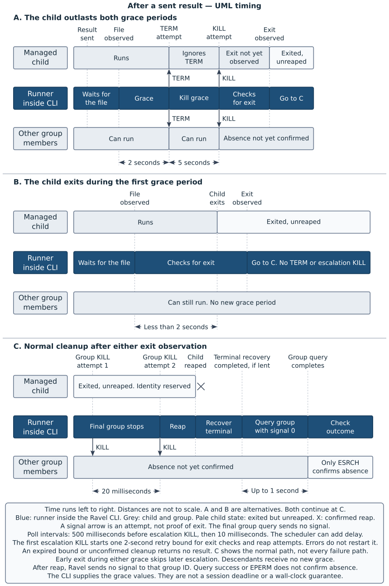
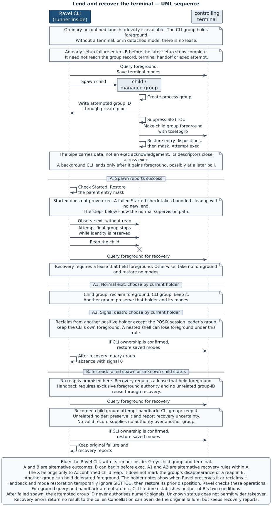

# Jobs, signals and the terminal

A [result](02-actors-and-words.md#the-managed-process-and-its-result) requests the end of a job. It does not prove that the job has ended.
The [Ravel CLI](02-actors-and-words.md#policy-evaluation-and-supervision) stays alive to supervise that end
before it returns the result to the [caller](02-actors-and-words.md#caller-and-owner).
The [runner](07-the-parts-of-ravel.md#the-runner-owns-the-local-job-mechanics)
inside the CLI supplies the process and terminal operations.

[Chapter 3](03-a-complete-session.md#send-the-result-and-finish-the-job)
introduced a job and its reap through one [session](02-actors-and-words.md#caller-and-owner). This chapter explains
why the order matters, how Ravel ends a process that does not exit, and what [confinement](02-actors-and-words.md#trust-and-confinement)
changes. It also explains terminal recovery, entry signals and the limits of
these guarantees. [Chapter 8](08-follow-a-session-through-the-code.md#finish-the-managed-job)
shows where these operations occur in the code.

## The managed process leads a job

The [managed process](02-actors-and-words.md#the-managed-process-and-its-result)
is the direct child that Ravel starts from the selected command.
For an ordinary unconfined launch, Ravel creates a new **process group** for
that child. The group's ID is the child's PID. Descendants inherit this group
unless they explicitly change it. The managed process and the members of its
group form the **job**.

A signal to a process group can reach its members together. A signal to the
child's PID reaches only that child. If Ravel stopped only the child, a helper
could keep a file lock or continue to change the caller's files.
The group gives Ravel a scope for shutdown that includes ordinary descendants.

A **POSIX session** can contain several process groups and can have a
controlling terminal. An ordinary unconfined launch keeps the caller's POSIX
session. Thus, Ravel can give the terminal's foreground to the new group.
The terminal rules select which group can read terminal input and receive
signals from the keyboard.

| Choice for the managed launch | Consequence |
|---|---|
| A new process group in the caller's POSIX session | Ravel can signal the job together and can lend the caller's terminal |
| A new POSIX session through `setsid` | The child starts without the caller's controlling terminal. This suits the detached modes below |
| Only the child's PID as the shutdown target | Descendants can survive their parent. This does not meet Ravel's cleanup contract |

A descendant can leave the job's group, for example through its own
`setsid` call. Group cleanup does not cover that descendant. Ravel does not
promise to track every process descended from the managed process.
A new process group also creates no new Ravel
[session](02-actors-and-words.md#caller-and-owner): that term means one
`start-session` invocation.

## Follow the escalation after a result

An interactive [harness](02-actors-and-words.md#the-managed-process-and-its-result)
can finish its work and then wait for another prompt.
The caller therefore tells it to send an
[opaque result](02-actors-and-words.md#the-managed-process-and-its-result)
with `end-session`. The command creates the completion file in the
[result channel](07-the-parts-of-ravel.md#the-result-channel-carries-the-value).
The runner observes that file's presence. Ravel checks its contents separately.

A signal name such as SIGTERM has the prefix SIG. This chapter writes INT, TERM,
HUP and KILL without that prefix, as the shell `trap` command does. Other signals
keep their full names.

Until it sends KILL, the runner checks the child and channel at 500-millisecond
intervals. Its first observation of the file starts the grace period. Thus, the
schedule starts at observation, not at the instant the sender calls `end-session`.

| Stage | Condition | Action and wait |
|---|---|---|
| Grace | The runner observes the completion file while the child still runs | Allow 2 seconds for the child to exit |
| TERM | The child still runs after the grace | Send TERM to the group and the child. Allow up to 5 seconds for the child to exit |
| KILL | The child still runs after the kill grace | Send KILL to the group and the child. Check for exit at 10-millisecond intervals |
| Final cleanup | The runner observes the child's exit | Stop the other group members before the reap, then recover the terminal and confirm group absence |

The figure separates the grace periods from final cleanup. Both exit paths
reach the group stops before reap, then the terminal recovery and group query.



[Open the escalation figure at full size.](figures/escalation-timing.svg)

TERM lets the program handle its own shutdown. A program can ignore TERM.
It cannot catch or ignore KILL. If the child exits during either grace period,
Ravel proceeds to final cleanup without the later escalation stages.
Descendants receive no separate grace period after the child exits.

The 2-second and 5-second values belong to the Ravel CLI. The runner accepts
its caller's durations. These values are not a seven-second deadline for
`start-session`: selection, observation delays and final cleanup also take time.
Without a result or cancellation, this escalation places no time limit on the
managed process.

After the escalation's first KILL attempt, the runner uses a two-second bound
for its exit checks and reap attempts. It does not restart that bound after
an error. If the bound expires, the runner reports unresolved ownership, and
Ravel returns no result to the caller.
This bound limits retries. It cannot guarantee a wall-clock deadline when the
scheduler or a kernel operation stalls.

## Run a fake that ignores TERM

Use the Ravel installation from
[chapter 3](03-a-complete-session.md#install-ravel-and-check-its-version).
Create an empty directory, make it the current directory, and create `bin`
inside it. Save these files at the labelled paths.

The fake ignores TERM before it sends the result. It then stays alive.
Ravel's escalation must reach KILL to end it. The command uses an empty private
HOME, an explicit policy and a cleared environment.

Complete example: a fake sends a result and then ignores TERM.

**`policy.ts`**

```ts
import { definePolicy } from "ravel/sdk";

export const policy = definePolicy({
  schemaVersion: 2,
  version: "job-escalation",
  select() {
    return {
      status: "selected",
      program: "fake-agent",
      args: [],
      provider: "local",
      model: "fake",
      effort: "none",
      reason: "Observe the end of a job without a model service.",
    };
  },
});
```

**`bin/fake-agent`**

```sh
#!/bin/sh
set -eu
trap '' TERM
ravel end-session -- "finished"
while :; do
  sleep 0.05
done
```

**Command**

```console
$ mkdir -p home tmp && chmod +x bin/fake-agent && env -i HOME="$PWD/home" TMPDIR="$PWD/tmp" PATH="$PWD/bin:$PATH" ravel start-session --kind demo --config policy.ts --prompt 'Send finished, then wait.'
```

**Standard output, without a final newline**

```text
finished
```

**Exit status**

```text
0
```

Ravel returns `finished` only after the job ends. The child's death
from KILL does not invalidate its result. This transcript claims the result
bytes and exit status, not an exact duration or a fixed standard-error stream.
The automatic example check has no terminal and uses no real harness.

## Stop the group before the reap

A process can exit before its parent collects its status. Until that
collection, it remains a **zombie**: the system retains its identity and exit
status, although it executes no more code. To **reap** the child, the parent
collects that status and releases the retained process identity.

Ravel first observes exit without a reap. Its `waitid` call uses `WNOWAIT`
for that purpose. The unreaped child reserves its PID, which is also the
job's group ID. Ravel uses that reservation for the last group signals.

If Ravel reaped first, the system could reuse the ID for an unrelated group.
A later KILL to that number could then reach that unrelated group.
The normal cleanup path therefore has this order:

| Step | Operation | What it establishes |
|---|---|---|
| 1 | Observe the child's exit with `waitid` and `WNOWAIT` | The child has exited, but still reserves its identity. A stop is not an exit |
| 2 | Send KILL to its group twice, with a 20-millisecond pause | Attempt to stop the other members while the identity remains reserved |
| 3 | Reap the direct child with `waitpid` | Confirm the child's status and release its identity |
| 4 | Recover the terminal if Ravel lent it | Check foreground recovery and restore the saved modes |
| 5 | Query the group without a signal, for up to one second | Confirm absence only when the system returns `ESRCH`, meaning no such process group |

The second KILL addresses a macOS case where a fork overlaps the first group
signal and leaves a new member. Both attempts precede the reap.
They do not change the direct child's status: it has already exited.
Ravel reaps its direct child. Other descendants' parents, or the system,
reap those descendants.

A successful signal operation does not prove that the group is gone.
The final query uses `kill` with signal 0, which sends no signal.
Success or `EPERM` means that absence remains unconfirmed. An unrelated group
that reuses the ID also prevents confirmation. Ravel does not signal that
number after the reap.

On macOS, a group with only zombies can reject KILL with `EPERM`, or
`Operation not permitted`. Ravel can retain this stop report without a
session failure, but only after confirmed reap, successful terminal recovery
and an `ESRCH` absence check. The report alone never confirms cleanup.
Ravel writes retained reports as `ravel:` lines on standard error, or in
`operationReports` with `--json`.

If the group still answers the query with success or `EPERM` after the confirmation wait, Ravel reports it and
returns no result to the caller. A query error also prevents success.
On an observation or reap error, Ravel attempts bounded cleanup and reports
what it cannot confirm. Once it loses or releases the child identity, it
stops all numeric signal attempts. After a timeout, it never reports a reap
that did not occur.

## Handle cancellation

Cancellation differs from a sent result. INT, TERM or HUP received by the
Ravel CLI suppresses the result, even if the managed process already sent it.
The runner checks for cancellation before it accepts an observed child exit.
The CLI also checks signals around supervision and final cleanup.

| Where cancellation occurs | Process action | Result |
|---|---|---|
| During policy selection | Stop and wait for the [policy worker](02-actors-and-words.md#policy-evaluation-and-supervision). Do not start the managed process | Return no result to the caller |
| During unconfined supervision | Forward the signal to the group and the direct child. If the child still runs after the kill grace, send KILL | Complete cleanup attempts, report cancellation, and return no result |
| During confined supervision | Attempt KILL immediately on the group and the direct child | Complete cleanup attempts, report cancellation, and return no result |

For unconfined supervision, cancellation skips the result's initial grace.
If the kill grace has already begun, cancellation does not restart it.
A child of the runner's `run_noninteractive` interface, described in the next
section, can itself supervise another process. The forwarded signal and kill
grace let that supervisor attempt its own cleanup.
A confined job receives KILL immediately so that its shutdown can fit within
an outer supervisor's grace.

The two [cancellation sequences in chapter 5](05-running-sessions.md#cancel-during-selection-or-supervision)
show the selection and supervision cases, with complete fake-program examples.
They do not show confined cancellation, which attempts KILL immediately.
[Chapter 8](08-follow-a-session-through-the-code.md#choose-the-final-outcome)
explains which signal and diagnostic Ravel reports when failures overlap.
A cleanup failure stays visible beside cancellation. It does not permit a
previously sent result to reach standard output.

## Separate noninteractive execution from confinement

The runner has a separate `run_noninteractive` interface. It starts a new
POSIX session, supplies end-of-file (EOF) on standard input, and closes inherited
descriptors above standard error at exec. Both output streams go to a regular
file that its caller supplies. It has no completion channel, so only child
exit or cancellation ends the launch.

This interface isolates process control. It does not restrict filesystem
access. It is also different from an ordinary `start-session` invocation
that runs without a terminal.

| Mode | POSIX session and input | Output and completion |
|---|---|---|
| Ordinary unconfined `start-session` | A new process group in the caller's POSIX session. Inherited input, with terminal access when available | Managed output goes to the caller's standard error. A result can request shutdown |
| Runner `run_noninteractive` | A new POSIX session, no inherited controlling terminal, EOF input, no inherited descriptors above 2 after exec | Both streams go to the supplied regular file. No completion channel |
| Confined `start-session` | A new POSIX session with the same input and descriptor isolation | Managed output goes to standard error. The private result channel remains available |

A new POSIX session removes the inherited controlling terminal relationship.
It does not restrict file access, and a descendant can still move to another
group. The confinement backend supplies filesystem restrictions separately.
These distinctions explain why the runner hides process mechanics behind
separate launch interfaces, while the CLI owns policy and result decisions.

## Apply filesystem confinement

[Confinement](02-actors-and-words.md#trust-and-confinement) restricts the managed
process and its descendants. It does not restrict the trusted
[owner policy](02-actors-and-words.md#caller-and-owner) or its
[policy worker](02-actors-and-words.md#policy-evaluation-and-supervision).
The CLI checks the grants and probes the backend before policy selection.
If the backend is absent or cannot establish its restrictions, the invocation
stops with `confinement_unusable` and status 2.
There is no unconfined fallback.

| Resource | Access for a confined managed process |
|---|---|
| Canonical working directory and private run directory | Read and write |
| An explicit `--exit-dir` | Read and write to that channel parent directory |
| Selected executable and the real Ravel executable | Read and execute |
| Each regular file named with `--runtime-read` | Read only, even under a writable directory |
| System runtime resources | Reads from the backend's platform list, such as system programs, libraries and certificate files |
| Other file contents | No grant. File metadata can remain visible on macOS |

Ravel rejects canonical grants that overlap the policy directory or owner
settings. A runtime grant names one regular file, not a directory.
The environment starts empty. Ravel adds HOME, USER, LOGNAME, PATH, LANG and
LC_* values, private temporary-directory values, and this launch's result path.
HOME's presence does not grant access to all files under it.

On macOS, `/usr/bin/sandbox-exec` applies a Seatbelt profile. Descendants
inherit the restrictions. The profile allows the declared writable roots,
read-only runtime files and system reads. It also allows network access.
The system reads include `/opt/homebrew/Cellar`, so confinement is not a claim
that only explicitly named runtime files are readable.

On Linux, bubblewrap starts from an empty mount namespace: a filesystem view
with only the mounts the backend supplies. Ravel adds system read-only mounts,
writable roots and explicit read-only file mounts. It supplies private `/proc`
and `/dev` views and makes their mounts read-only.
Bubblewrap also uses user, PID, IPC and UTS namespaces. These separate user
identity, process IDs, interprocess communication and hostname state.
Ravel does not request a network namespace, so confinement does not disable
network access.

The runner calls `setsid` before the backend executes. The confined launch
needs no terminal handoff, and its new POSIX session avoids the caller's
controlling terminal. On Linux, the selected program stays in the process
group of bubblewrap's monitor process. Thus, ordinary descendants remain within
the cleanup scope.

[Chapter 5's confinement example](05-running-sessions.md#confine-the-managed-process)
demonstrates a minimal confined result send. That section also explains
writable roots, read-only grants and errors that stop a launch through the CLI.
The runner tests add direct process checks:

| Test source under `crates/keyed-launch/tests/` | What it checks |
|---|---|
| `launch.rs` | Grace and KILL branches, ordinary descendants gone on return, and an unrelated process left untouched |
| `internal/wait_events.rs` | Cleanup order, a reported survivor, and cancellation across wait failures through a private process substitute |
| `noninteractive.rs` | EOF input, descriptor isolation, a new POSIX session, forwarded cancellation, and immediate confined cancellation |
| `confinement.rs` | Denied file reads and writes through a child and descendant, denied symlink access, and read-only runtime files |
| `job.rs` | Terminal foreground and mode behaviour through pseudo-terminals |

A selection of these process, isolation and Seatbelt tests passed on
aarch64 macOS on 18 October 2026. A macOS run does not execute the Linux bubblewrap backend.
The tests check named operations and process shapes. They do not establish
containment against every same-user attack or cleanup of a descendant that
leaves the job's group. They also do not qualify a native x86-64 Linux host.

## Lend and recover the terminal

A **controlling terminal** belongs to a POSIX session. It has one
**foreground process group** at a time. That group can read terminal input.
With the default terminal modes, Ctrl-C sends INT to that group.
A background group's attempt to read can instead stop it with SIGTTIN.

The runner opens `/dev/tty`, which names its controlling terminal.
Redirected standard input does not remove that relationship. If the open
fails, the runner proceeds without terminal job control. Detached modes do
not open the terminal at all.

An open terminal alone permits no handoff. The runner queries its foreground
group with `tcgetpgrp` and lends it only when the runner's own group holds it.
A Ravel CLI that starts in the background takes no foreground for itself.
A shell can later give the foreground to the CLI's group, for example with
`fg`. Then a later supervision poll can lend the terminal to the managed group.

Before the first handoff, the runner saves the terminal attributes with
`tcgetattr`. These **terminal modes** control such behaviour as character
echo, line input and keyboard signals. An interactive program can change them
to receive individual characters without echo. If KILL ends that program,
the program cannot restore the modes itself.

The ordinary foreground launch follows these steps:

| Step | Owner and operation | Purpose |
|---|---|---|
| Save | The runner retains a terminal descriptor, foreground ownership and the current modes in a terminal lease | Keep the recovery information alive through spawn and supervision |
| Record | The child enters its new group and writes that group ID to a private pipe | Tell the parent which group can take the terminal, even if exec fails |
| Lend | Before exec, the child calls `tcsetpgrp` to make its group foreground | Complete the handoff before the program's first terminal read |
| Supervise | The runner observes the child and performs any required group stops before reap | Retain the group identity for those signals |
| Recover | After reap, the runner applies the holder rules below and checks the terminal again | Restore saved modes only when the runner's group owns foreground |

The sequence shows why the terminal lease survives the exec attempt.
Its recovery branches depend on the child outcome and the current foreground holder.



[Open the terminal sequence at full size.](figures/terminal-lending-recovery.svg)

A background group can receive SIGTTOU when it changes terminal foreground.
The runner therefore temporarily ignores SIGTTOU for the **handback** (the
return of foreground to the runner's group) and for mode restoration. Then it
restores its previous disposition. It checks both the
terminal operation and that restoration. The child also suppresses SIGTTOU
for its handoff before it restores its entry signal state.

The lease remembers whether this launch ever held foreground. If it never
did, the runner takes no foreground and restores no modes.
For a lease that did hold foreground, the child's outcome changes the rule:

| Outcome and current holder | Foreground and mode action |
|---|---|
| The runner's group already holds foreground | Restore the saved modes |
| Normal child exit, with the child's group still foreground | Take foreground back, confirm it, then restore the modes |
| Normal child exit, with another group foreground | Preserve that holder and its modes |
| Known child death by signal | Reclaim from a positive foreground group other than the runner's group or the POSIX session leader's group. Restore modes only after confirmed ownership |
| Failed spawn or unknown child status, with the recorded child's group foreground | Attempt the conditional handback described below, then restore modes after confirmed ownership |
| Failed spawn or unknown child status, with an unrelated group foreground | Preserve it and report unconfirmed foreground and mode recovery |

The wider signal-death rule covers a managed supervisor that gives foreground
to another group, then dies without cleanup. Otherwise, that delegated group
could retain a raw terminal and continue to read input. The accepted cost is
that a nested job-control shell can lose its foreground after such a death.
Unknown child status does not permit this wider takeover.
The POSIX session leader is the process that created the terminal's POSIX
session.

Exec can fail after the child takes foreground. The parent therefore retains
the lease across a spawn error. The private pipe closes across exec and
provides an attempted-group record, not proof of exec or a live group.
If the record is missing or invalid, recovery is unconfirmed and Ravel reports it.
The runner never signals that recorded number after failed spawn.

Failed-spawn handback requires two conditions through recovery: no other
process or thread changes foreground, and no unrelated group reuses the
recorded ID. These conditions also apply to recovery from unknown status.
The foreground query and handback are separate operations. A one-session
CLI lifetime does not make them atomic or establish those conditions.

Ravel reports failures of foreground queries, handback, mode restoration and
temporary SIGTTOU restoration. After a recovery failure, Ravel returns no
result to the caller.
After failed spawn, the original spawn error stays primary unless cancellation
overrides it. Recovery reports remain visible beside that outcome.

The tests use a **pseudo-terminal**, or **PTY**, to observe these operations
without a human terminal. A PTY has two ends. The fixture uses one as its
controlling terminal, while the test controls input and reads output through
the other. Separate fixture processes keep terminal and signal changes out of
the test runner itself.

| Test source | Observed distinction |
|---|---|
| `crates/keyed-launch/tests/job.rs` | A raw-mode child actually changes the modes before KILL. The runner then recovers foreground and saved modes |
| `crates/keyed-launch/tests/job.rs` | The same other foreground holder remains after normal exit but loses foreground after signal death |
| `crates/keyed-launch/src/run/terminal_tests.rs` | Failed exec retains the lease. Unknown status preserves an unrelated holder. Recovery failures remain in the error |

These tests check named process arrangements and failure reports. They do not
prove exclusive terminal authority in every caller environment.
The book's complete examples have no terminal, so they do not check these
handoff branches.

## Preserve the entry signal state

A signal's **disposition** is the process-wide choice to use its default
action, ignore it, or call a handler. A thread's **signal mask** names signals
whose delivery that thread blocks. A blocked signal can remain queued until
the thread permits delivery. An ignored signal and a blocked signal are
different states.

Exec replaces the program but preserves the thread's signal mask.
It resets caught handlers to default actions. It preserves ignored
dispositions with one exception: portable code cannot assume that an ignored
SIGCHLD stays ignored after exec. The [POSIX exec specification](https://pubs.opengroup.org/onlinepubs/9799919799/functions/exec.html)
states that exception. Ravel explicitly restores its recorded
ignore/default values before exec on its supported targets.

On its supported targets, Ravel gives the managed process the signal state
from the CLI's executable entry, before Rust startup changes it. The table
below gives the exclusions.
For example, Rust startup ignores SIGPIPE. A capture in `main` would see that new ignore instead of the
state that Ravel inherited.

The CLI's initialiser in `signal_state.rs` records the ignored set and the
initial thread's mask before those runtime changes. It keeps that record
separate from later repairs by the CLI and the runner. If a required query
fails, the CLI refuses the launch. It does not accept a partial record. The runner receives the values through
`EntrySignals` and `Launch.transparent`. It does not capture them itself.

| State | Child behaviour in a transparent launch |
|---|---|
| Recorded ignore | Set the signal to ignored before exec |
| Other recorded disposition | Set the signal to its default action. Do not copy a host handler |
| Recorded mask | Apply the mask after the dispositions, so delivery uses the restored actions |
| KILL and SIGSTOP | Leave these unchangeable dispositions alone |
| Unsupported or runtime-reserved signal numbers | Exclude the platform's specified numbers. A failure for another required number remains an error |

The CLI and the runner also need signal state of their own. An ignored SIGCHLD or the
`SA_NOCLDWAIT` flag can let the system discard child status without a parent
reap. That would remove both the wait result and the identity reservation
needed for group cleanup. The CLI checks and repairs this state before the
policy worker starts. The runner checks it before its managed child starts.
These repairs do not alter the immutable child entry values.

The runner installs handlers for nonignored TERM and HUP. It also handles
nonignored INT when no terminal exists or the launch is transparent.
Ravel uses a transparent launch, so a nonignored INT sent directly to the CLI
can cancel it even while the managed group owns foreground.
The runner leaves ignored cancellation signals ignored.

Terminal INT follows foreground ownership. Before handoff, it can reach the
CLI's group. After handoff, it reaches the managed group. The child's death
from that signal is not itself a cancellation observation by the CLI.
Ravel can still return a result after child signal death if the CLI observes no
cancellation and all required cleanup succeeds.

The runner's handlers and SIGCHLD repair persist after its call returns,
on success or failure. A synchronous return does not restore a host's prior
state. The table gives the restoration responsibility at each boundary:

| Boundary | Restoration responsibility |
|---|---|
| `EntrySignals` | Supply the child's ignore/default state and mask. It restores no host state |
| Runner return | Report the child outcome and recovery failures. Retain installed cancellation handlers and any SIGCHLD repair |
| Ravel CLI final cleanup | Check temporary masks and restore the saved INT/TERM/HUP dispositions under the conditions below |
| A host that resumes other work | Needs its own signal lifetime, late-cancellation policy and restoration contract. The current runner supplies no such guarantee |

The CLI blocks its handled signals across the spawn transition.
After spawn reports success, its checked `Started` transition restores the
parent's entry mask. Failure enters bounded child teardown and terminal
recovery. It does not return early with an abandoned child.

`Started` means spawn-reported success, not confirmed exec. A child can die
before exec and still produce that event. Only an actual wait produces
`Reaped`.

Policy-output reader threads retain a mask that blocks INT, TERM and HUP
until those threads exit. A block on only the main thread would leave another
thread able to consume a signal during handoff. A bounded output drain can
leave such a reader thread alive until CLI exit.

On both success and failure, final cleanup keeps handlers installed while
the CLI restores its entry mask and collects cancellation observations.
It then blocks the handled signals, reads queued signal state and consumes the
runner's late signal. Under that block, it restores its saved handled
dispositions. A failed block keeps the handlers. Unknown queued signal state never
means that cancellation is absent.

| Final condition | CLI action |
|---|---|
| Known state, successful disposition restoration, no cancellation | Restore the entry mask. Other cleanup checks still precede result output |
| Cancellation selected | Report it and cleanup failures, then check the default action, unblock and raise the selected signal. Use a numeric fallback if propagation cannot succeed |
| Queued signal query failed while signals remain blocked, with no selected cancellation | Keep them blocked through diagnostics. Return failure without a result |
| Required mask or disposition operation failed | Retain the failure report and return no result |

An entry-blocked signal does not become cancellation merely because it is
queued. The managed child receives that entry block too.
The CLI's final signal decision follows the priority in
[chapter 8](08-follow-a-session-through-the-code.md#choose-the-final-outcome).
Its cleanup restores the saved handled dispositions and temporary masks.
It does not undo the SIGCHLD repair or restore every runtime signal change
for a host that continues after the call.

## Know the guarantees and their limits

Each guarantee below includes the boundary within which it holds.
The successful result is evidence of the required checks, not proof that
every descendant or hostile same-user process is absent.

| Guarantee | Limit |
|---|---|
| Ravel returns a result only after that launch's child reap, confirmed group absence and successful required cleanup | Group membership defines the cleanup scope. A descendant that leaves the group lies outside it |
| Ravel supervises shutdown while the CLI remains alive | Abrupt death of the CLI, for example from KILL, can orphan the managed job. Such death is not successful completion |
| Ravel keeps the first complete result through a private inherited channel and rejects invalid result files | The channel does not authenticate against hostile same-user code. Directory identity checks do not make concurrent pathname changes atomic |
| Ravel verifies and reaps the policy worker before the managed launch | Owner policy remains trusted executable code. Detached policy children lie outside worker cleanup |
| Ravel checks terminal recovery under the holder rules above | Failed-spawn and unknown-status handback require exclusive foreground authority and no unrelated group-ID reuse. Terminal tests cannot establish these conditions for a caller |
| Ravel retains failure reports and attempts required cleanup | A failed operation or expired retry bound can leave cleanup unconfirmed and processes alive. Ravel reports failure and returns no result |
| Cancellation observed by the final decision suppresses the result | A new signal can arrive after that decision. There is no atomic operation across signal delivery and the final output write |
| Successful cleanup permits the final result write | The write can still fail after a prefix reaches standard output. Ravel cannot retract that prefix. A failed write to standard error can also prevent the delivery of diagnostics |
| The CLI owns one launch and then exits | Process-wide handlers, signal latches and terminal authority do not support concurrent host calls or a fully restored host that continues work |

Native-entry behaviour has measured support on aarch64 macOS and aarch64
GNU/Linux. Each measurement covers its named kernel, libc and compiler,
not every combination. The GNU/Linux measurement used Rust 1.85.0.
Native x86-64 Linux remains unqualified: builds, lint checks and QEMU
user-mode execution do not qualify an x86-64 kernel.

The current runner is a private package within Ravel. Neither that package
boundary nor these checks deliver a
[persistent runner](01-what-ravel-is-for.md#decide-whether-ravel-fits) for an
arbitrary host. Chapter 10 belongs to a supported extracted component with its
own consumer contract. That chapter does not exist yet.
