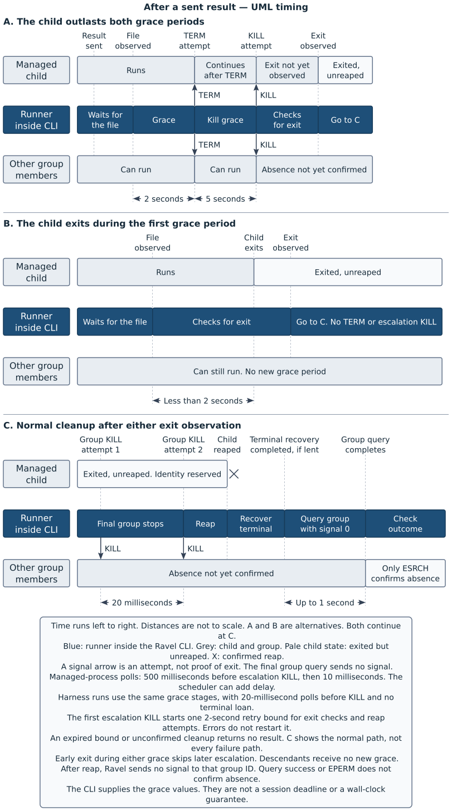
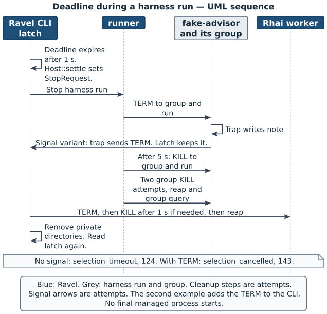
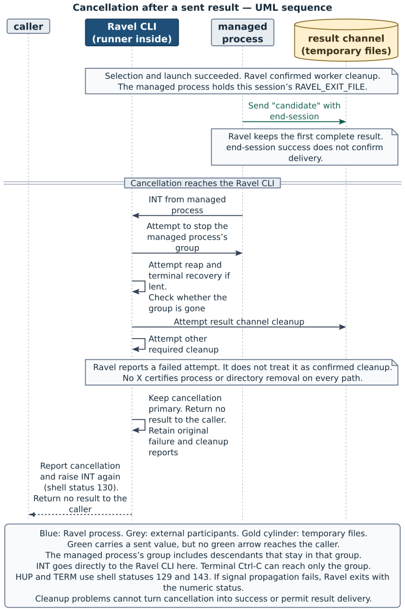
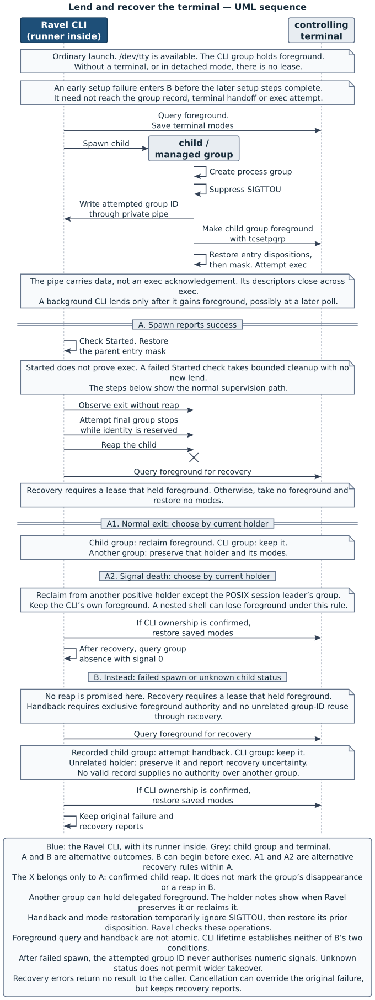

# Jobs, signals and the terminal

What does Ravel do when a program does not stop? Why can a result wait several
seconds before it reaches you? And what happens to a slow LLM call when you
press Ctrl-C? This chapter answers these questions. It explains how Ravel ends
each program that it starts, how it lends the terminal and which signal state
each program receives. It also states where these guarantees stop.

In [chapter 7](07-the-parts-of-ravel.md#watch-the-parts-in-one-session) you
ran the example `ravel-parts`. In that session the Ravel CLI started two
programs. `fake-advisor` was a harness run during selection, and `fake-agent`
was the managed process. Both fakes ended by themselves, so the session showed
no stop. This chapter changes one fake at a time to make each stop visible.

These are the words that this chapter uses. Each row gives the value that the
word has in `ravel-parts`.

| Word | What it names | In `ravel-parts` |
|---|---|---|
| [Ravel CLI](02-actors-and-words.md#evaluation-and-supervision) | The `ravel` command-line program. It checks the request, supervises the session and decides the outcome. | The process `ravel start-session --kind demo …` |
| [Runner](07-the-parts-of-ravel.md#the-runner-owns-the-local-job-mechanics) | The Rust library code in the Ravel CLI that starts and supervises a job | It runs both fakes |
| [Harness run](02-actors-and-words.md#evaluation-and-supervision) | One run of a program from the `harnesses` settings, during evaluation. Its output returns to the configuration script. | `fake-advisor` |
| [Managed process](02-actors-and-words.md#the-managed-process-and-its-result) | The program that the configuration script selects. It does the caller's work. | `fake-agent` |
| Job | A program that the runner starts, and the other processes in its process group | One job for each fake |
| [Result channel](07-the-parts-of-ravel.md#the-result-channel-carries-the-value) | A private temporary directory with one path for a result file. The path goes to a program in `RAVEL_EXIT_FILE`. | One for each fake |
| Cancellation | An INT, TERM or HUP signal that reaches the Ravel CLI | None: nothing sent a signal |

A signal name such as SIGTERM has the prefix SIG. This chapter writes INT, TERM,
HUP and KILL without that prefix, as the shell `trap` command does. Other signals
keep their full names.

A [result](02-actors-and-words.md#the-managed-process-and-its-result) requests
the end of a job. It does not prove that the job has ended. The Ravel CLI stays
alive to supervise that end before it returns the result to the
[caller](02-actors-and-words.md#caller-and-owner).
[Chapter 3](03-a-complete-session.md#send-the-result-and-finish-the-job)
introduced a job and its reap through one session.
[Chapter 8](08-follow-a-session-through-the-code.md#finish-the-managed-job)
shows where these operations occur in the code.

## Each program runs as a job

The runner starts each program as the leader of a new **process group**. The
group's ID is the program's PID. Descendants inherit this group unless they
explicitly change it. The program and the members of its group form the
**job**. In `ravel-parts`, `fake-advisor` led one job and `fake-agent` led
another.

A signal to a process group can reach its members together. A signal to the
program's PID reaches only that program. If Ravel stopped only the program, a
helper could keep a file lock or continue to change the caller's files. The
group gives Ravel a scope for shutdown that includes ordinary descendants.

A **POSIX session** can contain several process groups and can have a
controlling terminal. The two kinds of job differ here. The managed process
can need the caller's terminal, because an interactive harness talks to a
human there. A harness run gives its output to the configuration script, so it
needs no terminal.

| Choice | Used for | Consequence |
|---|---|---|
| A new process group in the caller's POSIX session | The managed process | Ravel can signal the job together and can lend the caller's terminal |
| A new POSIX session through `setsid` | Each harness run | The run starts without a controlling terminal. The terminal's keyboard signals do not reach it, and `/dev/tty` names no terminal for it. |
| Only the program's PID as the shutdown target | Nothing | Descendants can survive their parent. This does not meet Ravel's cleanup contract. |

A descendant can leave the job's group, for example through its own
`setsid` call. Group cleanup does not cover that descendant. Ravel does not
promise to track every process descended from the managed process or from a
harness run. A new process group also creates no new Ravel
[session](02-actors-and-words.md#caller-and-owner): that term means one
`start-session` invocation. The Rhai worker is no job. It stays in the process
group of the Ravel CLI, and the Ravel CLI stops it by its PID.

## Run a managed process that stays after its result

What does Ravel do with a program that sends its result and then does not
exit? You can see it with one change to `ravel-parts`. The example
directory is `~/ravel-parts-escalation`. Make it and copy the three files that
stay the same:

Fragment: make the example directory and copy three files of chapter 7. This
block omits the new `bin/fake-agent`. The book checker makes its own
directory and does not run this block.

```sh
mkdir -p ~/ravel-parts-escalation/bin
cd ~/ravel-parts-escalation
cp ~/ravel-parts/settings.json ~/ravel-parts/config.rhai .
cp ~/ravel-parts/bin/fake-advisor bin/
```

The new `fake-agent` sends `finished` and then stays alive. Its `trap` line
tells the shell to write a note when TERM arrives, and to continue. Thus,
Ravel's escalation must reach KILL to end it. The shell runs the note after
the current `sleep` ends. The TERM to the group also ends that `sleep`.

Complete example: the managed process sends `finished`, then stays alive after
TERM. The caller still receives `finished`.

**`settings.json`**

```json
{"harnesses":{"advisor":{"program":"fake-advisor"}},"budgets":{"harnessRuns":1}}
```

**`config.rhai`**

```rhai
export const SCHEMA_VERSION = 4;
export const VERSION = "parts";

fn select(request, context) {
    let run = ravel::run_harness(#{ harness: "advisor", args: [] });
    print(`The advisor run ended: ${run.status}, result ${run.result}.`);
    #{
        status: "selected",
        program: "fake-agent",
        args: [run.stdout],
        provider: "local",
        model: "fake",
        effort: "none",
        reason: "Show each part of Ravel.",
    }
}
```

**`bin/fake-advisor`**

```sh
#!/bin/sh
{
  echo "advisor: parent is $(ps -o args= -p "$PPID" | cut -d ' ' -f 1-2)"
  echo "advisor: RAVEL_CONFIG_RUN is ${RAVEL_CONFIG_RUN-absent}"
} > advisor.txt
printf '%s\n' "$RAVEL_EXIT_FILE" > advisor.path
printf 'short'
ravel end-session -- "advice"
```

**`bin/fake-agent`**

```sh
#!/bin/sh
trap 'echo "agent: received TERM and stayed" >> agent.txt' TERM
echo "agent: sent finished" > agent.txt
ravel end-session -- "finished"
while :; do sleep 0.05; done
```

**Command**

```console
$ mkdir -p home/.config/ravel tmp && chmod +x bin/* && cp settings.json home/.config/ravel/settings.json
$ env -i HOME="$PWD/home" TMPDIR="$PWD/tmp" PATH="$PWD/bin:$PATH" ravel start-session --kind demo --config config.rhai --prompt 'Show the parts of Ravel.' > result
```

**Standard output**

```text
```

**Exit status**

```text
0
```

**Command**

```console
$ cat agent.txt result && printf '\n'
$ rmdir tmp && echo "The directory tmp is empty again."
```

**Standard output**

```text
agent: sent finished
agent: received TERM and stayed
finished
The directory tmp is empty again.
```

**Exit status**

```text
0
```

The session takes at least seven seconds. The note shows that TERM arrived
after the result and that the agent stayed. KILL then ended it. The death of `fake-agent` from KILL does not
invalidate its result. `finished` reaches the caller only after the job ends.

The example check compares the result bytes, the note and the exit status. It
does not compare the duration or standard error. macOS can add `ravel: stop attempt`
lines whose process-group IDs change from run to run. The automatic example check has no
terminal and uses no real harness. The next section explains each stage of
this stop.

## Follow the escalation after a result

Why did `ravel-parts-escalation` take at least seven seconds? An interactive
[harness](02-actors-and-words.md#the-managed-process-and-its-result)
can finish its work and then wait for another prompt.
The caller therefore tells it to send an
[opaque result](02-actors-and-words.md#the-managed-process-and-its-result)
with `end-session`. The command creates the completion file in the result
channel. The runner observes that file's presence. Ravel checks its contents
separately.

Until it sends KILL, the runner checks the program and the channel at regular
intervals. For the managed process, the interval is 500 milliseconds. For a
harness run, it is 20 milliseconds, because a deadline and an output limit
bound the run. The first observation of the file starts the grace period.
Thus, the schedule starts at observation, not at the instant the sender calls
`end-session`.

| Stage | Condition | Action and wait |
|---|---|---|
| Grace | The runner observes the completion file while the program still runs | Allow 2 seconds for the program to exit |
| TERM | The program still runs after the grace | Send TERM to the group and the program. Allow up to 5 seconds, the **kill grace**, for the program to exit |
| KILL | The program still runs after the kill grace | Send KILL to the group and the program. Check for exit at 10-millisecond intervals |
| Final cleanup | The runner observes the program's exit | Stop the other group members before the reap, then recover the terminal and confirm group absence <!-- tc: depart synonym-rotation because confirmation establishes group absence, while exit checks can find a live program --> |

In `ravel-parts-escalation`, `fake-agent` passed through every stage. It sent
`finished` and stayed through the grace. It wrote its note at TERM and stayed
through the kill grace. KILL ended it, and final cleanup followed.

The figure separates the grace periods from final cleanup. Both exit paths
reach the group stops before reap, then the terminal recovery and group query.



[Open the escalation figure at full size.](figures/escalation-timing.svg)

TERM lets the program handle its own shutdown. A program can ignore TERM.
It cannot catch or ignore KILL. If the program exits during either grace
period, Ravel proceeds to final cleanup without the later escalation stages.
Descendants receive no separate grace period after the program exits.

The 2-second and 5-second values belong to the Ravel CLI, as
`run::ESCALATION`. It gives the same values to the managed process and to each
harness run. The runner accepts its caller's durations. These values are not a
seven-second deadline for `start-session`: selection, observation delays and
final cleanup also take time. Without a result, a stop request or
cancellation, this escalation places no time limit on the managed process.

After the escalation's first KILL attempt, the runner uses a two-second bound
for its exit checks and reap attempts. It does not restart that bound after
an error. If the bound expires, the runner reports unresolved ownership, and
Ravel returns no result to the caller.
This bound limits retries. It cannot guarantee a wall-clock deadline when the
scheduler or a kernel operation stalls.

## Stop the group before the reap

A process can exit before its parent collects its status. Until that
collection, it remains a **zombie**: the system retains its identity and exit
status, although it executes no more code. To **reap** the child, the parent
collects that status and releases the retained process identity.

Ravel first observes exit without a reap. Its `waitid` call uses `WNOWAIT`
for that purpose. The unreaped child reserves its PID, which is also the
job's group ID. Ravel uses that reservation for the last group signals.

If Ravel reaped first, the system could reuse the ID for an unrelated group.
A later KILL to that number could then reach that unrelated group.
The normal cleanup path therefore has this order, for the managed process and
for each harness run:

| Step | Operation | What it establishes |
|---|---|---|
| 1 | Observe the child's exit with `waitid` and `WNOWAIT` | The child has exited, but still reserves its identity. A stop is not an exit |
| 2 | Send KILL to its group twice, with a 20-millisecond pause | Attempt to stop the other members while the identity remains reserved |
| 3 | Reap the direct child with `waitpid` | Confirm the child's status and release its identity |
| 4 | Recover the terminal if Ravel lent it | Check foreground recovery and restore the saved modes. A harness run never receives the terminal, so this step does nothing for it |
| 5 | Query the group without a signal, for up to one second | Confirm absence only when the system returns `ESRCH`, meaning no such process group |

The second KILL addresses a macOS case where a fork overlaps the first group
signal and leaves a new member. Both attempts precede the reap.
They do not change the direct child's status: it has already exited.
Ravel reaps its direct child. Other descendants' parents, or the system,
reap those descendants.

A successful signal operation does not prove that the group is gone.
The final query uses `kill` with signal 0, which sends no signal.
Success or `EPERM` means that absence remains unconfirmed. An unrelated group
that reuses the ID also prevents confirmation. Ravel does not signal that
number after the reap.

On macOS, a group with only zombies can reject KILL with `EPERM`, or
`Operation not permitted`. Ravel can retain this stop report without a
session failure, but only after confirmed reap, successful terminal recovery
and an `ESRCH` absence check. The report alone never confirms cleanup.
Ravel writes retained reports as `ravel:` lines on standard error, or in
`operationReports` with `--json`.

The same refusal can occur before Ravel observes the exit. The result's TERM
can reach the group while its leader is inside its exit teardown. The leader's
own PID still accepts the signal, but `waitid` does not report the exit yet.
Ravel therefore continues to watch after a group stop answers `EPERM`. The
report then waits for the same three checks. A refused stop to the direct
child, or another error, ends the watch at once.

These failures prevent success. Their outcome depends on the kind of job:

| Failure | For the managed process | For a harness run |
|---|---|---|
| The group still answers the query with success or `EPERM` after the confirmation wait, or the query fails | Ravel reports the problem and returns no result to the caller | The evaluation ends as `harness_cleanup_failed`, status 5. The configuration script receives no map. |
| An observation or reap error | Ravel attempts bounded cleanup, reports what it cannot confirm and returns no result | The same refusal, `harness_cleanup_failed`, status 5 |
| Ravel cannot remove the result channel | `session_cleanup_failed`, and no result | The same refusal, `harness_cleanup_failed`, status 5 |

Once the runner loses or releases the child identity, it stops all numeric
signal attempts. After a timeout, it never reports a reap that did not occur.

## Stop a harness run

In `ravel-parts`, `fake-advisor` printed `short`, sent `advice` and exited.
What if it does not exit? A real LLM call can wait on a slow model service. You
may want such a call to stop at a deadline, so that your configuration script
can choose a fallback route.

The Ravel CLI does not send a signal to a harness run itself. It asks the
runner instead. Each run has a `StopRequest`, a flag that the runtime thread
of the Ravel CLI sets. The runner also keeps a second flag of its own, for the
output limit. It reads both flags at its 20-millisecond checks.

When one flag is set, the runner sends TERM to the run's group and to the run, without the 2-second
grace. If the run still exists after the 5-second kill grace, the runner sends
KILL. Then it stops the group before the reap, reaps the run and confirms
that the group is gone.

Three causes stop a run. Only the third ends the evaluation:

| Cause | Who asks for the stop | What the configuration script sees |
|---|---|---|
| The deadline of the run: a `timeoutMs` in the `ravel::run_harness` call that is less than the time that remains | The Ravel CLI, at that deadline | The map with `status` `timed_out`. The script continues. |
| More than 1 MiB on standard output or standard error | The runner's own thread that reads the run's pipes, through the runner's second flag | The map with `status` `output_limit`. The script continues. |
| A stop of the whole evaluation: its deadline, a cancellation, the output limit of the script, or a worker that dies or breaks the protocol | The Ravel CLI, in `Host::settle` | Nothing. The worker receives no more replies, and Ravel refuses. |

Without a `timeoutMs`, or with one that is not less than the time that
remains, the run has no deadline of its own. The evaluation deadline then
stops it as the third cause, and the script never sees `timed_out`.

[Chapter 4](04-write-a-configuration-script.md#run-a-harness-during-evaluation)
shows a configuration script that checks `run.status` before it uses the
answer. The next two sections show the third cause, which also stops the
worker.

## Stop the evaluation at its deadline

The evaluation has one deadline for all of its work: the worker start, the
reads, each harness run and `select`. The owner sets it as `timeoutMs` in the
settings, and `--timeout-ms` replaces it for one session. The smallest
permitted value is 1,000 milliseconds.

When that deadline expires during a harness run, the Ravel CLI stops the
evaluation in this order:

1. It records the first cause. A later cause does not repeat the stop.
2. It abandons a file read in progress, and it does not wait for it.
3. It asks the runner to stop a harness run in progress. The runner escalates
   from TERM to KILL, clears the group and reaps the run.
4. It stops the worker with TERM, kills it if it is still there after one
   second, and reaps it.
5. It removes the private directories and reports every cleanup failure.
6. It reads the cancellation latch again, and then it refuses.

The sequence shows why harness cleanup precedes worker teardown, and why a later signal changes the final refusal.



[Open the deadline sequence at full size](figures/selection-deadline.svg).

The **latch** is a variable of the Ravel CLI. Its signal handlers keep the
first INT, TERM or HUP there.

Only one host call runs at a time, so only one of steps 2 and 3 applies. A
stop drops the host call that waits, which abandons a read at once. A run
continues after that drop, until `Host::settle` asks the runner to stop it.
The worker only waits for its reply and holds nothing that needs a graceful
stop.

`Host::settle` waits at most 8 seconds for the runner. That is the 5-second
kill grace, plus the runner's bounds for a failed reap and for the group
query. A process that survives is a worse outcome than the deadline. Thus,
each failure of the run below replaces the deadline with
`harness_cleanup_failed`, status 5:

| Failure of the run | How Ravel then stops the worker |
|---|---|
| The runner does not settle the run in 8 seconds | No TERM. Ravel waits up to one second for the worker to exit, then kills it. The reap of the run is unconfirmed. |
| The run's group stays after its reap | No TERM. Ravel waits up to one second for the worker to exit, then kills it. |
| The reap of the run fails | No TERM. Ravel waits up to one second for the worker to exit, then kills it. |

Run this order with one change to `ravel-parts`. The example directory is
`~/ravel-parts-deadline`. Make it and copy the three files that stay the same:

Fragment: make the example directory and copy three files of chapter 7. This
block omits the new `bin/fake-advisor`. The book checker makes its own
directory and does not run this block.

```sh
mkdir -p ~/ravel-parts-deadline/bin
cd ~/ravel-parts-deadline
cp ~/ravel-parts/settings.json ~/ravel-parts/config.rhai .
cp ~/ravel-parts/bin/fake-agent bin/
```

The new `fake-advisor` writes its PID to `advisor.pid`. It never exits, and it
writes a note when TERM arrives. The command adds `--timeout-ms 1000`.

Complete example: the evaluation deadline expires during a harness run that
stays after TERM. Ravel stops the run, then the worker, and starts nothing.

**`settings.json`**

```json
{"harnesses":{"advisor":{"program":"fake-advisor"}},"budgets":{"harnessRuns":1}}
```

**`config.rhai`**

```rhai
export const SCHEMA_VERSION = 4;
export const VERSION = "parts";

fn select(request, context) {
    let run = ravel::run_harness(#{ harness: "advisor", args: [] });
    print(`The advisor run ended: ${run.status}, result ${run.result}.`);
    #{
        status: "selected",
        program: "fake-agent",
        args: [run.stdout],
        provider: "local",
        model: "fake",
        effort: "none",
        reason: "Show each part of Ravel.",
    }
}
```

**`bin/fake-advisor`**

```sh
#!/bin/sh
trap 'echo "advisor: received TERM and stayed" >> advisor.txt' TERM
echo "advisor: started" > advisor.txt
echo "$$" > advisor.pid
while :; do sleep 0.05; done
```

**`bin/fake-agent`**

```sh
#!/bin/sh
{
  echo "agent: parent is $(ps -o args= -p "$PPID" | cut -d ' ' -f 1-2)"
  echo "agent: RAVEL_CONFIG_RUN is ${RAVEL_CONFIG_RUN-absent}"
  echo "agent: argument is $1"
} > agent.txt
printf '%s\n' "$RAVEL_EXIT_FILE" > agent.path
ravel end-session -- "finished"
```

**Command**

```console
$ mkdir -p home/.config/ravel tmp && chmod +x bin/* && cp settings.json home/.config/ravel/settings.json
$ env -i HOME="$PWD/home" TMPDIR="$PWD/tmp" PATH="$PWD/bin:$PATH" ravel start-session --kind demo --config config.rhai --timeout-ms 1000 --prompt 'Show the parts of Ravel.' > result
```

**Standard output**

```text
```

**Standard error includes**

```text
ravel: refused (selection_timeout, stage evaluation): the configuration entry <scratch>/work/config.rhai did not return a result within the selection bound of 1000 ms (--timeout-ms), so worker teardown was attempted and nothing was launched
```

**Exit status**

```text
124
```

**Command**

```console
$ cat advisor.txt
$ kill -0 "$(cat advisor.pid)" 2>/dev/null || echo "The advisor process is gone."
$ test ! -e agent.txt && echo "The agent never started."
$ rmdir tmp && echo "The directory tmp is empty again."
```

**Standard output**

```text
advisor: started
advisor: received TERM and stayed
The advisor process is gone.
The agent never started.
The directory tmp is empty again.
```

**Exit status**

```text
0
```

The session takes a little more than six seconds: the 1-second deadline, then
the 5-second kill grace of the run. Each line of the output shows one step of the stop:

| Output | What it shows | Step |
|---|---|---|
| `selection_timeout`, status 124 | The deadline was the first cause. No signal reached the Ravel CLI before its final read. | 1 and 6 |
| `advisor: received TERM and stayed` | The runner sent TERM to the run at the deadline. The run stayed, so the runner sent KILL after the kill grace. | 3 |
| `The advisor process is gone.` | `kill -0` sends no signal. It fails because the run's PID no longer exists: Ravel reaped it. | 3 |
| `The agent never started.` | Ravel started no managed process after the stop | 6 |
| `The directory tmp is empty again.` | Ravel removed the run's result channel and its other private directories | 5 |

The `print` line of the script never ran, because `ravel::run_harness` never
returned. `fake-agent` is the file of chapter 7, and it never runs here.

## Let a signal win over the deadline

Step 6 above reads the cancellation latch again. Why? A signal can reach the
Ravel CLI while it stops the evaluation for another cause. The
[completion contract](08-follow-a-session-through-the-code.md#choose-the-final-outcome)
gives cancellation the first priority. Thus, a signal that the Ravel CLI
consumed before its final read wins over the deadline.

During evaluation, the runner holds no signal handler. The Ravel CLI installs
its own handlers for INT, TERM and HUP at the start of `start-session`. They
keep the first signal in its latch. A signal that was ignored when the Ravel
CLI started keeps that state and never reaches the latch.

The runtime thread reads that latch every 50 milliseconds. A harness run is in a POSIX session of its own, so a signal to the caller's
process group does not reach it. The Ravel CLI stops the run through its
`StopRequest`.

Change one line of `fake-advisor` in `~/ravel-parts-deadline` to see the rule.
The new `trap` line also sends TERM to the fake's parent, the Ravel CLI. That
TERM arrives after the deadline and before the kill grace of the run ends.

Complete example: the deadline expires during a harness run. The run's TERM
handler then sends TERM to the Ravel CLI, and the signal wins.

**`settings.json`**

```json
{"harnesses":{"advisor":{"program":"fake-advisor"}},"budgets":{"harnessRuns":1}}
```

**`config.rhai`**

```rhai
export const SCHEMA_VERSION = 4;
export const VERSION = "parts";

fn select(request, context) {
    let run = ravel::run_harness(#{ harness: "advisor", args: [] });
    print(`The advisor run ended: ${run.status}, result ${run.result}.`);
    #{
        status: "selected",
        program: "fake-agent",
        args: [run.stdout],
        provider: "local",
        model: "fake",
        effort: "none",
        reason: "Show each part of Ravel.",
    }
}
```

**`bin/fake-advisor`**

```sh
#!/bin/sh
trap 'echo "advisor: received TERM, sent TERM to the Ravel CLI" >> advisor.txt; kill -TERM "$PPID"' TERM
echo "advisor: started" > advisor.txt
echo "$$" > advisor.pid
while :; do sleep 0.05; done
```

**`bin/fake-agent`**

```sh
#!/bin/sh
{
  echo "agent: parent is $(ps -o args= -p "$PPID" | cut -d ' ' -f 1-2)"
  echo "agent: RAVEL_CONFIG_RUN is ${RAVEL_CONFIG_RUN-absent}"
  echo "agent: argument is $1"
} > agent.txt
printf '%s\n' "$RAVEL_EXIT_FILE" > agent.path
ravel end-session -- "finished"
```

**Command**

```console
$ mkdir -p home/.config/ravel tmp && chmod +x bin/* && cp settings.json home/.config/ravel/settings.json
$ env -i HOME="$PWD/home" TMPDIR="$PWD/tmp" PATH="$PWD/bin:$PATH" ravel start-session --kind demo --config config.rhai --timeout-ms 1000 --prompt 'Show the parts of Ravel.' > result
```

**Standard output**

```text
```

**Standard error includes**

```text
ravel: refused (selection_cancelled, stage evaluation): selection with the configuration script <scratch>/work/config.rhai was cancelled by SIGTERM: worker teardown was attempted and nothing was launched
original failure:
ravel: refused (selection_timeout, stage evaluation): the configuration entry <scratch>/work/config.rhai did not return a result within the selection bound of 1000 ms (--timeout-ms), so worker teardown was attempted and nothing was launched
```

**Exit status**

```text
143
```

**Command**

```console
$ cat advisor.txt
$ kill -0 "$(cat advisor.pid)" 2>/dev/null || echo "The advisor process is gone."
$ test ! -e agent.txt && echo "The agent never started."
$ rmdir tmp && echo "The directory tmp is empty again."
```

**Standard output**

```text
advisor: started
advisor: received TERM, sent TERM to the Ravel CLI
The advisor process is gone.
The agent never started.
The directory tmp is empty again.
```

**Exit status**

```text
0
```

Compare the two runs. The stop was the same: the run received TERM at the
deadline, stayed, and ended by KILL after the kill grace. Then the worker
stopped, and nothing started. Only the final decision changed:

| | Deadline alone | Deadline, then TERM to the Ravel CLI |
|---|---|---|
| First cause | The deadline | The deadline |
| Signal in the latch at the final read | None | TERM |
| Refusal | `selection_timeout` | `selection_cancelled`, with `selection_timeout` under “original failure:” |
| Exit status | 124 | 143, which is 128 plus 15, the number of TERM |
| How the Ravel CLI ends | It exits with status 124 | It reports, then raises TERM again |

The second TERM did not change the run's stop, and the kill grace did not
restart. The runner never reads the latch of the Ravel CLI for a harness run.
`Host::settle` only waits for the stop that it already asked for. Standard error also shows a
`session_cancelled` report after these lines, and `/bin/sh` reports that TERM
ended the command. The example does not claim those lines.

The same final read follows every other refusal of the evaluation. A signal
therefore also wins over a breach of a limit and over `harness_cleanup_failed`.
Among signals, the first that the Ravel CLI consumed stays the cause. A later
signal does not replace it. The last section of this chapter states the limit
for a signal that arrives after the final decision.

## Handle cancellation

Cancellation differs from a sent result. INT, TERM or HUP received by the
Ravel CLI suppresses the result, even if the managed process already sent it.
What Ravel stops depends on where the signal arrives:

| Where cancellation occurs | Who holds the signal | Process action | Result |
|---|---|---|---|
| During selection, with a harness run in progress | The latch of the Ravel CLI | Stop the harness run through its `StopRequest`, then stop and reap the [Rhai worker](02-actors-and-words.md#evaluation-and-supervision). Do not start the managed process. | `selection_cancelled`, then `session_cancelled`. Return no result to the caller. |
| During selection, with no harness run | The latch of the Ravel CLI | Stop and reap the Rhai worker. Do not start the managed process. | `selection_cancelled`, then `session_cancelled`. Return no result to the caller. |
| During supervision | The runner's handlers, which replace those of the Ravel CLI for the managed launch <!-- tc: depart synonym-rotation because launch is a noun that names the runner's launch modes, a technical name, while start is the verb for process creation --> | Forward the signal to the group and the direct child. If the child still runs after the kill grace, send KILL. | `session_cancelled`. Complete cleanup attempts and return no result. |

During supervision, the runner checks for cancellation before it accepts an
observed child exit. The Ravel CLI also checks signals around supervision and
final cleanup. Cancellation skips the result's initial grace. If the kill grace
has already begun, cancellation does not restart it.

The sequence shows why a sent result cannot survive cancellation during supervision.
Ravel attempts cleanup before it raises the signal again.



[Open the supervision cancellation sequence at full size](figures/supervision-cancellation.svg).

The managed process can itself supervise another process, for example a nested
`ravel start-session`. The forwarded signal and the kill grace let that
supervisor attempt its own cleanup.
[Chapter 5](05-running-sessions.md#keep-nested-sessions-separate) explains
nested sessions.

The two [cancellation sequences in chapter 5](05-running-sessions.md#cancel-during-selection-or-supervision)
show the selection and supervision cases, with complete fake-program examples.
[Chapter 8](08-follow-a-session-through-the-code.md#cancel-during-selection)
follows the selection case through `Host::settle` and `worker::supervise`.
[Chapter 8](08-follow-a-session-through-the-code.md#choose-the-final-outcome)
also explains which signal and diagnostic Ravel reports when failures overlap.
A cleanup failure stays visible beside cancellation. It does not permit a
previously sent result to reach standard output.

## Separate the three launch modes

The runner has three launch modes. The Ravel CLI uses two of them. The table
compares the three modes:

| Mode | Runner interface | POSIX session and input | Output, completion and signals |
|---|---|---|---|
| Ordinary launch, for the managed process | `run_observed_with_start_check` | A new process group in the caller's POSIX session. Inherited input, with terminal access when available | Output goes to the caller's standard error. A result can request shutdown. The runner installs cancellation handlers. |
| Captured launch, for each harness run | `run_captured`, with `CapturedLaunch` | A new POSIX session, no controlling terminal, no inherited descriptors above 2 after exec. Standard input is the run's `stdin` text, or end-of-file (EOF) without it | The runner's thread reads both streams into buffers of 1 MiB each. A result requests shutdown, and so does a `StopRequest`. The runner installs no signal handler. |
| Noninteractive launch | `run_noninteractive` | A new POSIX session, no controlling terminal, EOF input, no inherited descriptors above 2 after exec | Both streams go to a regular file that the caller supplies. No completion channel. The runner installs cancellation handlers. |

`run_noninteractive` has no production caller in Ravel. A test of
`crates/ravel/src/cancellation.rs` calls it.

Why does a captured launch install no signal handler? The Ravel CLI owns its
signals during evaluation. Its runtime thread watches the latch, the deadline
and the worker together, and it decides when to stop the run. If the runner
replaced the handlers of the Ravel CLI, that thread could lose a signal.

A new POSIX session removes the inherited controlling terminal relationship.
It does not restrict file access, and a descendant can still move to another
group. No mode of the runner restricts file access. These distinctions explain
why the runner hides process mechanics behind separate launch interfaces,
while the Ravel CLI owns the configuration script and result decisions.

The runner tests check these process operations directly:

| Test source under `crates/keyed-launch/tests/` | What it checks |
|---|---|
| `launch.rs` | Grace and KILL branches, ordinary descendants gone on return, and an unrelated process left untouched |
| `captured.rs` | Separate streams, standard input and EOF, and the output bound. A stop request that ends descendants, KILL after the kill grace, a new group without a terminal, and the EPERM cases |
| `internal/wait_events.rs` | Cleanup order, a reported survivor, and cancellation across wait failures through a private process substitute |
| `noninteractive.rs` | EOF input, descriptor isolation, a new POSIX session, forwarded cancellation, and KILL after the kill grace |
| `job.rs` | Terminal foreground and mode behaviour through pseudo-terminals |

`task test:runner` passed these tests on aarch64 macOS 27.0.1 on
12 November 2026. The tests check named operations and process shapes. They do
not establish containment against every same-user attack or cleanup of a
descendant that leaves the job's group. They also do not qualify a native
x86-64 Linux host.

## Lend and recover the terminal

A **controlling terminal** belongs to a POSIX session. It has one
**foreground process group** at a time. That group can read terminal input.
With the default terminal modes, Ctrl-C sends INT to that group.
A background group's attempt to read can instead stop it with SIGTTIN.

Start the Ravel CLI in the foreground of an interactive shell. During
selection, its group is then the foreground group, and the Rhai worker is in
that group too. A harness run is in another POSIX session, so Ctrl-C does not
reach it. During supervision, the runner lends the foreground to the managed
group, under the rules below.

The runner opens `/dev/tty`, which names its controlling terminal.
Redirected standard input does not remove that relationship. If the open
fails, the runner proceeds without terminal job control. Detached modes, such
as a harness run, do not open the terminal at all.

An open terminal alone permits no handoff. The runner queries its foreground
group with `tcgetpgrp` and lends it only when the runner's own group holds it.
A Ravel CLI that starts in the background takes no foreground for itself.
A shell can later give the foreground to the Ravel CLI's group, for example with
`fg`. Then a later supervision poll can lend the terminal to the managed group.

Before the first handoff, the runner saves the terminal attributes with
`tcgetattr`. These **terminal modes** control such behaviour as character
echo, line input and keyboard signals. An interactive program can change them
to receive individual characters without echo. If KILL ends that program,
the program cannot restore the modes itself.

The ordinary foreground launch follows these steps:

| Step | Owner and operation | Purpose |
|---|---|---|
| Save | The runner retains a terminal descriptor, foreground ownership and the current modes in a terminal lease | Keep the recovery information alive through spawn and supervision |
| Record | The child enters its new group and writes that group ID to a private pipe | Tell the parent which group can take the terminal, even if exec fails |
| Lend | Before exec, the child calls `tcsetpgrp` to make its group foreground | Complete the handoff before the program's first terminal read |
| Supervise | The runner observes the child and performs any required group stops before reap | Retain the group identity for those signals |
| Recover | After reap, the runner applies the holder rules below and checks the terminal again | Restore saved modes only when the runner's group owns foreground |

The sequence shows why the terminal lease survives the exec attempt.
Its recovery branches depend on the child outcome and the current foreground holder.



[Open the terminal sequence at full size.](figures/terminal-lending-recovery.svg)

A background group can receive SIGTTOU when it changes terminal foreground.
The runner therefore temporarily ignores SIGTTOU for the **handback** (the
return of foreground to the runner's group) and for mode restoration. Then it
restores its previous disposition. It checks both the
terminal operation and that restoration. The child also suppresses SIGTTOU
for its handoff before it restores its entry signal state.

The lease remembers whether this launch ever held foreground. If it never
did, the runner takes no foreground and restores no modes.
For a lease that did hold foreground, the child's outcome changes the rule:

| Outcome and current holder | Foreground and mode action |
|---|---|
| The runner's group already holds foreground | Restore the saved modes |
| Normal child exit, with the child's group still foreground | Take foreground back, confirm it, then restore the modes |
| Normal child exit, with another group foreground | Preserve that holder and its modes |
| Known child death by signal | Reclaim from a positive foreground group other than the runner's group or the POSIX session leader's group. Restore modes only after confirmed ownership |
| Failed spawn or unknown child status, with the recorded child's group foreground | Attempt the conditional handback described below, then restore modes after confirmed ownership |
| Failed spawn or unknown child status, with an unrelated group foreground | Preserve it and report unconfirmed foreground and mode recovery |

The wider signal-death rule covers a managed supervisor that gives foreground
to another group, then dies without cleanup. Otherwise, that delegated group
could retain a raw terminal and continue to read input. The accepted cost is
that a nested job-control shell can lose its foreground after such a death.
Unknown child status does not permit this wider takeover.
The POSIX session leader is the process that created the terminal's POSIX
session.

Exec can fail after the child takes foreground. The parent therefore retains
the lease across a spawn error. The private pipe closes across exec and
provides an attempted-group record, not proof of exec or a live group.
If the record is missing or invalid, recovery is unconfirmed and Ravel reports it.
The runner never signals that recorded number after failed spawn.

Failed-spawn handback requires two conditions through recovery: no other
process or thread changes foreground, and no unrelated group reuses the
recorded ID. These conditions also apply to recovery from unknown status.
The foreground query and handback are separate operations. A one-session
lifetime of the Ravel CLI does not make them atomic or establish those conditions.

Ravel reports failures of foreground queries, handback, mode restoration and
temporary SIGTTOU restoration. After a recovery failure, Ravel returns no
result to the caller.
After failed spawn, the original spawn error stays primary unless cancellation
overrides it. Recovery reports remain visible beside that outcome.

The tests use a **pseudo-terminal**, or **PTY**, to observe these operations
without a human terminal. A PTY has two ends. The fixture uses one as its
controlling terminal, while the test controls input and reads output through
the other. Separate fixture processes keep terminal and signal changes out of
the test runner itself.

| Test source | Observed distinction |
|---|---|
| `crates/keyed-launch/tests/job.rs` | A raw-mode child actually changes the modes before KILL. The runner then recovers foreground and saved modes |
| `crates/keyed-launch/tests/job.rs` | The same other foreground holder remains after normal exit but loses foreground after signal death |
| `crates/keyed-launch/src/run/terminal_tests.rs` | Failed exec retains the lease. Unknown status preserves an unrelated holder. Recovery failures remain in the error |

These tests check named process arrangements and failure reports. They do not
prove exclusive terminal authority in every caller environment.
The book's complete examples have no terminal, so they do not check these
handoff branches.

## Preserve the entry signal state

A signal's **disposition** is the process-wide choice to use its default
action, ignore it, or call a handler. A thread's **signal mask** names signals
whose delivery that thread blocks. A blocked signal can remain queued until
the thread permits delivery. An ignored signal and a blocked signal are
different states.

Exec replaces the program but preserves the thread's signal mask.
It resets caught handlers to default actions. It preserves ignored
dispositions with one exception: portable code cannot assume that an ignored
SIGCHLD stays ignored after exec. The [POSIX exec specification](https://pubs.opengroup.org/onlinepubs/9799919799/functions/exec.html)
states that exception. Ravel explicitly restores its recorded
ignore/default values before exec on its supported targets.

On its supported targets, Ravel gives the managed process and each harness
run the signal state that the Ravel CLI had at its executable entry. That is
the state before Rust startup changes it. The table below gives the exclusions.
For example, Rust startup ignores SIGPIPE. A capture in `main` would see that new ignore instead of the
state that Ravel inherited.

<!-- tc: depart synonym-rotation because repair names a signal-state correction, while fixed describes a constant bound -->
The initialiser of the Ravel CLI in `signal_state.rs` records the ignored set and the
initial thread's mask before those runtime changes. It keeps that record
separate from later repairs by the Ravel CLI and the runner. If a required query
fails, the Ravel CLI refuses the launch. It does not accept a partial record. The runner receives the values through
`EntrySignals`, in `Launch.transparent` for the managed process and in
`CapturedLaunch.transparent` for each harness run. It does not capture them itself.

| State | Child behaviour in a transparent launch |
|---|---|
| Recorded ignore | Set the signal to ignored before exec |
| Other recorded disposition | Set the signal to its default action. Do not copy a host handler |
| Recorded mask | Apply the mask after the dispositions, so delivery uses the restored actions |
| KILL and SIGSTOP | Leave these unchangeable dispositions alone |
| Unsupported or runtime-reserved signal numbers | Exclude the platform's specified numbers. A failure for another required number remains an error |

The Ravel CLI and the runner also need signal state of their own. An ignored SIGCHLD or the
`SA_NOCLDWAIT` flag can let the system discard child status without a parent
reap. That would remove both the wait result and the identity reservation
needed for group cleanup. The Ravel CLI checks and repairs this state before the
Rhai worker starts. The runner checks it before each job starts: each harness
run and the managed process.
These repairs do not change the immutable child entry values.

For the managed launch, the runner installs handlers for nonignored TERM and
HUP. It also handles nonignored INT when no terminal exists or the launch is
transparent. Ravel uses a transparent launch, so a nonignored INT sent
directly to the Ravel CLI can cancel it even while the managed group owns
foreground. The runner leaves ignored cancellation signals ignored. For a
harness run, the runner installs nothing, and the handlers of the Ravel CLI stay.

Terminal INT follows foreground ownership. Before handoff, it can reach the
group of the Ravel CLI. After handoff, it reaches the managed group. The child's death
from that signal is not itself a cancellation observation by the Ravel CLI.
Ravel can still return a result after child signal death if the Ravel CLI observes no
cancellation and all required cleanup succeeds.

The runner's handlers and SIGCHLD repair persist after its call returns,
on success or failure. A synchronous return does not restore a host's prior
state. The table gives the restoration responsibility at each boundary:

| Boundary | Restoration responsibility |
|---|---|
| `EntrySignals` | Supply the child's ignore/default state and mask. It restores no host state |
| Runner return | Report the child outcome and recovery failures. Retain installed cancellation handlers and any SIGCHLD repair |
| Final cleanup of the Ravel CLI | Check temporary masks and restore the saved INT/TERM/HUP dispositions under the conditions below |
| A host that resumes other work | Needs its own signal lifetime, late-cancellation policy and restoration contract. The current runner supplies no such guarantee |

The Ravel CLI blocks its handled signals across the spawn transition of the
managed process. After spawn reports success, its checked `Started` transition restores the
parent's entry mask. Failure enters bounded child teardown and terminal
recovery. It does not return early with an abandoned child.

`Started` means spawn-reported success, not confirmed exec. A child can die
before exec and still produce that event. Only an actual wait produces
`Reaped`.

Which thread receives a signal? The system can deliver a process signal to
any thread that does not block it. Ravel therefore blocks INT, TERM and HUP in
each helper thread for its whole life:

| Thread | What it does | How it gets the block |
|---|---|---|
| `config-stdout` and `config-stderr` | Read the worker's standard output and standard error | The Ravel CLI blocks the signals before it creates them, then restores its own mask |
| `ravel-reader` | Does every file read and every harness run of the evaluation | The same, through `Shield::block` in `rhai_worker/reader.rs` |
| `keyed-launch-pipes` | Reads the pipes of a harness run | The reader thread creates it, and a new thread inherits the mask of its creator |

A block on only the main thread would leave another thread able to consume a
signal during handoff. A stop can leave a reader thread alive until the Ravel
CLI exits, for example after a bounded output drain or an abandoned file read.

On both success and failure, final cleanup keeps handlers installed while
the Ravel CLI restores its entry mask and collects cancellation observations.
It then blocks the handled signals, reads queued signal state and consumes the
runner's late signal. Under that block, it restores its saved handled
dispositions. A failed block keeps the handlers. Unknown queued signal state never
means that cancellation is absent.

| Final condition | Action of the Ravel CLI |
|---|---|
| Known state, successful disposition restoration, no cancellation | Restore the entry mask. Other cleanup checks still precede result output |
| Cancellation selected | Report it and cleanup failures, then check the default action, unblock and raise the selected signal. Use a numeric fallback if propagation cannot succeed |
| Queued signal query failed while signals remain blocked, with no selected cancellation | Keep them blocked through diagnostics. Return failure without a result |
| Required mask or disposition operation failed | Retain the failure report and return no result |

An entry-blocked signal does not become cancellation merely because it is
queued. The managed child receives that entry block too.
The final signal decision of the Ravel CLI follows the priority in
[chapter 8](08-follow-a-session-through-the-code.md#choose-the-final-outcome).
Its cleanup restores the saved handled dispositions and temporary masks.
It does not undo the SIGCHLD repair or restore every runtime signal change
for a host that continues after the call.

## Know the guarantees and their limits

Each guarantee below includes the boundary within which it holds.
The successful result is evidence of the required checks, not proof that
every descendant or hostile same-user process is absent.

| Guarantee | Limit |
|---|---|
| Ravel returns a result only after that launch's child reap, confirmed group absence and successful required cleanup | Group membership defines the cleanup scope. A descendant that leaves the group lies outside it |
| Ravel supervises shutdown while the Ravel CLI remains alive | Abrupt death of the Ravel CLI, for example from KILL, can orphan the managed job or a harness run. Such death is not successful completion |
| Ravel keeps the first complete result through a private inherited channel and rejects invalid result files | The channel does not authenticate against hostile same-user code. Directory identity checks do not make concurrent pathname changes atomic |
| Ravel asks the runner to stop each harness run before it stops the worker, and launches nothing after a stop | A process that leaves the run's group lies outside this stop. A run that the runner does not settle in 8 seconds gives `harness_cleanup_failed`, without a confirmed reap. A stop of an LLM call ends only local work: the model service can still finish a request that it accepted |
| Ravel verifies and reaps the Rhai worker before the managed launch | The configuration script remains trusted executable code. The worker starts no process. Its harness runs have the group limit above |
| A signal that the Ravel CLI consumes before its final read wins over the deadline, a breached limit and a cleanup failure | The first consumed signal stays the cause. A later signal does not replace it |
| Ravel checks terminal recovery under the holder rules above | Failed-spawn and unknown-status handback require exclusive foreground authority and no unrelated group-ID reuse. Terminal tests cannot establish these conditions for a caller |
| Ravel retains failure reports and attempts required cleanup | A failed operation or expired retry bound can leave cleanup unconfirmed and processes alive. Ravel reports failure and returns no result |
| Cancellation observed by the final decision suppresses the result | A new signal can arrive after that decision. There is no atomic operation across signal delivery and the final output write |
| Successful cleanup permits the final result write | The write can still fail after a prefix reaches standard output. Ravel cannot retract that prefix. A failed write to standard error can also prevent the delivery of diagnostics |
| The Ravel CLI owns one session and then exits | Process-wide handlers, signal latches and terminal authority do not support concurrent host calls or a fully restored host that continues work |

Native-entry behaviour has measured support on aarch64 macOS and aarch64
GNU/Linux. Each measurement covers its named kernel, libc and compiler,
not every combination. The GNU/Linux measurement used Rust 1.85.0.
Native x86-64 Linux remains unqualified: builds, lint checks and QEMU
user-mode execution do not qualify an x86-64 kernel.

The current runner is a private package within Ravel. Neither that package
boundary nor these checks deliver a
[persistent runner](01-what-ravel-is-for.md#decide-whether-ravel-fits) for an
arbitrary host.

Ravel supports no separate component. The runner serves the Ravel CLI, which
supervises one session and then exits. The runner's return does not
restore process-wide signal state. Another program invokes the Ravel CLI as
a child process. Thus, the signal state that the runner changes stays in that
child process and ends when it exits.
