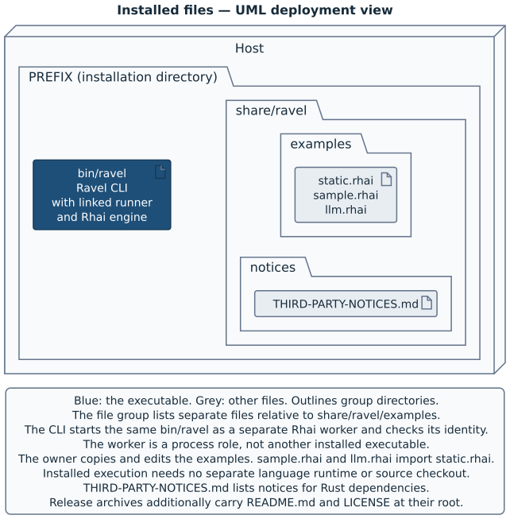

# Deliver Ravel

Ravel 2.0.0 has a delivery problem that a version number alone cannot solve.
Grove, the task-tree driver and Ravel's first caller, has a released version
that accepts only Ravel 1.x. Grove's formula depends on the unversioned
Homebrew formula `ravel`. If `ravel` moved to 2.0.0 at once, every new
installation and every upgrade of Grove would install a Ravel that this Grove refuses. [Grove](https://github.com/Linkuistics/grove) is only an illustrative
caller here. Any released caller that refuses a new major has the same
problem.

Thus, the 2.0.0 delivery has two steps. First, one version cut makes one tag,
one book and three archives. It delivers them through the keg-only formula `ravel@2`, and unversioned `ravel` stays at 1.1.0. Later, when the caller has a
compatible release, `task release:promote` delivers the same archives as unversioned `ravel`. Promotion cuts no version and builds nothing.

| Step | Task | What changes in the tap | Unversioned `ravel` afterwards |
|---|---|---|---|
| The cut of 2.0.0 | `task release:major CHANNEL=versioned-2` | `Formula/ravel@2.rb` holds 2.0.0 | 1.1.0 |
| The promotion, after the caller's compatible release | `task release:promote VERSION=2.0.0` | `Formula/ravel.rb` holds 2.0.0, and `ravel@2.rb` gains a deprecation | 2.0.0 |

This chapter follows that delivery. It starts with what a release holds and
how the checks show that each archive works. Then it explains the two formula
channels, the version cut, the promotion and the recovery of a release that
stopped part of the way.

A release carries one executable, `bin/ravel`, which supplies the
[Ravel CLI](02-actors-and-words.md#evaluation-and-supervision), the command-line
program, and its [Rhai worker](02-actors-and-words.md#evaluation-and-supervision).
The worker is a second process of that executable that evaluates the Rhai
configuration script, the owner's file that selects a program.
[Chapter 7](07-the-parts-of-ravel.md#the-installed-executable-supplies-both-roles)
explains the shared executable. Ravel 1.x also installed a TypeScript worker,
its SDK and its runtime under `libexec/ravel`. Ravel 2.0.0 removed them, with
their probe workers and their checks. No archive, formula or installation of
2.0.0 holds them.

The private runner serves the Ravel CLI, which supervises one session and
exits. Ravel supports no separately installed worker or library. Another
program invokes the Ravel CLI as a child process.

Start with [chapter 10's install and smoke tasks](10-develop-ravel.md#install-and-test-the-installed-files).
Those tasks test a local installation. This chapter extends that check to
archives, to the environments where their programs run and to Homebrew.

## Keep the version and executable together

The workspace has one Ravel version, independent of any caller. `Cargo.toml`
supplies it to both Rust packages. Until the cut of 2.0.0, the checkout's
version is 1.1.0, the last release. An unreleased archive uses the checkout's
version even when its source differs from that version's release tag. Thus,
the archive name alone does not make it a released artifact.

The executable holds a source identity, which its build script computes from
the Rust sources, the manifest and `Cargo.lock`. The Rhai worker is a second
invocation of the same executable. Its `hello` carries the identity, and the
Ravel CLI compares it with its own before it sends the request. A mismatch
causes `worker_identity_mismatch`, exit 5, before evaluation. A symlink to the
CLI still uses the same resolved executable for the worker. Installed
execution needs no Bun or Node runtime.

## Build archives before a release

`task release:archives` builds local archives without a version cut. With no
`TARGETS` argument, it builds these targets:

| Target | Archive contents run on |
|---|---|
| `aarch64-apple-darwin` | Apple silicon macOS |
| `aarch64-unknown-linux-gnu` | Arm64 GNU/Linux |
| `x86_64-unknown-linux-gnu` | x86-64 GNU/Linux |

The target names spell arm64 as `aarch64` and x86-64 as `x86_64`. This
chapter uses the target spelling only in target names and in the support
statement.

Run the release tasks from the checkout. The full workflow needs an Apple
silicon Mac, Bash 4 or later, Task, rustup, curl, tar with xz and ShellCheck.
The Linux builds also need Zig, cargo-zigbuild 0.23.3 or later and both Linux
Rust target libraries. The Linux smoke tests need an available `linux/arm64`
Docker daemon with kernel 6.7 or later.

The kernel requirement comes from the emulated routes. They register QEMU in a
private `binfmt_misc` instance, which Linux 6.7 and later gives each user
namespace. Thus, the registration does not change the Docker host's own. The
requirement applies to the test environment. It is not Ravel's minimum
kernel.

`task setup` supplies the book tools of the checkout. The Rust build uses the
pinned Rhai dependency in `crates/ravel/Cargo.toml` and `Cargo.lock`. Bun is a
book tool only. It is not part of an installed Ravel.

The release build puts rustup's tools first on `PATH` when its shims exist.
Those shims read `rust-toolchain.toml`, which selects Rust 1.99.1 with the
three target libraries. An explicit `RUSTC` override can still select another
compiler. [The release doctor](#prepare-a-version-cut) checks the compiler
that the build will use and its target libraries.

Fragment: prepare the target libraries and build local archives. This recipe
omits tool installation and the command output.

```sh
rustup toolchain install
task setup
task release:archives
```

The build writes `target/archives/ravel-v<VERSION>-<TARGET>.tar.xz`. It
clears `target/archives` before each build, even for one target. Thus, an
archive from an earlier build cannot stand in for a target that failed. Each
archive first has a temporary filename. The build gives the archive its final
filename only after the manifest check passes, then prints its SHA-256
digest.

For a local macOS check, select only the native target. This selection
replaces the contents of the archive directory and does not check Linux.

Fragment: build only the macOS archive. This recipe omits setup and output.

```sh
task release:archives TARGETS=aarch64-apple-darwin
```

If an unreleased build fails, correct the reported cause and run the task
again. It creates no release tag or remote release. The later release
procedure builds fresh artifacts from the release tag into `target/dist`.

## Check the archive contents

An archive has one top directory, `ravel-v<VERSION>-<TARGET>/`. That
directory is an installation prefix. The manifest in
`scripts/release-common.sh` permits exactly these files and their
directories:

| Path below the prefix | Purpose |
|---|---|
| `bin/ravel` | Ravel CLI and its internal Rhai worker role |
| `share/ravel/examples/static.rhai` | Starter configuration script |
| `share/ravel/examples/sample.rhai` | Example that an owner can copy and edit |
| `share/ravel/examples/llm.rhai` | Harness-assisted selection example |
| `share/ravel/notices/THIRD-PARTY-NOTICES.md` | Rust dependency notices |
| `README.md`, `LICENSE` | Project entry and licence |

The installed-file view separates Ravel’s Homebrew record from a skill source’s payload and links.



[Open the installed-file view at full size](figures/installed-files.svg).

[Chapter 6's installed-layout view](06-reference.md#installed-layout) shows
the executable and the data files. `task notices` generates the notice file
under `target/notices/`. The installation and the archive build copy those bytes unchanged.

The manifest check refuses extra files and directories, missing files,
symlinks in place of files, and executables without execute permission. Caller
programs, caller adapters, owner configuration, choice files and development
dependencies do not belong in an archive. The installation record does not
belong there either, because only an installation knows its prefix. The pack
step also excludes macOS extended attributes and their AppleDouble metadata
files.

`task release:test` tests the manifest check. It compares the manifest with a
fresh Ravel build, then uses deliberately incorrect archives. Each omitted
file causes a failure. Other controls add unwanted files, change types or
permissions, and add macOS metadata. The task needs no Docker, but its
metadata controls use macOS tools.

Fragment: test the manifest check. This recipe omits setup and output.

```sh
task release:test
```

The manifest check examines layout, types and execute permission. It does not
show that the executable behaves correctly. The installed smoke test does
that.

## Test the installed archive

`task release:smoke` builds the selected archives again, then tests them. With
no selection, every target runs. A missing tool, a failed target or a selected
target that did not run fails the task. There is no successful skip path.

Fragment: build and test all target archives. This recipe omits setup and the
output of each target.

```sh
task release:smoke
```

Each environment extracts its archive with its own tar into a fresh prefix.
It checks the CLI version and runs `scripts/installed-smoke.sh`, the same
script that [chapter 10's `task install`](10-develop-ravel.md#install-and-test-the-installed-files)
runs. That script tests both the direct CLI path and a relative symlink from
another prefix. Its private utility `PATH` has no Bun, Node or Grove. It
supplies a fresh home and temporary directory through a cleared environment.

The test uses a shell fake agent, a real Rhai worker and the installed files.
Each [session](02-actors-and-words.md#caller-and-owner) returns the
[opaque result](02-actors-and-words.md#the-managed-process-and-its-result)
that the fake agent sends with `end-session`:

| Check | What the test compares |
|---|---|
| Installed files | The three examples and the notice file exist. No `libexec/ravel` and no installation record exist |
| Copied sample | The sample, which imports `static.rhai`, uses the selected choice and starts the fake agent |
| Result values | Ordinary, empty, multiline and option-like values return unchanged |
| Child output | The child's standard output goes to diagnostics, separate from the result |
| Rhai imports and inputs | A relative module import, a measured read and `--param` values reach the configuration script |
| Retired format | A `policy.ts` entry refuses as `config_format_retired`, with status 3 and no result |
| Missing [session-result context](02-actors-and-words.md#three-different-kinds-of-information) | `end-session` fails and writes no result |
| Temporary resources | The sessions leave no resources in their temporary directory |

No model or personal configuration script runs. The test does not exercise an
interactive terminal or all lifecycle failures.
[Chapter 9](09-jobs-signals-and-the-terminal.md) explains those separate
obligations.

## Read the platform checks correctly

A platform floor is the oldest library or CPU capability that a check
exercises. The Linux executable builds against glibc 2.17 through Zig. The
archive smoke test then runs it at each floor.

| Route | Environment and check |
|---|---|
| macOS arm64 | Native execution on the Mac that runs the task |
| Linux arm64, native CPU | Pinned CentOS 7.9 userland in arm64 Docker, with glibc 2.17 |
| Linux arm64, CPU floor | The same userland under QEMU 10.2.2 with the Cortex-A53 model |
| Linux x86-64, CPU floor | CentOS 7.9 under QEMU 10.2.3 with the Nehalem model |

Each Linux route checks that the userland reports glibc 2.17. A probe built
for that floor runs. A second probe needs `GLIBC_2.25`, and the userland
refuses it. The two probes show that the environment both runs valid programs
and refuses a newer library requirement.

The CPU controls use an instruction above each floor: an Armv8.1 LSE atomic
operation for arm64, and AVX2 for x86-64. At the floor, the instruction
causes SIGILL. The same probe runs under the same emulator with `-cpu max`.
Thus, the failure at the floor comes from the CPU model, not from a defective
probe.

Each emulated route checks that `bin/ravel`, the only ELF executable in the
archive, matches its emulator registration. Thus, the executable runs through
QEMU, not directly on the host CPU. The routes also check the guest address
bounds and the presence of the vDSO, an interface that the kernel maps into a
process. The test programs run without network access, as an unprivileged
user, with read-only test inputs.

These checks show different limits:

| Observation | Limit |
|---|---|
| Native macOS smoke passed | It checks the host macOS version, not an older macOS floor |
| glibc and CPU controls passed | They check these userlands and CPU models, not every distribution or processor |
| Linux container or user-mode QEMU passed | It uses the host kernel and does not measure a minimum kernel version |
| Archive smoke passed | It checks the installed workflow, not the full process and terminal campaign |

The native-entry campaign measured aarch64 macOS and aarch64 Linux. x86_64
Linux is built and run only under emulation. Native x86-64 Linux remains
unqualified, with qualification tracked in
[Linkuistics/Ravel#1](https://github.com/Linkuistics/Ravel/issues/1). An
archive smoke pass does not change that support statement.

[Chapter 10's evidence map](10-develop-ravel.md#read-the-evidence-for-a-change)
names the separate archive and native-entry records. Those records name their
source revisions and measured environments. After a source change, run
`task release:smoke` again. It builds the archives again before it tests
them.

## Choose a formula channel

A Homebrew formula tells Homebrew which archive to download, how to install it and how to test the installation. A **formula channel** selects how one
release's artifacts reach Homebrew. It selects no other build and no other
archive layout. Ravel has two channels:

| `CHANNEL` | Formula | Class | Installed command |
|---|---|---|---|
| `versioned-2` | `ravel@2`, in `Formula/ravel@2.rb` | `RavelAT2`, with `keg_only :versioned_formula` | Only `$(brew --prefix ravel@2)/bin/ravel`. Homebrew links no command into the shared prefix |
| `unversioned` | `ravel`, in `Formula/ravel.rb` | `Ravel` | `$(brew --prefix)/bin/ravel`, the command that `PATH` usually finds |

A keg is Homebrew's directory for one installed version of a formula, such as
`/opt/homebrew/Cellar/ravel/1.1.0`. A **keg-only** formula installs its keg
but does not link its commands into the shared prefix. Thus, `ravel@2`
installs beside unversioned `ravel` and does not change the `ravel` command that an active caller uses. A user who wants 2.0.0 before promotion names the
prefix of `ravel@2`.

Why does Ravel deliver 2.0.0 through `ravel@2` first? The decision record
`docs/adr/a-caller-transition-publishes-a-versioned-formula-first.md` gives
the reason. A released caller, Grove 22.8, accepts only stable Ravel 1.x from
1.1.0. Its formula depends on unversioned `ravel`, and its formula test
requires a 1.x version. Direct delivery of 2.0.0 as `ravel` would move
every new Grove installation and every upgrade to a Ravel that this Grove
refuses. The cost is a transition formula and a second delivery step, the promotion.

Each version-cut task, `release:patch`, `release:minor` or `release:major`, requires `CHANNEL`. It has no default, so an omission never changes unversioned `ravel`. `scripts/release-channel.sh` maps the channel
to its formula name, file, class, keg-only line and prefix. Each script of the cut that writes or reads a formula takes `--channel` as an argument.

`release:promote` takes no channel. It makes the versioned release available through unversioned `ravel`. The table gives the rules that accept a channel for a version.

| Channel | Delivers | Refuses |
|---|---|---|
| `versioned-2` | Major 2 only | Any other major. Also any version after unversioned `ravel` has major 2, because promotion is then complete |
| `unversioned` | Any version, except major 2 before promotion | A major-2 version while unversioned `ravel` has a major below 2, or is absent |

Before the cut, preparation checks the baseline release in the formula that delivered it. The first 2.0.0 cut checks baseline 1.1.0 in `Formula/ravel.rb`,
then delivers 2.0.0 through `ravel@2`. A later 2.x cut before promotion checks its baseline in `Formula/ravel@2.rb` and delivers through `ravel@2` again. After promotion, a cut
selects `CHANNEL=unversioned` and checks its baseline in `Formula/ravel.rb`.
`ravel@2` then stays at the promoted version and receives no later release.

Homebrew links a requested versioned keg-only formula into the shared prefix
when neither that formula nor its unversioned formula is installed. Thus, the
first installation of `ravel@2` uses `brew install --skip-link`. An upgrade
keeps the link state of the installed keg.

## Package a skill source for the default directory

Both channels install the same files. Each formula also writes the
[installation record](06-reference.md#default-skill-directory),
`share/ravel/installation.json`, into its keg. The record names the default
skill directory, `$(brew --prefix)/share/ravel/skills`. That is a path in the
shared prefix, not in the keg. Thus, keg-only `ravel@2` and unversioned
`ravel` name the same directory. With no `skills.sources` in the owner's
settings, Ravel reads that directory.

Another formula can put a skill source into that directory. It does not
install a real source directory there. Homebrew can replace a directory link
of one keg with a real directory when a second keg links into the same
directory. It then links each file of the first source separately. Each such
file link leaves the source boundary, and Ravel refuses the whole resolution
as `skill_resource_invalid`.

Thus, a formula installs each source as a private payload and exposes it
through a relative directory symlink, the **source alias**:

| Path in the keg | Content |
|---|---|
| `libexec/skill-sources/ID/` | The payload: the source directory, with its executable bits and its links |
| `share/ravel/skills/ID` | The source alias: the relative directory symlink `../../../libexec/skill-sources/ID` |

Homebrew links each source alias as one entry into
`$(brew --prefix)/share/ravel/skills/ID`, and it never goes into a payload.
Ravel's own `examples`, `notices` and `installation.json` are in
`share/ravel`, outside the skill directory. They are not sources and need no
alias. The specification `docs/specs/skill-discovery.md` gives the rule in its section on a default source, and `docs/skill-discovery-design-evidence.md` gives
its measurement against Homebrew's own link code.

## Prepare and test the Homebrew formula

Ravel's formula template is `scripts/templates/ravel.rb.tmpl`. One template
renders both channels. The two texts differ only in the class line and the
`keg_only` line. Each selects one of the three target archives, installs
`bin/ravel` and the data under `share/ravel`, and writes the installation
record. The template has no Grove dependency.

`task release:formula` requires all three current-version archives in
`target/archives`. It checks each archive against the manifest. It renders
both formulae with the version and the archive digests, and it fails on a
placeholder that it did not replace. It also renders the deprecated `ravel@2.rb` that promotion puts in the tap.

Fragment: after the full archive smoke task, test the formulae. This recipe
omits setup, archive construction and output.

```sh
task release:formula
```

The task needs Homebrew on Apple silicon macOS. It loads each rendered
formula through Homebrew's Ruby library and calls its actual install and test
methods. Only the installation prefix and the test directory change to
private temporary directories. The task creates no Homebrew keg and edits no
tap.

| Formula check | What it shows |
|---|---|
| Two channels from one template | `ravel.rb` and `ravel@2.rb` differ only in the class line and the `keg_only` line |
| Installed paths | The temporary prefix has exactly the archive's `bin` and `share` contents and the installation record |
| Installation record | The record names `$(brew --prefix)/share/ravel/skills`. A copy of the installed executable, with a private record, resolves a fixture source with no settings and reports its directory |
| Real configuration script and shell fake agent | The static example works through a symlink to the installed CLI |
| Result comparisons | Ordinary, empty, multiline and option-like results return unchanged |
| Cleared environment | The sessions use private home and temporary directories |
| Temporary resources | The formula's sessions leave their temporary directory empty |
| Deprecated `ravel@2.rb` | Homebrew's own loader accepts the file that promotion renders |

The output in `target/archives` is preparation material. Its URLs use the
checkout's version, but its digests describe the local archives. Those bytes
can differ from the assets at the release URLs, even when the version agrees.
Do not copy these formulae into a tap or upload these archives as a release.
The version-cut task builds fresh archives from the tag. It renders and tests both formulae, and it keeps only the formula of its channel.

The final installation uses the tap `linkuistics/taps`. Its `brew test`
checks the real installed keg. Then `scripts/installed-record.sh` compares the
bytes of the installed record with the record that the formula writes. The
temporary-prefix check above does not replace that final check.

## Prepare a version cut

A version cut selects the next version and creates its source commit and
tag. Ravel's stable CLI uses semantic versions: compatible changes use patch
or minor releases, and incompatible changes need a major release.

| Task | Effect |
|---|---|
| `release:doctor` | Check tools, target libraries, the smoke hosts, GitHub authentication, the book tools, the book version line and the Pages setting |
| `release:notes` | Fill empty Unreleased notes, or replace them with an explicit reviewed body |
| `release:lifecycle:test` | Test release order, refusals, notes, book delivery, the channels, promotion and recovery in isolated repositories |
| `release:patch CHANNEL=…` | Cut, deliver and install the next patch release through the channel |
| `release:minor CHANNEL=…` | Cut, deliver and install the next minor release through the channel |
| `release:major CHANNEL=…` | Cut, deliver and install the next major release through the channel |
| `release:promote VERSION=…` | Deliver a complete `ravel@2` release as unversioned `ravel`. [Promote a versioned release](#promote-a-versioned-release) explains it |

The three version-cut tasks have public effects. They push source and a tag,
create a GitHub release, put the book on the Pages branch and update the tap.
They also install or upgrade the channel's formula on the local machine.
Choose one task for the intended change. Do not run them as a sequence. Each
refuses an unknown or absent `CHANNEL` before it changes anything.

In addition to the archive tools, delivery needs jj, Git, jq, Homebrew and
cargo-release 1.1.2. It also needs authenticated `gh` access to
`Linkuistics/Ravel` and a clean, synchronised clone of `linkuistics/taps`.

`task setup` supplies the pinned mdBook 0.5.4 and the book Bun. The lifecycle
suite needs that setup, because it builds books in its fixtures. The tap path
defaults to `~/Development/homebrew-taps`. If the clone is elsewhere, set
`RAVEL_TAP_DIR` to its path. Put Homebrew's Bash before `/bin` on `PATH`, so
the scripts use Bash 4 or later.

The release procedure uses jj (Jujutsu), a version-control tool that can
share a repository with Git. In jj, each change has a stable change ID and a
description, which `jj describe` sets. A bookmark, such as `main`, is jj's
name for a branch. A colocated workspace has both `.jj` and `.git` in one
directory.

Run the cut from Ravel's default colocated jj workspace. The release task
refuses other directories. First, give each intended change a description and
put it on local `main`. The preparation step of the release task saves the
current change ID, then creates a clean child of `main`. Unrelated work stays
at the saved ID. Later, `jj edit SAVED_CHANGE_ID` returns to that work.

A run can stop before any version write, and you can start the task again.
The second run then saves the empty child that the first run made. Your work is then at the ID that the
first run printed.

Fragment: check release prerequisites and remote tags. This recipe omits tool
installation, notes review and the version cut. The tap check fetches its
remote.

```sh
task release:doctor
scripts/release-publish.sh --check-tap
scripts/release-book.sh check-remote
git ls-remote --tags origin
task release:lifecycle:test
```

Run the lifecycle suite in a shell without `HOMEBREW_NO_INSTALL_CLEANUP`.
The suite's fake `brew` reads that variable from its environment. An exported
value therefore hides the mutant that removes the setting from
`scripts/release-install.sh`, and the suite fails at that mutant.

The doctor reports missing prerequisites and their remedies. It checks the
pinned mdBook and reads the repository's Pages setting. Disabled Pages
produces a note, because an administrator enables it after the first book
reaches the branch. A different branch, folder or deployment mode fails the
check.

The separate `check-remote` command checks that Git can read `origin`, the
remote that holds the Pages branch. Neither check changes the remote.
`--check-tap` reads the tap state alone. Thus, it is the only mode of
`scripts/release-publish.sh` without a channel.

The doctor does not test tap synchronisation or the prior release.
Preparation makes those separate checks. It fetches origin and
refuses conflicts, divergence from origin, undescribed new changes on `main`,
and version work outside `main`.

For the current version, preparation requires local and remote tags that
agree and a complete non-draft GitHub release. It also requires the version
line of the baseline formula on the remote tap. It also requires new commits after the
baseline tag. 

Thus, a prior release without its tags, its GitHub release or its formula
leads to recovery, not another version cut. Preparation does not check the
prior release's installation, evidence or `live` check. Finish those steps
before the next cut. The special absent-tag case applies only to version 0.0.0 with no
local or remote version tags. The historical `structured-plan-migration` tag
is not a release baseline.

Write meaningful release notes under the single `## Unreleased` heading in
`CHANGELOG.md`. The notes of 2.0.0 name the change of the configuration
format, the `config_format_retired` refusal and chapter 4, because the
refusal's remedy names that chapter. Preparation keeps a nonempty body byte
for byte. For an empty body, it uses the first lines of the nonempty,
described commits since the current version tag. Then it commits those notes
to `main` through jj. Review generated notes, because commit descriptions can
contain internal details.

Fragment: replace the notes with reviewed prose. This recipe omits the
creation of the input file and the later jj commit. The changelog must match
`main` first.

```sh
task release:notes -- --to main --from-file /absolute/path/reviewed-body.md
```

Without arguments, `release:notes` uses the current jj revision and fills
only an empty body. `--from-file` deliberately replaces a nonempty body too.
The input contains a section body, with no level-two heading. The script
keeps the versioned sections and refuses missing, empty or invalid input.

It also refuses missing or duplicate Unreleased headings, an ambiguous
revision, or a changelog that differs from the selected revision. Commit
reviewed notes through jj before the cut. This procedure runs no
[harness](02-actors-and-words.md#the-managed-process-and-its-result) or
model.

## Cut and deliver a release

Fragment: the first cut of 2.0.0, from Ravel's default colocated workspace.
This recipe omits the preparation above and the output. It shows the tap path
of one machine.

```sh
RAVEL_TAP_DIR=/Users/antony/Development/Delivery/homebrew-taps task release:major CHANNEL=versioned-2
```

Each version-cut task calls the internal `release` task, which runs the steps
below in order. The task first creates the `.jj/release-lock` directory.
While it exists, a second release task or a promotion stops. A `defer`
command in the task removes the lock when the task succeeds or fails.

| Step | What it changes or checks |
|---|---|
| Check prerequisites | Run the doctor, the tap preflight and the Pages remote check |
| Prepare `main` | Keep unrelated work. Check the prior release in its channel's formula and check that the channel accepts the new version. Prepare notes |
| Check the tap and source again | Repeat the tap preflight, then run `task check` |
| Preview and cut | Run cargo-release first as a preview without `--execute`, then with `--execute --no-confirm` |
| Check the tagged book | Require the tag's chapter 3 version line to match the cut |
| Record and build the book | Move `main` to the release commit, then build the tag's book into `target/book-release/vX.Y.Z/` |
| Build the archives | Build all archives and the channel's formula into a fresh `target/dist` |
| Test the archives | Run the smoke test for every target at its floors |
| Send the source | Push `main`, then push the tag |
| Deliver | Create the GitHub release. Put the book on the Pages branch and check it with `verify`. Then update the channel's formula in the tap |
| Install | Install or upgrade the channel's formula with cleanup suppressed, run its test, and check its keg and installation record |
| Record the evidence | Write `target/release-evidence/vX.Y.Z.json` |
| Check the book on the site | Run `scripts/release-book.sh live vX.Y.Z` against the served pages |

The activity shows which checks come before the first public write and where
each failure resumes. After a version write, recovery keeps the selected
version.

The grey exits refer to the
[recovery table](#recover-a-partial-release-without-another-bump). Each
decision summarises the checks since the previous decision. A failure stops
at its own step, before the later actions in that group. The book build stays
local. The Pages branch check comes before the tap update. The check of the
served site comes last.


[Open the release activity at full size.](figures/release-delivery.svg)

`release.toml` disables cargo-release pushes and crates.io uploads.
Cargo-release creates the local version commit and tag through Git. The
procedure otherwise uses jj. This commit and the tag operations are its Git
exceptions. The [runner](07-the-parts-of-ravel.md#the-runner-owns-the-local-job-mechanics)
package, `keyed-launch`, sets `release = false`, so cargo-release does not
release it separately. The changelog and book replacements are in the workspace's `release.toml`.

The changelog replacement requires exactly one whole-line Unreleased heading.
It inserts the version heading below a fresh Unreleased heading. Thus, the
notes become that version's notes. The same release commit updates the
manifests, the lockfile and the book version line.

The archive build checks the clean source, the exact release tag and the
workspace version before it clears `target/dist`. It builds all three targets. It renders and tests both formulae and the deprecated `ravel@2.rb`, and it keeps only the channel's formula in `target/dist`. The next step runs the smoke test for
every target from that directory. A failed build, formula test or smoke test
stops before any push.

Before it creates the GitHub release, `scripts/release-publish.sh` checks the
tap, the archive manifests and the rendered formula again. It requires exactly three archives and a formula that matches their version
and digests. It also checks again that the channel accepts the version. The GitHub release takes its notes from that version's changelog section.

The tap update copies only the channel's formula file. It stops if the tap then holds any other change, such
as the other channel's formula. Every unrelated formula, such as
`ravel-lite.rb`, stays unchanged.

### Keep each old keg for its active readers

A caller can still use an old keg while it runs. For example, a Grove session that
started under Ravel 1.1.0 ends through
`/opt/homebrew/Cellar/ravel/1.1.0/bin/ravel`. That executable runs
`libexec/ravel/ravel-policy` and reads its SDK in the same keg. If the keg
disappears, the session cannot end.

`brew install` and `brew upgrade` normally run Homebrew's cleanup, which
removes old versions. The environment variable `HOMEBREW_NO_INSTALL_CLEANUP=1`
turns off that cleanup for one command. `scripts/release-install.sh` sets it
on each Homebrew command that changes an installation. It never runs
`brew cleanup`, an uninstall or a reinstall.

Before its first change, the script records each `ravel` and `ravel@2` keg.
The record holds each path, its type and the target of each link. It also
holds the executable bit and the SHA-256 of each file. After the installation, it compares them again and refuses if
any earlier keg changed. Homebrew's own `INSTALL_RECEIPT.json` must stay, but
Homebrew can change its content, and Ravel does not read it.

| Variable | Effect | Where it is set |
|---|---|---|
| `HOMEBREW_NO_INSTALL_CLEANUP=1` | One install or upgrade removes no old version | On each command of `scripts/release-install.sh` |
| `HOMEBREW_NO_CLEANUP_FORMULAE=ravel` | No cleanup removes an old keg of `ravel` | In Homebrew's user `brew.env` file, by the operator, until the last reader of the old keg ends |

The variable protects only the commands that set it. Any other install,
upgrade or reinstall on the machine can run Homebrew's periodic cleanup.
After the upgrade of unversioned `ravel` to 2.0.0, the 1.1.0 keg is such an
old version.

From that upgrade until its last reader ends, add `ravel` to `HOMEBREW_NO_CLEANUP_FORMULAE` and keep its current entries. Set it where
every Homebrew command on the machine reads it, such as Homebrew's user
`brew.env` file. The [Homebrew manual](https://docs.brew.sh/Manpage#environment)
describes both variables. Neither protects a keg from an explicit uninstall or
cleanup.

### Check the installation and record the evidence

The installation step checks class, keg-only state, destination and prefix
together:

| Check | `versioned-2` | `unversioned` |
|---|---|---|
| Install command | `brew install --skip-link` the first time, then `brew upgrade` | `brew install`, or `brew upgrade` |
| Homebrew's record of the formula | Keg-only for `:versioned_formula`, with no linked keg | Not keg-only, and the release version is the linked keg |
| Shared command | Unversioned `ravel`, its keg and its links stay unchanged | `$(brew --prefix)/bin/ravel` is the command of the new keg |
| Both | `brew test`, the installation record, the prefix that resolves to the keg, and `bin/ravel --version` of the keg | The same |

In both cases, the keg's own `bin/ravel` must report the release version. The check uses that executable, not the first `ravel` on
`PATH`, because a local `task install` can put another copy earlier on
`PATH`.

`scripts/release-evidence.sh` then writes `target/release-evidence/vX.Y.Z.json`. It changes nothing outside that directory. It reads the public tag, assets, book and tap, the archives in `target/dist` and the installed keg. The record names the channel, its formula and
its class. It names the tag's commit, the SHA-256 of each asset and the book
commit on the Pages branch. It also names the tap commit and the installed
result.

A promotion reads this record later. Keep it, with the logs of the build and the smoke test, as the delivery
record of the release. This release procedure installs Ravel alone. It does
not replace Grove.

## Promote a versioned release

You may want new and upgraded default installations to use a complete
`ravel@2` release after its callers are ready. `task release:promote` makes
that release available as unversioned `ravel`. It cuts no version,
builds no archive, creates no tag or GitHub release and changes no book.

Fragment: promote 2.0.0 from Ravel's default colocated workspace. This recipe
omits the readiness receipt and the output. It shows the tap path of one
machine.

```sh
RAVEL_TAP_DIR=/Users/antony/Development/Delivery/homebrew-taps task release:promote VERSION=2.0.0
```

Promotion needs two local files. `EVIDENCE=FILE` names the cut's release
evidence, by default `target/release-evidence/v2.0.0.json`. `READINESS=FILE`
names the **consumer readiness receipt**, by default
`target/release-evidence/v2.0.0.readiness.json`. The release owner who coordinates the products writes the receipt after the
caller's compatible release and its installed check.

The receipt names the Ravel version, its tag commit and asset
digests, and the caller's name, version and formula file in the same tap.
Ravel reads no table of caller versions. The receipt and the caller's formula
in the tap are its only inputs about the caller.

The task holds the release lock, and `scripts/release-promote.sh` works in
this order:

1. Check the evidence and the receipt. Each must be exactly one JSON object.
2. Check that the public tag has the cut's commit and that the GitHub release
   is complete.
3. Download the three assets, and compare each SHA-256 with the evidence.
4. Check that the cut's book commit last changed `v2.0.0/` on the Pages branch.
5. Fetch the tap, and check that the caller's formula has the receipt's
   version.
6. Render both classes from the downloaded assets with the template at the
   tag's commit. Add the deprecation to `ravel@2.rb`. Test the three files
   through Homebrew.
7. Change the tap to the promotion, as the table below states.
8. Install and check unversioned `ravel`, with cleanup suppressed and every
   earlier keg kept.
9. Write `target/release-evidence/v2.0.0.promotion.json`.

The two receipt files are local, so a missing receipt refuses before any
network read. The deprecation is one line after the `keg_only` line of
`ravel@2.rb`:

```ruby
  deprecate! date: "<promotion date>", because: :versioned_formula, replacement_formula: "ravel"
```

The date is the date of the tag's commit at UTC−12. Homebrew marks the
formula deprecated only when the date is not after its local date. No time
zone is behind UTC−12, so that date is never in the future after the tag. The
date depends only on the tag, so each retry renders the same bytes.
`ravel@2` stays installable at the promoted version.

| Tap state on the remote | Behaviour |
|---|---|
| `ravel.rb` and `ravel@2.rb` hold the promotion, and local `main` of the tap agrees with the remote | Keep both |
| Local `main` of the tap is one promotion commit ahead of the remote | Push that commit |
| `ravel@2.rb` is the versioned formula of the cut, and `ravel.rb` has a major below 2 or is absent | Make one commit with both files, and push it through jj |
| Any other state | Report the difference, and change nothing |

The tap must be a jj repository without uncommitted changes. The task fetches
and pushes the remote `origin` by name. A retry checks and keeps a formula, commit or installation that agrees. It reports a mismatch and does not overwrite
it.

After promotion, `CHANNEL=versioned-2` refuses every later version, and each
later cut selects `CHANNEL=unversioned`.

### See what promotion changes for an owner

After promotion, a new or upgraded default installation uses Rhai
configuration scripts.
Ravel 1.x read a TypeScript configuration script, `~/.config/ravel/policy.ts`.
Ravel 2.0.0 reads only `config.rhai`. It refuses a `HOME` that holds only
`policy.ts`, and it starts nothing. Thus, an owner who upgrades unversioned
`ravel` without a Rhai script receives a refusal, not a session.

The example below shows that refusal. Its directory holds one file,
`home/.config/ravel/policy.ts`. The command gives Ravel that `home` as its
`HOME` and no `--config` option. Thus, Ravel looks for the default entry,
finds no `config.rhai` and finds the old file. The content of the file does
not matter, because Ravel does not read a retired format.

Complete example: a `HOME` that holds only the retired TypeScript entry. Ravel
refuses with `config_format_retired` and exit status 3.

**`home/.config/ravel/policy.ts`**

```ts
export default {};
```

**Command**

```console
$ mkdir -p tmp
$ env -i HOME="$PWD/home" TMPDIR="$PWD/tmp" PATH="$PATH" ravel start-session --kind review --prompt "Review the change."
```

**Standard output, without a final newline**

```text
```

**Standard error**

```text
ravel: refused (config_format_retired, stage authority): the selected configuration entry <scratch>/work/home/.config/ravel/policy.ts is TypeScript or JavaScript, which this release no longer evaluates
  source: <scratch>/work/home/.config/ravel/policy.ts
  remedy: write config.rhai using chapter 4 of the book, "Write a configuration script", and name a .rhai file with --config PATH if it is elsewhere
```

**Exit status**

```text
3
```

Ravel checks the configuration entry before it prepares skills or starts the
Rhai worker. Thus, the refusal is the same for an installation with a
default skill directory. The remedy names
[chapter 4, “Write a configuration script”](04-write-a-configuration-script.md).
The decision record `docs/adr/configuration-script-uses-rhai.md` gives the
reason for the change. The 2.0.0 release notes name this refusal and that
chapter. The [diagnostic codes in chapter 6](06-reference.md#diagnostic-codes)
list `config_format_retired` with the other refusals of the authority stage.

## Keep the book with its release

[Chapter 3's version line](03-a-complete-session.md#install-ravel-and-check-its-version)
lets a reader compare the book with `ravel --version`. A checkout between
releases shows the placeholder `@RAVEL_BOOK_VERSION@` or the version of the
last release. Its other text can contain later changes.

The second replacement in `release.toml` finds the whole version line in
`docs/book/src/03-a-complete-session.md`. It accepts the placeholder or an
`X.Y.Z` version and requires exactly one match. Cargo-release writes the new
version into the same commit and tag as the product. Thus, the line at a
release tag is `ravel X.Y.Z`. The line is ordinary Markdown text, so the raw
file, GitHub and mdBook show the same value.

| Guard | What it reads and refuses |
|---|---|
| `scripts/release-book-version.sh ready` | Read the checkout page. Refuse a missing page, or any count other than one line of the form `ravel <version or placeholder>` |
| `scripts/release-book-version.sh released vX.Y.Z` | Read the page at the tag. Refuse an unreadable tag or page, a different version, duplicate or absent lines, or a placeholder anywhere in the page |

The doctor runs `ready` before the cut. The task runs `released` after the
cut and before the archive build. `ready` checks that the replacement is
possible. It does not require the current line to agree with the workspace
version. The second guard checks what the tag actually carries. If it
refuses, the cut stays local, and the task pushes nothing.

If `ready` refuses, edit chapter 3 until it has exactly one version line.
Then run `task release:doctor` again. If `released` refuses, the local tag
exists already. Use the local-cut rows of
[the recovery table](#recover-a-partial-release-without-another-bump), and do
not start another version cut.

### Build and deliver the tagged book

The release procedure puts each book at
`https://linkuistics.github.io/Ravel/vX.Y.Z/`, where `X.Y.Z` is the release
version. The root page lists releases, newest first. Ravel 1.1.0 was the
first release that carried the book. Its tag holds `docs/book`, and the site
serves its book at `https://linkuistics.github.io/Ravel/v1.1.0/`.

The Pages branch, `gh-pages`, holds one `vX.Y.Z/` directory for each release,
a root `index.html` and an empty `.nojekyll` file. A release directory is
final. The script refuses different bytes in a release directory that already
holds a book. A retry with the same bytes adds no commit to the branch.

This branch keeps earlier books when a new release adds its directory. A
custom workflow would need to keep them in its site artifact too. An artifact
with only the newest book would lose those earlier books. Ravel needs no
custom workflow file. GitHub uses its own deployment workflow for the branch
and recognises `.nojekyll` for prebuilt content.
[GitHub's source settings](https://docs.github.com/en/pages/getting-started-with-github-pages/configuring-a-publishing-source-for-your-github-pages-site)
explain this branch mode.

`scripts/release-book.sh` divides the work into four modes:

| Mode | Work and refusals |
|---|---|
| `build vX.Y.Z` | Export the tag's book and build it into the stage with pinned mdBook. Refuse an absent tag, a wrong source version or export file count, and mdBook `ERROR` or `WARN` output. Refuse missing output pages, a wrong rendered version, a chapter 3 placeholder, or symlinks in the output |
| `publish vX.Y.Z` | Put the staged book on `gh-pages`. Refuse an absent stage, a changed tag commit or changed staged files. Require the same tag commit on the remote and a complete non-draft GitHub release. Refuse a release directory that already holds different bytes, or a site at the script's size threshold |
| `verify vX.Y.Z` | Check the remote branch against the stage. Refuse an absent or changed stage, an absent branch, root `.nojekyll` or release directory, different book contents, or an index that omits the release |
| `live vX.Y.Z` | Read the served chapter 3 and root page. Refuse a wrong version code block or an absent release link after the last attempt |

`build` uses `git archive` on the tag's commit. Changes to the book text of
the checkout cannot enter that export. After the tag and version checks pass,
the build removes the old stage before it exports and builds the book again.
The stage is `target/book-release/vX.Y.Z/`. Beside it, `vX.Y.Z.identity`
records the commit, the mdBook version and a digest of the staged files. The
identity file does not go to Pages.

`publish` uses a temporary clone and a push without force. It does not change
the checkout or its jj state. Before the push, the script requires a GitHub
release with exactly the three expected, nonempty archive assets. `verify`
then checks the branch contents, not the pages that the site serves. `live`
makes up to 30 attempts by default, with ten seconds between attempts.

`release-publish.sh` puts the book on the Pages branch after the GitHub
release. It updates the tap only after the book's `verify` step passes. Thus,
the Pages branch holds a release's book before the tap offers that release.
Pages can still take time to serve the new files, so the task checks the
served pages last.

The [Pages limits](https://docs.github.com/en/pages/getting-started-with-github-pages/github-pages-limits)
include a 1 GB site maximum, with soft limits of 100 GB each month and ten
builds each hour. The script refuses a total site size of 1,000,000 KB or
more, as `du` reports it. A local build of the current book in `target/book`
uses about 7 MB. Later releases add their own directories, so the site grows.

The book stays outside the product archives and the source identity of the
executable. The local `docs:book:build` task writes `target/book`, and
`docs:book` serves it locally. Neither task sends files to Pages.

### Set up Pages for the first release

A repository administrator enables Pages one time. The release script creates
the branch but does not change the Pages setting. For Ravel, the 1.1.0
release did this. The steps apply again only if Pages is disabled later.

1. Run a version cut. Its `publish` step creates `gh-pages` if it is absent.
2. In the repository's Settings → Pages, select “Deploy from a branch”.
3. Select the `gh-pages` branch and the `/ (root)` folder.
4. Save the setting.
5. After Pages is enabled, run `scripts/release-book.sh live vX.Y.Z` for that release.

The branch must exist before step 2. If Pages is disabled during a release,
the release task stops at its final `live` check. Earlier successful release
steps stay complete. After an administrator enables Pages, repeat only
`live`.

An administrator can use the
[Pages REST endpoint](https://docs.github.com/en/rest/pages/pages#create-a-github-pages-site)
instead of the settings page. The endpoint needs suitable repository rights.

Fragment: enable Pages after the branch exists. This recipe omits the release
and the final `live` check.

```sh
gh api -X POST repos/Linkuistics/Ravel/pages \
  -f build_type=legacy -f 'source[branch]=gh-pages' -f 'source[path]=/'
```

The lifecycle suite's fixtures build books with pinned mdBook and use a local
bare remote, replaced GitHub responses and a loopback web server. They cannot
show the served public address, an administrator's call to the create
endpoint, the Pages delay or GitHub's view of the book. An organisation domain
setting can change the address.

## Recover a partial release without another bump

After any cut step partly succeeds, do not repeat `release:patch`,
`release:minor` or `release:major`. Another version cut, a **bump**, selects a
new version and leaves the unfinished release incomplete under the old one.
First, inspect the source, the local and remote tags, the GitHub assets and
the tap.

Every recovery command below that writes or reads a formula takes the channel
that the cut selected. For the first cut of 2.0.0, that is
`--channel versioned-2`. No resume mode has a default channel. A resume with the other channel
refuses at its channel check or writes the wrong formula. Thus, name the
cut's channel each time.

Fragment: inspect a partial release. Replace `vX.Y.Z` with its selected tag.
This recipe omits the tap inspection and every correction.

```sh
jj st
jj log --no-pager
git status --short
git tag --list 'v*'
git ls-remote --tags origin
gh release view vX.Y.Z --repo Linkuistics/Ravel --json isDraft,assets
```

If Task stopped abruptly, its lock can remain. Before you remove
`.jj/release-lock` with `rmdir`, check that no release or promotion process
remains. Keep the saved jj change and each partial release write. The table
has eleven recovery rows. Choose the row for the step that did not complete.
Each command uses `CHANNEL` for the cut's channel, such as `versioned-2`.

The scripts of a resume run at the release commit. Each reads the tag from
Git's `HEAD` and refuses a dirty source tree. In the colocated workspace,
`jj new RELEASE_COMMIT` sets Git's `HEAD` to the release commit, with no
change. `jj edit RELEASE_COMMIT` does not, because Git's `HEAD` is then the
parent and the release's changes show as uncommitted. Run `jj new RELEASE_COMMIT` before each resume command.

| Failure point | Next action |
|---|---|
| Before any version write | Correct prerequisites, notes, synchronisation or the channel. Check that manifests and tags have no new version. Then start the task again |
| During the local cut | Complete the selected version as described below. Do not start another version cut |
| Tagged cut, but the book build, archive build, formula or smoke test failed | Correct the environment. Then build the book again and run `scripts/release-build.sh --channel CHANNEL` and the smoke test for the same release source |
| Push of `main` or of the tag failed | After the build and smoke checks pass, retry only the missing push |
| GitHub release, asset upload or book step failed | Complete that release and its three assets. Then run `scripts/release-publish.sh --channel CHANNEL --book-only` and `--tap-only` |
| Tap copy, commit or push failed | Keep the local tap work and finish only the change to the channel's formula |
| Local installation or its check failed | Correct the cause. If the script reported a changed earlier keg, restore that keg first. Then finish from the installation step. Make no new version |
| Release evidence failed | Correct the cause, then finish from the evidence step. The script compares the public assets with the archives in `target/dist` |
| Pages does not show the book | Check the branch and the Pages setting, then repeat only `live` |
| A promotion stopped before its tap write | Correct the reported cause, such as an incomplete cut. Then run `task release:promote VERSION=X.Y.Z` again. Nothing in the tap changed |
| A promotion stopped after its tap write | Run `task release:promote VERSION=X.Y.Z` again. It keeps the formulae on the remote, pushes a local promotion commit and finishes the installation |

Each row ends a part of the task. After the row's action, finish the later
steps of the task in their order. After the tap update, those steps are the
installation, the release evidence and the `live` check. A row that stops
earlier leaves no release evidence, and a promotion refuses without it.

Fragment: finish a release from the installation step. Replace `CHANNEL` with
the cut's channel and `vX.Y.Z` with its tag. This recipe omits the correction
of the cause and the output.

```sh
jj new RELEASE_COMMIT
scripts/release-install.sh --channel CHANNEL
scripts/release-evidence.sh --channel CHANNEL
scripts/release-book.sh live vX.Y.Z
```

To finish from the evidence step, omit the installation. The evidence script
compares each public asset with the archive of the same name in `target/dist`.
Perhaps `target/dist` no longer holds the archives that the smoke test
checked. Then build them again from the tag with
`scripts/release-build.sh --channel CHANNEL`.

The build is reproducible only if the source and the tools are the
same. Thus, if the evidence then reports a different asset, stop. Do not
replace a public asset to make the comparison pass.

For a partial local cut, inspect the cargo-release preview and log. Set the
workspace manifests and `Cargo.lock` to the selected version. If its changelog
heading is absent and Unreleased still holds its notes, run
`cargo release replace --execute --no-confirm` one time. Do not repeat that
replacement after the version heading exists. If only the book line needs a
correction, correct that line without another changelog replacement.

When the manifests and lockfile agree, check them. Then describe the release
change in jj. Move `main` to that commit and create its empty successor.

Create only a missing local tag at the intended commit. The release procedure
uses an annotated Git tag for this operation. Inspect any tag that already
exists. Never overwrite a tag to hide a source mismatch.

For a failed build or smoke test, return to a clean child of the release
commit with `jj new RELEASE_COMMIT`. If the cut did not move `main`, set it to
that commit with `jj bookmark set main -r RELEASE_COMMIT`.

Fragment: check the tag's book line, build its book, then build and test the
release archives again. Replace `vX.Y.Z` with the selected tag and `CHANNEL`
with the cut's channel. This recipe omits source corrections and pushes.

```sh
scripts/release-book-version.sh released vX.Y.Z
scripts/release-book.sh build vX.Y.Z
scripts/release-build.sh --channel CHANNEL
scripts/release-smoke.sh --archives target/dist
```

If the release source itself needs a correction, give the correction its own
described change. Then decide which version and tag carry it. Do not move a
tag that is already public. A correction in the checkout alone cannot correct
the book page that `released` reads at the tag. If the source and the tag
disagree, stop until that decision is made.

After all smoke routes pass, retry only a missing
`jj git push --remote origin -b main` or `git push origin vX.Y.Z`. Before you
continue, check that the remote tag resolves to the release commit. Do not
force a public tag.

If GitHub has no release for the tag, run
`scripts/release-publish.sh --channel CHANNEL` after the smoke test passes.
That command creates the release, then does the book and tap steps.

If the release exists, upload only missing current archives with `gh release upload`.
Inspect assets that already exist. Do not overwrite them. If the release is a
draft, remove its draft status with `gh release edit` after all three assets
are complete. Both `gh` commands take the selected tag and
`--repo Linkuistics/Ravel`.

Fragment: resume the book and tap steps after the GitHub assets are complete.
Replace `CHANNEL` with the cut's channel. This recipe omits asset inspection,
the book build and the earlier smoke checks.

```sh
scripts/release-publish.sh --channel CHANNEL --book-only
scripts/release-publish.sh --channel CHANNEL --tap-only
```

`--book-only` resumes the book step without a second GitHub release or a tap
change. If the stage is missing, first run
`scripts/release-book.sh build vX.Y.Z`. If the push fails, the branch on the
remote stays unchanged. A retry sends the same staged bytes and adds no commit
if the branch already holds them. Different bytes in the same release
directory fail. Never replace that directory by hand to hide a mismatch.

`--tap-only` requires a non-draft GitHub release with exactly the three
nonempty assets. It downloads them and compares each with the local archive
that the smoke test checked. A mismatch stops before a tap change.
`--tap-only` also runs the book's `verify` mode and the channel check before it changes the tap. It creates no second GitHub release.

The script does not run the smoke test. Thus, use this mode only after the
smoke test passes for the same archives.

If the tap copy already occurred, keep that work. Do not run
`scripts/release-publish.sh` against a tap with uncommitted changes. In a jj
tap, finish the formula change with these steps:

1. Describe the intended formula change, such as `ravel@2 v2.0.0`.
2. Move `main` to that change.
3. Create an empty successor.
4. Push `main` to `origin`.

If the commit already exists, retry only its push. A Git-only tap uses its
normal commit and push procedure. Check the remote formula file of the channel,
`Formula/ravel@2.rb` or `Formula/ravel.rb`. Keep every unrelated formula.

If only the local installation failed, finish from the installation step,
as the fragment above shows. The installation script runs `brew update`, then installs or upgrades the channel's
formula with cleanup suppressed. It installs `ravel@2` for the first time
with `--skip-link`. Then it runs `brew test`, checks the installation record,
the keg and the version, and checks that no earlier keg changed. A missing local installation needs
no new cut.

The script records the earlier kegs again at the start of each run. Thus, a
rerun after its refusal “the earlier keg … changed” records the changed keg
and passes. Restore that keg first, as the refusal says, before you run the
script again.

If only the `live` check failed, keep the release and tap unchanged. Check
the branch, then the Pages setting.

Fragment: check the book's branch and the Pages setting, then repeat the
check of the served site. Replace `vX.Y.Z` with the tag. This recipe omits
the output.

```sh
scripts/release-book.sh verify vX.Y.Z
scripts/release-book.sh check-pages
scripts/release-book.sh live vX.Y.Z
```
If Pages is disabled,
complete [the Pages setup](#set-up-pages-for-the-first-release). After the setting is correct, repeat only the `live` check.

Promotion has its own boundary. Its steps 1 to 6 change nothing. If one of
them refuses, correct the cause that it names and run the task again. A
refusal of the cut, such as an incomplete GitHub release or a missing book,
needs the cut's own recovery rows first.

A promotion in the tap with a failed
installation needs only the installation. A local promotion commit that did
not reach the tap's remote needs only its push. Neither condition needs
another Ravel release or a manual change to the tap. Run
`task release:promote VERSION=X.Y.Z` again for both.

Its tap table above keeps a promotion on the remote, pushes a local promotion
commit, and reports any other state without a change. The installation step
keeps an installation that agrees and every earlier keg.

A retry runs steps 1 to 6 again, with the check of the caller's formula. If
the caller delivered another release after the first attempt, that check
refuses. The release owner then writes a new receipt for the caller's current
version, and the retry uses it.

Fragment: retry a promotion with a new receipt. The path is the default, and
the tap path is that of one machine. This recipe omits the receipt's content
and the output.

```sh
RAVEL_TAP_DIR=/Users/antony/Development/Delivery/homebrew-taps task release:promote VERSION=2.0.0 READINESS=target/release-evidence/v2.0.0.readiness.json
```

The lifecycle suite tests these procedure boundaries in isolated repositories
with local remotes and replaced service responses. It also runs real
cargo-release previews, book-version cuts, book delivery, channel checks and promotion retries there. Those results do not show that a particular
public recovery succeeded. The source, tags, assets and tap that you observe
during that recovery decide its next step.

## Understand what the release checks establish

The [release check record](https://github.com/Linkuistics/Ravel/blob/main/docs/evidence/develop-ravel-k308/README.md)
gives the commands, versions and results behind this chapter's procedures.
Those checks cover archives, both formula channels and isolated release
fixtures. They do not establish that a public cut or recovery succeeded.
The public tag, assets, book and tap need their own verification.

These observations add no native x86-64, interactive-terminal, real-agent or
reader-comprehension result. The platform limits above still apply.
