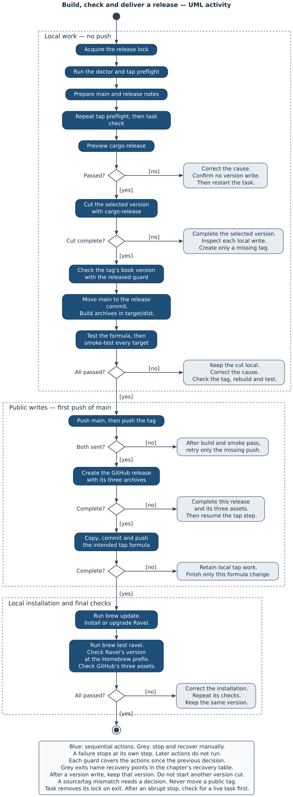

# Deliver Ravel

A release carries a matched pair: the
[Ravel CLI](02-actors-and-words.md#policy-evaluation-and-supervision) and its
[policy worker](02-actors-and-words.md#policy-evaluation-and-supervision).
[Chapter 7](07-the-parts-of-ravel.md#the-installed-pair-stays-together)
explains why the pair stays together. An archive check establishes that this
pair has the right files and can run outside the checkout. A version number
alone establishes neither fact.

Start with [chapter 11's install and smoke tasks](11-develop-ravel.md#install-and-test-the-installed-pair).
Those tasks test a local installation. This chapter extends that check to
archives and the environments where their programs run.

## Keep the version and pair together

The workspace has one Ravel version, independent of the version of any
[caller](02-actors-and-words.md#caller-and-owner).
`Cargo.toml` supplies it to both Rust packages, and the worker build reads the
Ravel package version. The checkout used for this chapter has version 1.0.0.
Its local tags include `v0.1.0` and `v1.0.0`, and `CHANGELOG.md` describes both.

An unreleased archive uses the checkout's version even when its source differs
from that version's release tag. Thus, a local archive named with `v1.0.0`
can contain later changes. Its name does not make it the released artifact.

Before the Ravel CLI sends the
[owner policy](02-actors-and-words.md#caller-and-owner) for evaluation, it
checks three worker values:

| Value | What it establishes |
|---|---|
| Protocol number | Both programs use protocol 1 |
| Package version | Both programs report the same Ravel version |
| Source identity | Both builds used the same worker source inputs |

The source identity is a SHA-256 digest. Relative to `crates/ravel`, its inputs
are the TypeScript files under `worker/src`, `worker/sdk` and `worker/examples`,
both worker tsconfigs, and `scripts/dispatch.sh`.
Both builds sort those paths, hash each file, then hash the
same list of paths and digests.

The source identity shows that two builds belong together. It does not
authenticate an installation or cover every Rust source file. A worker with a
different protocol, version or identity causes `worker_identity_mismatch`, with
exit status 5, before policy evaluation. A probe worker that the tests build
also has a different identity, and causes the same failure. To correct a
mismatch, rebuild and install the pair together.

The CLI finds `libexec/ravel/ravel-policy` relative to its own canonical path,
which is its path with all symlinks resolved.
A symlink to the CLI therefore still reaches that CLI's worker. Another worker
on `PATH` cannot replace it. The worker contains Bun 1.4.2, so an installation
needs no separate Bun or Node runtime.

## Build archives before a release

`task release:archives` builds local archives without a version cut. With no
`TARGETS` argument, it builds these targets:

| Target | Archive contents run on |
|---|---|
| `aarch64-apple-darwin` | Apple silicon macOS |
| `aarch64-unknown-linux-gnu` | Arm64 GNU/Linux |
| `x86_64-unknown-linux-gnu` | x86-64 GNU/Linux |

The target names spell arm64 as `aarch64` and x86-64 as `x86_64`. This chapter
uses the target spelling only in target names and in the support statement.

Run the release tasks from the checkout. The full workflow needs an Apple
silicon Mac, Bash 4 or later, Task, rustup with Rust 1.85 or later, curl,
tar/xz and ShellCheck. The Linux builds also need Zig, cargo-zigbuild and both
Linux Rust target libraries. The Linux smoke tests need an available
`linux/arm64` Docker daemon with kernel 6.7 or later.

The kernel requirement comes from the emulated routes. They register QEMU in a
private `binfmt_misc` instance, which Linux 6.7 and later gives each user
namespace. Thus, the registration does not change the Docker host's own. The
requirement applies to the test environment. It is not Ravel's minimum kernel.

`task setup` supplies the checkout's pinned Bun and development dependencies.
The release build prefers rustup's tools on `PATH` when its shims exist.
An explicit `RUSTC` override can still select another compiler.
[The release doctor](#prepare-a-version-cut) checks the compiler that the build
will use and its target libraries.
The worker build checks each target's Bun
runtime against a committed SHA-256 digest before compilation. It also generates
the SDK declarations.

Fragment: prepare the target libraries and build local archives. This recipe
omits tool installation and the command output.

```sh
rustup target add aarch64-apple-darwin aarch64-unknown-linux-gnu x86_64-unknown-linux-gnu
task setup
task release:archives
```

The build writes `target/archives/ravel-v<VERSION>-<TARGET>.tar.xz`.
It clears `target/archives` before each build, even for one target.
Thus, an archive from an earlier build cannot stand in for a target that failed.
Each archive first has a temporary filename. The build gives the archive its
final filename only after the manifest check passes, then prints its SHA-256
digest.

For a local macOS check, select only the native target. This selection replaces
the archive directory's contents and does not check Linux.

Fragment: build only the macOS archive. This recipe omits setup and output.

```sh
task release:archives TARGETS=aarch64-apple-darwin
```

If an unreleased build fails, correct the reported cause and repeat the task.
It creates no release tag or remote release. The later release procedure builds
fresh artifacts from the release tag into `target/dist`.

## Check the archive contents

An archive has one top directory, `ravel-v<VERSION>-<TARGET>/`. That directory
is an installation prefix. The manifest in `scripts/release-common.sh` permits
exactly these files and their directories:

| Path below the prefix | Purpose |
|---|---|
| `bin/ravel` | Ravel CLI executable |
| `libexec/ravel/ravel-policy` | Matched policy worker executable |
| `libexec/ravel/sdk/index.ts`, `sdk/index.d.ts` | SDK source and declarations, both under `libexec/ravel` |
| `libexec/ravel/examples/static.ts`, `examples/static.d.ts` | Static example source and declarations, both under `libexec/ravel` |
| `libexec/ravel/examples/sample.ts` | Sample that an owner can copy and edit |
| `libexec/ravel/notices/NOTICES.md`, `notices/bun-LICENSE.md` | Runtime notices, both under `libexec/ravel` |
| `README.md`, `LICENSE` | Project entry and licence |

[Chapter 6's installed-layout view](06-reference.md#installed-layout) shows
how the CLI, worker, SDK and examples fit together. In the checkout, the runtime
notices are under `crates/ravel/notices/`. In an installation, they are under
`PREFIX/libexec/ravel/notices/`.

The manifest check rejects extra files and directories, missing files,
symlinks in place of files, and executables without execute permission. Caller programs,
caller adapters, owner configuration, choice files, development dependencies
and probe directories do not belong in an archive. The pack step also excludes
macOS extended attributes and their AppleDouble metadata files.

`task release:test` tests the manifest check. It compares the manifest with a
fresh production worker build, then uses deliberately incorrect archives. Each
omitted file causes a failure. Other controls add unwanted assets, change types
or permissions, and add macOS metadata. The task needs no Docker, but its
metadata controls use macOS tools.

Fragment: test the manifest check. This recipe omits setup and output.

```sh
task release:test
```

The manifest check examines layout, types and execute permission. It does not
prove that the file at the worker path is the right program.

The installed smoke test checks the pair through a real policy. The
hostile-runtime suite separately puts probe workers at the worker path. It checks that each probe causes
`worker_identity_mismatch`. Those tests need the probe workers that
`task probes` builds. `task check` runs that build too.

## Test the installed archive

`task release:smoke` rebuilds the selected archives, then tests them. With no
selection, every target runs. A missing tool, failed target or unrun selected
target fails the task. There is no successful skip path.

Fragment: rebuild and test all target archives. This recipe omits setup and
per-target output.

```sh
task release:smoke
```

Each environment extracts its archive with its own tar into a fresh prefix.
It checks the CLI version and runs `crates/ravel/scripts/installed-smoke.sh`.
That script tests both the direct CLI path and a relative symlink from another
prefix. Its private utility `PATH` has no Bun, Node or Grove. It supplies a
fresh home and temporary directory through a cleared environment.

The test uses a shell fake agent, a real policy worker and installed assets.
Each [session](02-actors-and-words.md#caller-and-owner) returns the
[opaque result](02-actors-and-words.md#the-managed-process-and-its-result)
that the fake agent sends with `end-session`:

| Check | What the test compares |
|---|---|
| SDK, static example and copied sample | The sample uses the selected choice and starts the fake agent |
| Result values | Ordinary, empty, multiline and option-like values return unchanged |
| Child output | Child standard output goes to diagnostics, separate from the result |
| TypeScript imports | A relative helper and a declared package load from the test policy |
| Policy inputs | Measured policy context and `--param` values reach the policy |
| Missing [session-result context](02-actors-and-words.md#three-different-kinds-of-information) | `end-session` fails and writes no result |
| Temporary resources | The sample sessions leave no resources in their temporary directory |

No model or personal policy runs.
The test does not exercise an interactive terminal or all lifecycle failures.
[Chapter 9](09-jobs-signals-and-the-terminal.md) explains those separate obligations.

## Read the platform checks correctly

A platform floor is the oldest library or CPU capability that a check exercises.
The Linux CLI builds against glibc 2.17 through Zig. The worker uses its pinned
Bun runtime. Both executables then run in the same archive smoke test.

| Route | Environment and check |
|---|---|
| macOS arm64 | Native execution on the Mac that runs the task |
| Linux arm64, native CPU | Pinned CentOS 7.9 userland in arm64 Docker, with glibc 2.17 |
| Linux arm64, CPU floor | The same userland under QEMU 10.2.2 with the Cortex-A53 model |
| Linux x86-64, CPU floor | CentOS 7.9 under QEMU 10.2.3 with the Nehalem model |

Each Linux route checks that the userland reports glibc 2.17. A probe built for
that floor runs. A second probe needs `GLIBC_2.25`, and the userland rejects it.
The two probes show that the environment both runs valid programs and rejects
a newer library requirement.

The CPU controls use an instruction above each floor: an Armv8.1 LSE atomic
operation for arm64, and AVX2 for x86-64. At the floor, the instruction causes
SIGILL. The same probe runs under the same emulator with `-cpu max`. Thus, the
failure at the floor comes from the CPU model, not from a defective probe.

Each emulated route checks that every ELF executable in the archive, the CLI
and the worker included, matches its emulator registration. Thus, those
executables run through QEMU, not directly on the host CPU. The routes also
check guest address bounds and the presence of the vDSO, a kernel-supplied
interface mapped into a process.
The test programs run without network access, as an unprivileged user, with
read-only test inputs.

These checks establish different limits:

| Observation | Limit |
|---|---|
| Native macOS smoke passed | It checks the host macOS version, not an older macOS floor |
| glibc and CPU controls passed | They check these userlands and CPU models, not every distribution or processor |
| Linux container or user-mode QEMU passed | It uses the host kernel and does not measure a minimum kernel version |
| Archive smoke passed | It checks the installed workflow, not the full process and terminal campaign |

The native-entry campaign measured aarch64 macOS and aarch64 Linux.
x86_64 Linux is built and run only under emulation. Native x86-64 Linux remains
unqualified, with qualification tracked in [Linkuistics/Ravel#1](https://github.com/Linkuistics/Ravel/issues/1).
An archive smoke pass does not change that support statement.

[Chapter 11's evidence map](11-develop-ravel.md#read-the-evidence-for-a-change)
locates the separate runtime, archive and native-entry records. Those records
name their source revisions and measured environments. After a source or
runtime change, run `task release:smoke` again. It rebuilds the archives
before it tests them.

## Prepare and test the Homebrew formula

A Homebrew formula tells Homebrew which archive to fetch, how to install it,
and how to test the installation. Ravel's template is
`scripts/templates/ravel.rb.tmpl`. It selects one of the three target archives
and installs its `bin` and `libexec` directories. It has no Grove dependency.

`task release:formula` requires all three current-version archives in
`target/archives`. It builds the four native probe workers, checks each
archive against the manifest, and fills the template with the version and
archive digests. An unexpanded placeholder fails the task.

Fragment: after the full archive smoke task, test the formula. This recipe
omits setup, archive construction and output.

```sh
task release:formula
```

The task needs Homebrew on Apple silicon macOS. It loads the rendered formula
through Homebrew's Ruby library and calls its actual install and test methods.
Only the installation prefix and test directory change to private temporary
directories. The task creates no Homebrew keg and edits no tap. A keg is
Homebrew's directory for one installed version.

| Formula check | What it establishes |
|---|---|
| Installed paths | The temporary prefix has exactly the archive's `bin` and `libexec` contents |
| Real policy and shell fake agent | The SDK and static example work through a symlink to the installed CLI |
| Result comparisons | Ordinary, empty, multiline and option-like results return unchanged |
| Cleared environment | The session uses private home and temporary directories, with no host TypeScript runtime |
| Temporary resources | The formula's sessions leave their temporary directory empty |
| Four substituted workers | Each probe causes `worker_identity_mismatch`, with exit status 5 |

The normal formula test first checks the matched production worker. Then the
identity controls substitute `autoload`, `tsconfig`, `unregistered` and
`unmoved` probe workers at that worker's path. After the controls pass, the
test restores the production worker. All these operations stay in the temporary
prefix, and no model runs.

The output, `target/archives/ravel.rb`, is preparation material. Its URLs use
the checkout's version, but its digests describe the local archives. Those bytes
can differ from the assets at the release URLs, even when the version agrees.
Do not copy this formula into a tap or upload these archives as a release.
The version-cut task builds fresh archives from the tag and tests their formula.

The final installation uses `linkuistics/taps/ravel`. Its `brew test ravel`
checks the real installed keg. The temporary-prefix check above does not replace
that final check.

## Prepare a version cut

A version cut selects the next version and creates its source commit and tag.
Ravel's stable CLI uses semantic versions: compatible changes use patch or minor
releases, and incompatible changes require a major release.

| Task | Effect |
|---|---|
| `release:doctor` | Check tools, target libraries, host, GitHub authentication and the book version line |
| `release:notes` | Fill empty Unreleased notes, or replace them with an explicit reviewed body |
| `release:lifecycle:test` | Test release order, refusals, notes and recovery in isolated repositories |
| `release:patch` | Cut, deliver and install the next patch release |
| `release:minor` | Cut, deliver and install the next minor release |
| `release:major` | Cut, deliver and install the next major release |

The three version-cut tasks have public effects. They push source and a tag,
create a GitHub release, update the tap, and install or upgrade local Ravel.
Choose one task for the intended change. Do not run them as a sequence.

In addition to the archive tools, delivery needs jj, Git, jq, Homebrew and
cargo-release 1.1.2. It also needs authenticated `gh` access to
`Linkuistics/Ravel` and a clean, synchronised clone of `linkuistics/taps`.
The tap path defaults to `~/Development/homebrew-taps`.
If the clone is elsewhere, set `RAVEL_TAP_DIR` to its path.
Put Homebrew's Bash before `/bin` on `PATH`, so the scripts use Bash 4 or later.

The release procedure uses jj (Jujutsu), a version-control tool that can share
a repository with Git. In jj, each change has a stable change ID and a
description, which `jj describe` sets. A bookmark, such as `main`, is jj's
name for a branch. A colocated workspace has both `.jj` and `.git` in one
directory.

Run the cut from Ravel's default colocated jj workspace. The release task
refuses other directories. First, give each intended change a description and
put it on local `main`. The preparation step of the release task saves the
current change ID, then creates a clean child of `main`. Unrelated work stays
at the saved ID. Later, `jj edit SAVED_CHANGE_ID` returns to that work.

Fragment: check release prerequisites and remote tags. This recipe omits tool
installation, notes review and the version cut. The tap check fetches its remote.

```sh
task release:doctor
scripts/release-publish.sh --check-tap
git ls-remote --tags origin
task release:lifecycle:test
```

The doctor reports missing prerequisites and their remedies. It does not test
tap synchronisation or prove that a prior release is complete. Preparation
performs those separate checks. It fetches origin and refuses conflicts,
divergence from origin, undescribed new changes on `main`, and version work
outside `main`.

For the current version, preparation requires local and remote tags that agree,
a complete non-draft GitHub release, and the remote tap's version line.
It also requires new commits after the baseline tag. An incomplete prior release
therefore leads to recovery, not another version cut. The special absent-tag
case applies only to version 0.0.0 with no local or remote version tags.
The historical `structured-plan-migration` tag is not a release baseline.

Write meaningful release notes under the single `## Unreleased` heading in
`CHANGELOG.md`. Preparation preserves a nonempty body byte for byte. For an
empty body, it uses first lines from nonempty, described commits since the
current version tag, then commits those notes to `main` through jj.
Only the initial 0.0.0 case uses repository history without a baseline tag.
Review generated notes because commit descriptions can contain internal details.

Fragment: replace the notes with reviewed prose. This recipe omits creation of
the input file and the later jj commit. The changelog must match `main` first.

```sh
task release:notes -- --to main --from-file /absolute/path/reviewed-body.md
```

Without arguments, `release:notes` uses the current jj revision and fills only
an empty body. `--from-file` deliberately replaces a nonempty body too.
The input contains a section body, with no level-two heading. The script
preserves versioned sections and refuses missing, empty or invalid input.

It also refuses missing or duplicate Unreleased headings, an ambiguous revision,
or a changelog that differs from the selected revision. Commit reviewed notes
through jj before the cut. This procedure runs no
[harness](02-actors-and-words.md#the-managed-process-and-its-result) or model.

## Cut and deliver a release

Each version-cut task calls the internal `release` task, which runs the steps
below in order. The task first creates the `.jj/release-lock` directory. While
it exists, a second release task stops. A `defer` command in the task removes
the lock when the task succeeds or fails.

| Step | What it changes or checks |
|---|---|
| Check prerequisites | Run the doctor and tap preflight |
| Prepare `main` | Preserve unrelated work, check the prior release and prepare notes |
| Recheck the tap and source | Repeat tap preflight, then run `task check` |
| Preview and cut | Run cargo-release first as a preview without `--execute`, then with `--execute --no-confirm` |
| Check the tagged book | Require the tag's chapter 3 version line to match the cut |
| Record and build | Move `main` to the release commit and build all archives into a fresh `target/dist` |
| Test the formula and archives | Test the formula in temporary prefixes, then run the smoke test for every target at its floors |
| Send the release | Push `main`, push the tag, create the GitHub release and update the tap |
| Check the installation | Update Homebrew, install or upgrade Ravel, run its test, and check its version and GitHub assets |

The activity shows which checks precede the first public write and where each
failure resumes. After a version write, recovery keeps the selected version.

The grey exits refer to the [recovery table](#recover-a-partial-release-without-another-bump).
Each decision summarises the checks since the previous decision. A failure
stops at its own step, before the later actions in that group.



[Open the release activity at full size.](figures/release-delivery.svg)

`release.toml` disables cargo-release pushes and crates.io uploads. Cargo-release
creates the local version commit and tag through Git. The procedure otherwise
uses jj. This commit and the tag operations are its Git exceptions. The
[runner](07-the-parts-of-ravel.md#the-runner-owns-the-local-job-mechanics)
package, `keyed-launch`, sets `release = false`, so cargo-release does not
release it separately. Only the `ravel` package's configuration holds the
changelog replacement.

The changelog replacement requires exactly one whole-line Unreleased heading.
It inserts the version heading below a fresh Unreleased heading. The notes
therefore become that version's notes. The same release commit updates the
manifests, lockfile and book version line.

The archive build checks the clean source, exact release tag and workspace
version before it clears `target/dist`. It builds all three targets, their
probe controls and the formula. The next step runs the smoke test for every
target from that directory. A failed build, formula test or smoke test stops before any push.

Before it creates the GitHub release, `scripts/release-publish.sh` rechecks
the tap, archive manifests and rendered formula. It requires exactly three
archives and a formula that matches their version and digests. The GitHub
release takes its notes from that version's changelog section.
The tap update changes only `Formula/ravel.rb`. It retains `ravel-lite.rb`,
which supplies a separate command, and every unrelated formula.

The final version check uses the binary under `brew --prefix`, not the first
`ravel` on `PATH`. A local `task install` can put another copy earlier on
`PATH`. The task also inspects GitHub's assets and checks their count.
This release procedure installs Ravel alone. It does not replace Grove or
the legacy harness-dispatch installation.

Keep a delivery record outside the book. Record the source revision, each
archive's SHA-256 digest, each target route and control, and any missing
prerequisite. The check wrapper prints a summary and the full log path under
`target/release-archives.*`, `target/release-formula.*` or
`target/release-lifecycle.*`. Save the build and floor-smoke output too.
These records show whether a result comes from a real target run or from a
test of the procedure.

## Keep the book with its release

[Chapter 3's version line](03-a-complete-session.md#install-ravel-and-check-its-version)
lets a reader compare the book with `ravel --version`. A checkout between
releases can show the placeholder or the last release's version.
Its other text can contain later changes.

The version line is `ravel @RAVEL_BOOK_VERSION@` until the first release that
carries the book. After it, the line is `ravel X.Y.Z`. The second replacement
in `release.toml` finds this whole line in
`docs/book/src/03-a-complete-session.md`. It accepts the placeholder or an
`X.Y.Z` version and requires exactly one match. Cargo-release writes the new
version into the same commit and tag as the product. The line is ordinary
Markdown text, so raw-file, GitHub and mdBook views use the same value.

| Guard | What it reads and refuses |
|---|---|
| `scripts/release-book-version.sh ready` | Read the checkout page. Refuse a missing page, or any count other than one line of the form `ravel <version or placeholder>` |
| `scripts/release-book-version.sh released vX.Y.Z` | Read the page at the tag. Refuse an unreadable tag/page, a different version, duplicate or absent lines, or a placeholder anywhere in the page |

The doctor runs `ready` before the cut. The task runs `released` after the
cut and before the archive build. `ready` checks that replacement is possible.
It does not require the current line to agree with the workspace version.
The second guard checks what the tag actually carries. If it refuses, the cut
stays local, and the task pushes nothing.

If `ready` refuses, edit chapter 3 until it has exactly one version line. Then
run `task release:doctor` again. If `released` refuses, the local tag exists already.
Use the local-cut rows of
[the recovery table](#recover-a-partial-release-without-another-bump), and do
not start another version cut.

The delivery contract requires the book on GitHub Pages to match each release.
This checkout does not yet implement that step. The release task
checks the book version but does not build or deploy the book. The local
`docs:book:build` task writes `target/book`, and `docs:book` serves it locally.
Neither command sends those files to GitHub Pages. The release needs the
Pages delivery step before it can meet that contract.

No release carries the book yet. For example, tag `v1.0.0` has no
`docs/book` directory. Until a release carries it, there is no book on
GitHub Pages to use. Read the checkout's Markdown or local build, and check
its version line. A version-line pass alone does not establish a deployed book.

The book that a release carries has no chapter 10. The work that delivers a
supported extracted component and its consumer writes that chapter.

## Recover a partial release without another bump

After any cut step partly succeeds, do not repeat `release:patch`,
`release:minor` or `release:major`. Another version cut, a bump, selects a new
version and leaves the unfinished release incomplete under the old one. First
inspect the source, local and remote tags, GitHub assets and tap.

Fragment: inspect a partial release. Replace `vX.Y.Z` with its selected tag.
This recipe omits the tap inspection and every correction.

```sh
jj st
jj log --no-pager
git status --short
git tag --list 'v*'
git ls-remote --tags origin
gh release view vX.Y.Z --repo Linkuistics/Ravel --json isDraft,assets
```

If Task stopped abruptly, its lock can remain. Before you remove
`.jj/release-lock` with `rmdir`, check that no release process remains.
Preserve the saved jj change and each partial release write. Choose the row
for the last step that completed.

| Failure point | Next action |
|---|---|
| Before any version write | Correct prerequisites, notes or synchronisation. Before you start the task again, check that manifests and tags have no new version |
| During the local cut | Complete the already selected version as described below. Do not start another version cut |
| Tagged cut, but build, formula or smoke failed | Correct the environment, then rebuild and test the same release source |
| Main or tag push failed | After the build and smoke checks pass, retry only the missing push |
| GitHub release or asset upload failed | Complete that release and its three assets, then resume the tap step |
| Tap copy, commit or push failed | Retain local tap work and finish only the intended formula change |
| Local installation or final check failed | Correct the installation and repeat its checks, with no new version |

For a partial local cut, inspect the cargo-release preview and log. Reconcile
the workspace manifests and `Cargo.lock` to the selected version. If its
changelog heading is absent and Unreleased still holds its notes, run
`cargo release replace --execute --no-confirm` once. Do not repeat that
replacement after the version heading exists. If only the book line needs a
correction, correct that line without another changelog replacement.

When the manifests and lockfile agree, check them. Then describe the release
change in jj. Move `main` to that commit and create its empty successor.

Create only a missing
local tag at the intended commit. The release procedure uses an annotated Git
tag for this operation. Inspect any tag that already exists. Never overwrite
a tag to hide a source mismatch.

For a failed build or smoke test, return to a clean child of the release commit
with `jj new RELEASE_COMMIT`. If the cut did not move `main`, set it to that
commit with `jj bookmark set main -r RELEASE_COMMIT`.

Fragment: check the tag's book line, then rebuild and test the release
archives. Replace `vX.Y.Z` with the selected tag. This recipe omits source
corrections and pushes.

```sh
scripts/release-book-version.sh released vX.Y.Z
scripts/release-build.sh
scripts/release-smoke.sh --archives target/dist
```

If the release source itself needs a correction, give the correction its own
described change. Then decide which version and tag carry it. Do not move a
tag that is already public. A correction in the checkout alone cannot correct
the book page that `released` reads at the tag. If the source and the tag
disagree, stop until that decision is made.

After all smoke routes pass, retry only a missing `jj git push -b main` or
`git push origin vX.Y.Z`. Before you continue, check that the remote tag
resolves to the release commit. Do not force a public tag.

If GitHub has no release for the tag, run `scripts/release-publish.sh` after
the smoke test passes. If the release exists, upload only missing current
archives with `gh release upload`. Inspect assets that already exist.
Do not overwrite them. If the release is a draft, remove its draft status with
`gh release edit` after all three assets are complete. Both commands take the
selected tag and `--repo Linkuistics/Ravel`.

Fragment: resume only the tap step after the GitHub assets are complete.
This recipe omits asset inspection and the earlier smoke checks.

```sh
scripts/release-publish.sh --tap-only
```

This mode requires a non-draft GitHub release with exactly the three nonempty
assets. It downloads them and compares each with the local archive that the
smoke test checked. A mismatch stops before a tap edit. It creates no second
GitHub release. The script does not run the smoke test. Thus, use this mode
only after the smoke test passes for the same archives.

If the tap copy already occurred, preserve that work. Do not run
`scripts/release-publish.sh` against a tap with uncommitted changes. In a jj
tap, finish the formula change with these steps:

1. Describe the intended formula change.
2. Move `main` to that change.
3. Create an empty successor.
4. Push `main`.

If the commit already exists, retry only its push. A Git-only tap uses its
normal commit and push procedure. Check the remote `Formula/ravel.rb` and
retain every unrelated formula.

If only local installation failed, run `brew update` again. If Ravel is not
installed, install `linkuistics/taps/ravel`. Otherwise, upgrade `ravel`. Run
`brew test ravel` and the Homebrew-prefix binary's version check. Inspect the matched worker
layout and GitHub's three assets. A missing local installation needs no new cut.

The lifecycle suite tests these procedure boundaries in isolated repositories
with local remotes and substituted service responses. It also runs real
cargo-release previews and book-version cuts there. Those results do not prove
that a particular public recovery succeeded. The source, tags, assets and tap
observed during that recovery determine its next step.

## Checks made for this chapter

The checks for this chapter used macOS 27.0.1 arm64, Bash 5.3.20 and rustup rustc 1.93.1.
All three Rust target libraries were present. Zig 0.17.0, cargo-zigbuild and
Docker 29.8.1 were available. Docker reports `linux/arm64` with kernel
7.0.14-linuxkit. No archive-test prerequisite was missing.

The first set of checks passed on 2026-10-18:

| Task | Observed result |
|---|---|
| `release:doctor` | All reported prerequisites passed |
| `release:test` | Manifest and deliberately incorrect archive controls passed |
| `release:smoke` | Fresh archives passed all four routes above, direct and through a symlink |
| `release:lifecycle:test` | Release procedure, recovery, notes and book-version controls passed in isolated fixtures |

The smoke task ran `release:archives` as its build step. Both Linux CPU controls
failed at their floor and passed with `-cpu max`. Every Linux route passed the
glibc probe and rejected the probe that needs glibc 2.25. No target was skipped.
The source and script digests stayed unchanged through these checks.

A second set of checks passed later on 2026-10-18, on the same host:

| Task | Observed result |
|---|---|
| `release:doctor` | All reported prerequisites and the book version line passed |
| `release:formula` | Real Homebrew install/test methods and all four worker-identity controls passed in a temporary prefix |
| `release:lifecycle:test` | Release order, refusal, recovery, notes and book-version controls passed in isolated fixtures |

Formula preparation used the three archives from the first set. Their digests
and the tracked source inputs stayed unchanged through the second set. The formula's four
result sessions succeeded and reported stop-attempt permission errors on stderr.
Those operation reports remained separate from the returned results.

Neither set changed the project's release notes or ran its `release:patch`,
`release:minor` or `release:major` tasks. Those tasks change
public release state and the local installation. The lifecycle suite exercised
notes, previews and cuts only in its fixtures. No project push, tag, tap edit,
permanent installation or GitHub Pages deployment ran.

Neither set repeated `install` or `smoke`. Chapter 11 records those checks.
The smoke task here ran the same installed test through fresh archives.
These observations establish no new native x86-64, interactive-terminal,
real-agent or reader-comprehension result.
